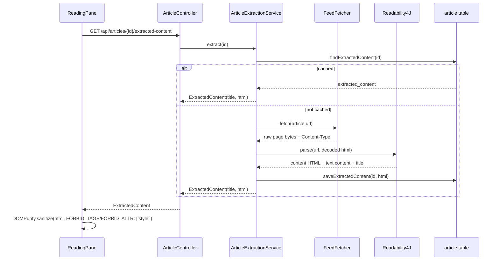

# Domain Concepts

> **Scope note:** this page covers the core content model (Feed, Article, Folder, Board, IntegrationConfig) and migrations V1-V5. The interest-scoring, engagement-learning and topic-suggestion schema added in V6/V7 (`interest_profile`, `interest_topic`, `article_score`, `article_feedback`, `article_engagement`, `topic_suggestion_dismissal`, etc.) is documented in [Interest Scoring](interest-scoring.md), not here.

## Entities and schema evolution

Flyway migrations tell the story of how the core content model grew:

- **`V1__initial_schema.sql`**: `feed` and `article` tables (core RSS reader), plus `integration_config` (generic key/value integration settings, unique per `type`).
- **`V2__folders_boards_and_feed_folder.sql`**: adds `folder` (feed grouping, with `display_order` for drag-to-reorder) and `board`/`board_article` (curated collections a user saves articles into — see "read later" in `docs/backlog.md`), plus `feed.folder_id`.
- **`V3__article_image_url.sql`**: adds `article.image_url` (thumbnail extracted from feed content).
- **`V4__strip_raindrop_api_token.sql`**: removes a legacy `apiToken` field that used to live inside `integration_config.config` JSON — the token moved to `myfeeder.raindrop.api-token` (env-var-backed config property) instead of being stored in the DB. See [Raindrop Integration](../integrations/raindrop.md). This migration is unusual in that it can't be re-triggered by normal Flyway test startup (see `V4StripRaindropApiTokenMigrationTest` in [Testing Guide](../testing/guide.md) for the pattern used to test it).
- **`V5__article_extracted_content.sql`**: adds `article.extracted_content TEXT` — a cache of the readable-content HTML produced by Reader View extraction (see below).
- V6 and V7 add the interest-scoring, feedback and engagement schema (`interest_profile`, `interest_topic`, `article_score`, `article_feedback`, `article_engagement`, `topic_suggestion_dismissal`); see [Interest Scoring](interest-scoring.md) for that model. This page only notes the places that schema touches `article` directly (engagement capture, below).

### `Feed` (`model/Feed.java` / table `feed`)
Tracks a subscribed source: `url`, `title`, `description`, `siteUrl`, `feedType` (RSS/Atom/JSON — `FeedType` enum), `pollIntervalMinutes`, `folderId`, and **poll health state**: `lastPolledAt`, `lastSuccessfulPollAt`, `errorCount`, `lastError`, `etag`, `lastModifiedHeader`. The last four fields exist purely to support conditional GETs and backoff — see [Feed Lifecycle Workflow](../workflows/feed-lifecycle.md).

### `Article` (`model/Article.java` / table `article`)
One article from a feed: `feedId` (FK, cascade delete), `guid` (dedup key, unique with `feedId`), `title`, `url`, `author`, `content`, `summary`, `imageUrl`, `extractedContent` (V5, Reader View cache), `publishedAt`, `fetchedAt`, `read`, `starred`. `content`/`summary`/`extractedContent` get nulled out by `RetentionService` after `full-content-days`. Three further fields are `@Transient` (computed per request, never persisted on `article` itself): `interestScore`, `interestBreakdown` and `feedback` (interest/feedback schema, see [Interest Scoring](interest-scoring.md)) and `engagement` (the engagement kinds recorded for the article — see "Engagement capture" below). All four are populated only by `ArticleService.findByIdWithBreakdown` (i.e. `GET /api/articles/{id}` and the feedback responses) and are omitted from list responses.

**Sort order rule (important, easy to get wrong):** articles are sorted by `COALESCE(published_at, fetched_at)`, **not** by `id`. Batch-fetched articles (e.g. from a bulk OPML import or a feed with a backlog of items) get sequential DB IDs but widely varied publication dates, so `ORDER BY id` does not produce chronological order. Cursor pagination therefore uses a composite `(published_at, id)` comparison — `ArticleController`/`ArticleService` still expose a single article ID as the cursor, but the service looks up that cursor article's date to build the SQL comparison.

**Pagination shape:** all list endpoints return `PaginatedResponse<T>` (`{items, nextCursor}` — the field is `items`, not `articles`). Controllers fetch `limit + 1` rows and delegate the "does another page exist / trim the extra row" logic to `PaginatedResponse.of(fetched, limit, idExtractor)` (see `controller/PaginatedResponse.java`) — don't reimplement that trimming logic per-controller.

**Reading pane fetch-by-ID:** the reading pane fetches the selected article directly via `GET /api/articles/{id}` (`useArticle(id)`), not by searching the paginated list query client-side. This avoids the reading pane and the article list disagreeing about filters/sort — a pattern also leaned on by `useKeyboardShortcuts` (see [Architecture Overview](../architecture/overview.md)) to resolve the "current article" on views where the visible list and the hook's list diverge.

### `Folder` (`model/Folder.java` / table `folder`)
A named grouping of feeds with a user-controlled `displayOrder` (drag-to-reorder in the sidebar, `c47a2a0`/`4cc1a1b`). A feed's `folderId` is nullable (`ON DELETE SET NULL`), so deleting a folder ungroups its feeds rather than deleting them.

### `Board` / `BoardArticle` (`model/Board.java`, `BoardArticle.java` / tables `board`, `board_article`)
A board is a named, user-created collection (e.g. "Read Later"); `board_article` is the join table (`UNIQUE(board_id, article_id)` — adding the same article twice is a no-op, see `BoardService.addArticle`). `BoardService.getOrCreateByName` backs the "Read Later" quick-action so it doesn't need a separate creation step in the UI. Adding an article to a board (including on a re-add) also records BOARD engagement — see below.

### `IntegrationConfig` (`model/IntegrationConfig.java` / table `integration_config`)
Generic per-integration settings row (`type` unique, JSON `config` blob, `enabled` flag). Currently the only consumer is Raindrop.io — see [Raindrop Integration](../integrations/raindrop.md) for how `RaindropConfig` is deserialized from the `config` column and how the token itself is deliberately **not** stored here (V4 migration).

## Reader View (article content extraction)

`GET /api/articles/{id}/extracted-content` serves a readable-content fallback for feed items whose feed-supplied `content`/`summary` is thin, missing, or badly styled:

- **`ArticleExtractionService.extract(articleId)`** is the single entry point: it 404s on an unknown article, 400s on an article with no `url`, fetches the original page through `FeedFetcher` (reusing its SSRF guard, body-size cap and User-Agent — the extraction path never issues a raw `RestClient` call), decodes the bytes with jsoup (header charset, else BOM/meta-tag detection), and runs Readability4J (`net.dankito.readability4j`) over the decoded HTML.
- The first successful extraction is cached verbatim in `article.extracted_content` (V5); subsequent calls for the same article are served from that column without re-fetching the source page.
- A `FeedFetchException` (page fetch failed) or `FeedParseException` (Readability4J found no readable content, or threw) both map to HTTP 422 via `GlobalExceptionHandler`.
- `extracted_content` is aged out together with `content`/`summary` by **`RetentionService`**'s scheduled cleanup (`myfeeder.retention.full-content-days`), so Reader View re-extracts from the live page again after retention clears it.
- On the frontend, `ReadingPane` auto-enables Reader View when an article has no `content`/`summary`, and offers a manual "📖 Reader View" toggle otherwise. The extracted HTML is run through **DOMPurify** with `FORBID_TAGS`/`FORBID_ATTR: ['style']` before rendering, so publisher inline styling (e.g. forced dark/light colors) is stripped and the app's own theme applies instead.

## Engagement capture (brief; full mechanics live elsewhere)

Three article actions are recorded as sticky, per-article "engagement" signals that later feed interest-score learning — see [Interest Ranking Workflow](../workflows/interest-ranking.md) for the full learning mechanics (how engagement becomes a capped additive term in the ranking CTEs). The points relevant to this page's data model:

- Capture points: STAR (`ArticleService.updateState`, only on an unstarred→starred transition), BOARD (`BoardService.addArticle`, including re-adds), and RAINDROP (`RaindropService`, right after a bookmark is created). A fourth kind, OPEN_ORIGINAL, is recorded by `ArticleService.recordOpen` via `PUT /api/articles/{id}/engagement/open`.
- **Recorded outside any transaction boundary.** All three save-triggered capture points call `ArticleEngagementStore.recordQuietly`, a single `INSERT ... ON CONFLICT DO NOTHING` statement that runs on its own, uncoordinated with the surrounding save's transaction, and swallows any `DataAccessException` (logged at WARN with only the kind, article id, and exception class name). This is deliberate: a failed engagement insert must never roll back or fail the user's star/board/Raindrop action that triggered it.
- **Sticky**: engagement rows are not removed by unstarring, removing an article from a board, or deleting a board — only `DELETE /api/articles/{id}/engagement` ("Forget") removes them, and it removes all of an article's engagement kinds at once (no per-kind tombstone). Engagement rows cascade-delete when their article or feed is deleted (`article_engagement.article_id REFERENCES article(id) ON DELETE CASCADE`).
- `GET /api/articles/{id}` carries the article's `engagement` kinds (`[]` when none); list endpoints never include it.

## API surface (by domain)

| Domain | Controller | Base path / notable routes |
|---|---|---|
| Feed | `FeedController` | `/api/feeds` |
| Article | `ArticleController` | `/api/articles`, `GET /api/articles/{id}/extracted-content` (Reader View, see above), `PUT /api/articles/{id}/engagement/open` / `DELETE /api/articles/{id}/engagement`, `PUT`/`DELETE /api/articles/{id}/feedback` |
| Folder | `FolderController` | `/api/folders` |
| Board | `BoardController` | `/api/boards` |
| Integration | `IntegrationConfigController` | `/api/integrations` |
| OPML | `OpmlController` | `/api/opml` |
| Interest | `InterestController`, `InterestStatusController`, `InterestPreviewController`, `InterestRescoreController`, `TopicSuggestionController` | `/api/interest/*` — see [Interest Scoring](interest-scoring.md) |

`GET /api/articles/{id}` is the richest single-article response: besides the core `Article` columns it also carries `engagement` (Phase 8, described above) and `feedback`/`interestScore`/`interestBreakdown` (interest-scoring fields, populated by `ArticleService.findByIdWithBreakdown`) — see [Interest Scoring](interest-scoring.md) for what those fields mean and how they're computed; this page does not duplicate that detail.

Request bodies are typed records per action (e.g. `FeedUpdateRequest`, `CreateBoardRequest`, `MoveFeedToFolderRequest`, `ArticleStateRequest`, `MarkReadRequest`) rather than raw `Map` — see [Architecture Overview](../architecture/overview.md) for the HTTP-layer conventions and exception-to-status mapping shared by all these controllers.

## Business rules worth remembering

- **Article dedup key is `(feed_id, guid)`**, enforced at the DB level and checked in `FeedPollingService` before insert.
- **`read`/`starred` are independent booleans**, both patchable via `PATCH /api/articles/{id}` (`ArticleStateRequest`). "Mark read" also supports bulk operations by article ID list, by feed, or by "older than N days" (`MarkReadRequest` — see `docs/backlog.md` for the UI preset days: 1/3/7/14).
- **OPML import** (`OpmlService` + `OpmlImportService`) has explicit XXE protection in the XML parser — preserve this if you touch `OpmlService`'s parsing code. Import matches existing feeds by URL (update in place) and folders by case-insensitive name (create if missing); only newly created feeds publish `FeedSavedEvent`.
- **Engagement capture never blocks the triggering action** (see "Engagement capture" above) and is sticky by design — don't "clean up" engagement rows when a star/board state reverses; only an explicit Forget or a cascading article/feed delete removes them.
