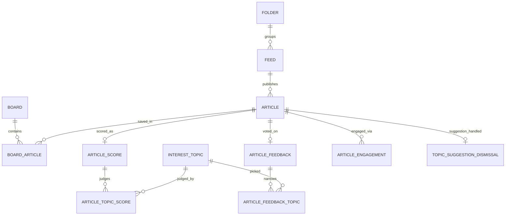

# Domain Concepts

## Entities and schema evolution

Flyway migrations tell the story of how the domain grew:

- **`V1__initial_schema.sql`**: `feed` and `article` tables (core RSS reader), plus `integration_config` (generic key/value integration settings, unique per `type`).
- **`V2__folders_boards_and_feed_folder.sql`**: adds `folder` (feed grouping, with `display_order` for drag-to-reorder) and `board`/`board_article` (curated collections a user saves articles into — see "read later" in `docs/backlog.md`), plus `feed.folder_id`.
- **`V3__article_image_url.sql`**: adds `article.image_url` (thumbnail extracted from feed content).
- **`V4__strip_raindrop_api_token.sql`**: removes a legacy `apiToken` field that used to live inside `integration_config.config` JSON — the token moved to `myfeeder.raindrop.api-token` (env-var-backed config property) instead of being stored in the DB. See [Raindrop Integration](../integrations/raindrop.md). This migration is unusual in that it can't be re-triggered by normal Flyway test startup (see `V4StripRaindropApiTokenMigrationTest` in [Testing Guide](../testing/guide.md) for the pattern used to test it).
- **`V5__article_extracted_content.sql`**: adds `article.extracted_content` (`TEXT`), a reader-view cache of the readable content extracted from the article's original page. It is explicitly excluded from every list-page column set (badge/priority queries, `PaginatedResponse` rows) — it ships only from the dedicated `GET /api/articles/{id}/extracted-content` endpoint, so a list payload never grows with it.
- **`V6__interest_scoring.sql`**: the complete interest-scoring schema (singleton `interest_profile`, `interest_topic`, `article_score`, `article_topic_score`, `article_feedback`, `article_feedback_topic`). No later migration touches these tables.
- **`V7__engagement.sql`**: the engagement-capture schema (`article_engagement`, `topic_suggestion_dismissal`). No backfill: both tables start empty and only accumulate from user action going forward.

### `Feed` (`model/Feed.java` / table `feed`)
Tracks a subscribed source: `url`, `title`, `description`, `siteUrl`, `feedType` (RSS/Atom/JSON — `FeedType` enum), `pollIntervalMinutes`, `folderId`, and **poll health state**: `lastPolledAt`, `lastSuccessfulPollAt`, `errorCount`, `lastError`, `etag`, `lastModifiedHeader`. The last four fields exist purely to support conditional GETs and backoff — see [Feed Lifecycle Workflow](../workflows/feed-lifecycle.md).

### `Article` (`model/Article.java` / table `article`)
One article from a feed: `feedId` (FK, cascade delete), `guid` (dedup key, unique with `feedId`), `title`, `url`, `author`, `content`, `summary`, `imageUrl`, `publishedAt`, `fetchedAt`, `read`, `starred`, `extractedContent` (V5). `content`/`summary` get nulled out by `RetentionService` after `full-content-days`. An article delete cascades to its `article_score`, `article_feedback` and `article_engagement` rows (and a feed delete cascades through `article` to all of them), so removing a feed or an article never leaves orphaned scoring, feedback or engagement state behind.

**Sort order rule (important, easy to get wrong):** articles are sorted by `COALESCE(published_at, fetched_at)`, **not** by `id`. Batch-fetched articles (e.g. from a bulk OPML import or a feed with a backlog of items) get sequential DB IDs but widely varied publication dates, so `ORDER BY id` does not produce chronological order. Cursor pagination therefore uses a composite `(published_at, id)` comparison — `ArticleController`/`ArticleService` still expose a single article ID as the cursor, but the service looks up that cursor article's date to build the SQL comparison.

**Pagination shape:** all list endpoints return `PaginatedResponse<T>` (`{items, nextCursor}` — the field is `items`, not `articles`). Controllers fetch `limit + 1` rows and delegate the "does another page exist / trim the extra row" logic to `PaginatedResponse.of(fetched, limit, idExtractor)` (see `controller/PaginatedResponse.java`) — don't reimplement that trimming logic per-controller. This Long-cursor scheme (opaque only in the sense that the client doesn't need to interpret it, but is literally the last row's numeric `id`) is what every non-Priority list endpoint uses.

**Reading pane fetch-by-ID:** the reading pane fetches the selected article directly via `GET /api/articles/{id}` (`useArticle(id)`), not by searching the paginated list query client-side. This avoids the reading pane and the article list disagreeing about filters/sort — a pattern also leaned on by `useKeyboardShortcuts` (see [Architecture Overview](../architecture/overview.md)) to resolve the "current article" on views where the visible list and the hook's list diverge. `GET /api/articles/{id}` also rides along the article's stored `article_feedback` vote and its `article_engagement` kinds (`findByIdWithBreakdown`), so only the single-article fetch — never a list — carries that per-user state.

### `Folder` (`model/Folder.java` / table `folder`)
A named grouping of feeds with a user-controlled `displayOrder` (drag-to-reorder in the sidebar, `c47a2a0`/`4cc1a1b`). A feed's `folderId` is nullable (`ON DELETE SET NULL`), so deleting a folder ungroups its feeds rather than deleting them.

### `Board` / `BoardArticle` (`model/Board.java`, `BoardArticle.java` / tables `board`, `board_article`)
A board is a named, user-created collection (e.g. "Read Later"); `board_article` is the join table (`UNIQUE(board_id, article_id)` — adding the same article twice is a no-op, see `BoardService.addArticle`). `BoardService.getOrCreateByName` backs the "Read Later" quick-action so it doesn't need a separate creation step in the UI. Every add — any board, "Read Later", or the `b` keyboard shortcut — also records a `BOARD` engagement row (best-effort, see below); removing the article from the board does **not** remove that engagement row.

### `IntegrationConfig` (`model/IntegrationConfig.java` / table `integration_config`)
Generic per-integration settings row (`type` unique, JSON `config` blob, `enabled` flag). Currently the only consumer is Raindrop.io — see [Raindrop Integration](../integrations/raindrop.md) for how `RaindropConfig` is deserialized from the `config` column and how the token itself is deliberately **not** stored here (V4 migration). Saving an article to Raindrop also records a `RAINDROP` engagement row.

## Interest scoring and engagement schema (V6/V7)

### `InterestProfile` (`model/InterestProfile.java` / table `interest_profile`)
A **singleton** row (`id = 1`, `CHECK (id = 1)`, seeded by V6 so it is always UPDATE-able). `profileText` is free text (reader interests, up to 2,000 UTF-16 chars), and `version` is a plain column — not optimistic-locking — bumped only when the text actually changes (never on a no-op save). `InterestService` is the sole writer.

### `InterestTopic` (`model/InterestTopic.java` / table `interest_topic`)
A user-defined rubric item: `name` (short display label, up to 40 chars, never sent to the judge model), `description` (up to 500 chars, goes into the Noul question), `weight` (points, `-50..+50`, default 20), and `version` (bumped only when `description` changes — a name- or weight-only edit keeps the same version). Up to 25 topics (`InterestService.MAX_TOPICS`) may exist at once.

### `article_score` / `article_topic_score`
One row per judged article (`article_score`, PK = `article_id`, cascades from `article`): `status` is `SCORED` (write-once — never overwritten once written, except that it *does* overwrite an existing `FAILED` row), `FAILED` (increments `attempts`, capped at `ArticleScoreStore.MAX_ATTEMPTS` = 3 retries), or `SKIPPED` (terminal — no GUID or no judgeable text, first writer wins). `profile_score`/`profile_max_level`/`profile_confidence`/`profile_version` are all null when no profile question was asked (cold start had no profile text at judge time). `article_topic_score` is a child of `article_score` (cascades on its delete, so resetting a score for a re-score also clears its topic nouls): one `noul` (`0..1`) per topic the article was judged against, stamped with the `topic_version` the judgment used.

### `article_feedback` / `article_feedback_topic`
One thumbs vote per article (`vote` is `1` or `-1`, PK = `article_id`, cascades from `article`). `topics_narrowed = false` means every topic the article matched is affected by the vote; `true` means only the topics picked in `article_feedback_topic` are (and zero picks penalize nothing). `ArticleFeedbackStore` is the only writer of these two tables; it never writes `interest_topic` itself — the topic's learned adjustment is always *derived* at read time from the stored votes (see below), so a user's own configured weight is never silently rewritten.

### `article_engagement` (V7)
One **sticky** row per `(article_id, kind)` (`PRIMARY KEY (article_id, kind)`), where `kind` is one of `OPEN_ORIGINAL`, `STAR`, `BOARD`, `RAINDROP` (`EngagementKind`, declaration order = API/display order). Capture rules, all enforced by `ArticleEngagementStore`:

- **Idempotent insert**: `INSERT ... ON CONFLICT (article_id, kind) DO NOTHING`, so each kind keeps its **first** `created_at` — re-opening, re-starring or re-saving an already-engaged article never moves its timestamp.
- **Sticky across reversal**: unstarring an article does *not* delete its `STAR` row, and removing an article from every board does not delete its `BOARD` row. There is no "undo engagement" path except the explicit forget action (`DELETE /api/articles/{id}/engagement`, `ArticleService.forgetEngagement`), which deletes every engagement row for the article and nothing else (the star, board memberships and thumbs vote are untouched) — it is *not* the inverse of a save, and a later open records again since no tombstone is kept.
- **Capture points**: `recordOpen` (direct, 404s on a missing article; the write is best-effort from the client's perspective but the HTTP call itself surfaces DB failures as 5xx) records `OPEN_ORIGINAL`; `ArticleService.updateState` records `STAR` only on an unstarred-to-starred transition (`recordQuietly`, never on unstar); `BoardService.addArticle` records `BOARD` after the add-or-already-present branch; `RaindropService` records `RAINDROP` after a successful save. The three `recordQuietly` call sites never throw: a `DataAccessException` is caught and logged at WARN with only the kind, article id and exception class name, so an engagement-write failure can never fail the star/board/Raindrop action that triggered it.
- **Cascades**: `article_engagement.article_id` references `article(id) ON DELETE CASCADE`, so deleting an article (and, transitively, deleting its feed) removes its engagement rows automatically — there is no separate cleanup job.
- **MAX strength per article**: when the learned model folds engagement into a topic adjustment, every article contributes at most once per topic, taking the `MAX` of its engagement kinds' configured strengths (`engagementOpenWeight` for `OPEN_ORIGINAL`, `engagementSaveWeight` for `STAR`/`BOARD`/`RAINDROP` — a save always outweighs a bare open) — see the learned-weight model below.

### `topic_suggestion_dismissal` (V7)
One row per article (`PRIMARY KEY (article_id)`), `reason` is `DISMISSED` (explicit user dismissal, `PUT /api/interest/suggestions/{articleId}/dismissal`) or `TOPIC_CREATED` (the article's suggestion was resolved because the user saved a new topic with that article as its `sourceArticleId`, written in the same transaction as the topic create). Once handled, a suggestion **stays** handled permanently — there is no "un-dismiss", and deleting the topic later created from it does not reopen the suggestion (there is no FK to `interest_topic` at all). `TopicSuggestionStore` is the only reader of this table besides its own writer `handle()`; `InterestScoreQueries` (the ranking/badge SQL) never reads it, a boundary enforced by a dedicated migration test.

`TopicSuggestionStore.candidates` is the **gap-discovery predicate** (Suggested topics, GAP-01/04/05): an article qualifies when it has

1. at least one engagement row, whose **latest** `created_at` across kinds falls inside a **30-day window** (`TopicSuggestionService.WINDOW_DAYS`, `HAVING MAX(g.created_at) > :cutoff`) — note "latest" is keyed off each kind's first `created_at` (engagement rows are sticky), so re-opening an old article does not refresh the window, but adding a *new* kind (e.g. starring an already-opened article) does;
2. a `SCORED` `article_score` row (unscored or failed/skipped articles never qualify);
3. **no** stored `article_feedback` vote (`NOT EXISTS`) — a thumbs vote on an article removes it from suggestion candidacy entirely, voted or not;
4. **no** `topic_suggestion_dismissal` row (`NOT EXISTS`);
5. a best `noul` (`MAX(article_topic_score.noul)` across every topic, whatever the topic's weight sign, `0` when the article matched no topic at all) **below** the configured near-miss threshold (`myfeeder.interest.suggestions.near-miss`, default `0.35`, bound `0 < near-miss <= 0.5` so the match threshold of `0.5` is never exceeded).

Qualifying rows are ranked badge ascending ("surprise" order, ties by latest engagement newest-first then id descending), capped to `TopicSuggestionService.MAX_SUGGESTIONS` (10) as `items`, with the full qualifying count reported separately as `total`.

## `InterestService`: profile/topic limits and the cold-start predicate

`InterestService` owns every interest-profile and interest-topic business rule; it is the single place that enforces size and weight limits (also mirrored in the UI, but re-checked here so a client cannot bypass them):

| Constant | Value | Rule |
|---|---|---|
| `MAX_PROFILE_CHARS` | 2000 | profile text length, counted in UTF-16 code units (`String.length()`, same unit as the browser `maxLength`) |
| `MAX_TOPICS` | 25 | topic count cap — checked count-then-insert in one transaction; concurrent creates are not serialized (single-user app) |
| `MIN_WEIGHT`/`MAX_WEIGHT` | -50 / 50 | topic weight range |
| `MAX_NAME_CHARS` | 40 | topic name length |
| `MAX_DESCRIPTION_CHARS` | 500 | topic description length |

Every limit violation is a fixed-text `IllegalArgumentException` that never echoes the submitted value (so a user cannot use the error message to probe what was rejected). `updateTopic` keeps the topic's id (in-place edit) and only bumps `version` when the trimmed description changes; `deleteTopic` relies on the V6 foreign keys to cascade its scores and feedback picks.

**The single cold-start predicate** is `InterestService.isColdStart()`: true only when the profile text is blank after trim **and** there are zero topics. This is the one method both the `/api/interest/status` endpoint and `ArticleScoringService`'s scoring gate (SCOR-06) call — neither reimplements the check, so the UI's "cold start" banner and the scorer's "nothing to judge, skip" decision can never disagree.

## `InterestQuestions` and `ArticleStateBuilder`: shared pure builders

Both are static, dependency-free (no Spring, no I/O) utility classes shared **verbatim** between the topic preview (`InterestPreviewService`) and the production scorer (`ArticleScoringService`), so the preview always judges exactly what scoring would send:

- **`ArticleStateBuilder.build(feedTitle, article)`** builds the Jev "state" object: `feed`, `title`, `summary` (falling back to `content` when the summary is empty), in that order, with blank fields omitted. Article text is untrusted feed content (a prompt-injection surface), so it travels only as data in the state map and is never interpolated into question text. Raw HTML is capped at 50,000 characters before jsoup parsing (jsoup 1.11.2 predates the CVE-2021-37714 fix), and the extracted summary text is truncated to 1,500 characters at a word boundary where possible. `hasJudgeableText` gates both callers: an article with neither a `title` nor a `summary` key is never sent to the judge model.
- **`InterestQuestions`** builds the Jev question objects: `profile(profileText)` is a 5-level situational `Score` question (`PROFILE_MAX_LEVEL = 4`); `topic(description)` is a positively-phrased `Noul` question (a high noul means the article is about the topic). `forRubric(profileText, topics)` assembles the full question map keyed `profile` (when the profile text is non-blank) plus one `topic_<id>` per topic in ascending id order — callers must check `isColdStart()` first, since an empty map is rejected by the judge call.

## The Priority view's distinct cursor scheme

`GET /api/articles/priority` (`PriorityService` + `InterestScoreQueries`) ranks **unread** articles by their blended interest score, then falls back to date for unscored ones. It cannot reuse the Long-cursor `PaginatedResponse` scheme that every other list endpoint uses, because the sort key here is not a stable column: a vote or new engagement can change an article's score between two page fetches of the *same* Priority browse. `PriorityPage` therefore uses an **opaque, self-describing cursor**:

- **Wire format**: base64url (no padding) of the UTF-8 text `<score>|<epochMicros>|<id>`, where `score` is `Double.toString` (`-Infinity` for an unscored row) and the date is encoded as epoch microseconds.
- **Compare against the served tuple, not the live row**: the next page's SQL filters on `(sort_score, sort_date, id) < (cursorScore, cursorDate, cursorId)` using the literal values the client was given, never by re-reading the cursor article's current score. This means the cursor row's own later score change can never cause rows to be skipped (a live-row lookup would do exactly that if the cursor article's score rose), at the cost that a newly-raised row that would now sort above the cursor is not retroactively inserted into an already-fetched page — the UI's "Ranking changed" hint asks the user to refresh for that case.
- **A cursor whose article was deleted still works** (the statement never re-reads the cursor article), but `PriorityService.page` explicitly checks the cursor id still exists and throws a 404 first — this is the same "restart from page 1" signal `decodeCursor` itself returns.
- **404, not 400, on an unreadable cursor**: `PriorityPage.decodeCursor` throws `NotFoundException` with a fixed message (`"Priority cursor not recognized"`, never echoing the input) whenever the cursor fails to parse, decodes to the wrong shape, parses to `NaN`, or decodes to a date outside `0001-01-01T00:00:00Z..9999-12-31T23:59:59.999999Z` (a `timestamptz`-representable range Postgres/PgJDBC would otherwise silently clamp to `-infinity`/`infinity`, producing a comparison against a tuple the server never actually served). 404 (not 400) is deliberately the same "restart" signal an old client tab sending a stale numeric Long-cursor would already trigger, so `PriorityList` handles both the same way instead of failing "Load more" forever.

In short: **Long-cursor `PaginatedResponse`** (opaque only incidentally — it's the last row's numeric `id`) is used wherever the sort column is a stable, monotonic article property (date); **`PriorityPage`**'s score|date|id cursor is used specifically because the Priority sort key is a live, score-based value that can legitimately change underneath an in-progress browse.

## The learned-weight model

`InterestScoreQueries` is the single source of truth for both the Priority sort order and every "why this score" badge/breakdown — both are built from the same `blendCte`, so they can never disagree. It also derives each topic's **learned weight** at query time, never storing it:

- **`w_thumbs` — the thumbs-only effective weight.** The `learned` CTE sums `vote * hinge` (`hinge = max(0, (noul - 0.5) * 2)`) per topic over stored `article_feedback` votes on `SCORED` articles (honoring `topics_narrowed`/`article_feedback_topic` picks). `eff` scales that sum by `learnRate` and clamps it to `+/- learnedCap` (`learned`, the capped thumbs points). `eff2` then applies the **sign clamp**: for a positive-base topic, `base + learned` is floored at 0; for a negative-base topic, it is ceilinged at 0; for a zero-base topic, either direction is allowed — all within `-50..+50`. The result is `w_thumbs`, i.e. the base-plus-thumbs weight a topic would have if engagement did not exist.
- **Engagement is a second, independently capped additive term**, folded in only at query time (never stored): the `engaged` CTE collapses `article_engagement` to one `MAX` strength per article (a save beats a bare open; one article counts once per topic) and drops any article that has a thumbs vote at all (the vote always overrides engagement for that article — removing the vote restores the engagement contribution). `eng_learned` sums `strength * hinge` per topic over `SCORED` articles only, with no age or read-state window. `eff` scales that by the same `learnRate` into `eng_raw`, then caps it at `engagementCap` with a zero floor into `eng` — and a **negative-base topic's engagement contribution is forced to zero** in SQL (engagement can never turn a configured "downweight" topic positive). `eff2`'s final column `w` applies the same sign-clamp logic as `w_thumbs` but to `base + learned + eng`, i.e. the fully blended effective weight actually used in the Priority score and the badge.
- A `learnedCap`/`engagementCap` of `0` disables that term outright, whatever the weights are (enforced at startup by `MyfeederProperties.Interest.Blend.Engagement.isValid`, which also requires `0 <= openWeight < saveWeight < 1` and `0 < engagementCap < learnedCap` whenever engagement is enabled).

### `LearnedLimit`: why a topic's learned adjustment is smaller than the nominal nudge

`LearnedLimit.of(TopicWeight, learnedCap, engagementCap)` explains, for one topic, which bound actually held back its learned adjustment, in this precedence order (later checks only run if no earlier one matched):

1. **`LEARNED_CAP`** — the *uncapped* thumbs points alone (`|learnedRaw|`) already reach `learnedCap` (exactly the cap counts as reaching it).
2. **`SIGN_CLAMP`** — `base + learned` (thumbs **and** engagement combined, per D-15) would cross zero, so the effective weight is held at exactly 0 (a sum that lands on exactly 0 without crossing is not counted as a clamp).
3. **`WEIGHT_RANGE`** — `|base + learned|` would exceed `InterestService.MAX_WEIGHT` (50); exactly 50 is not a limit hit.
4. **`ENGAGEMENT_CAP`** — reported only when none of the above bound the weight, and the *uncapped* engagement points reach `engagementCap` (`LearnedLimit.engagementAtCap`, the same predicate the learned-topics API reports independently of which limit wins — a cap of `0` disables engagement, so it is never "at cap", and a negative-base topic never reaches it since its `engagementRaw` is zeroed in SQL).
5. **`NONE`** — otherwise: the topic's full nominal adjustment applied.

This precedence changed across phases (it supersedes an earlier ordering) specifically so that `SIGN_CLAMP` and `WEIGHT_RANGE` — both describing the *combined* post-blend weight — are checked before `ENGAGEMENT_CAP`, which describes only the engagement term in isolation.

### Scores are discarded, not retried, if the rubric changes mid-call

`ArticleScoringService.score` snapshots the profile text/version and the full topic list/versions **before** calling the judge model (a call that can take up to ~90 seconds with retries). After the call returns, it recomputes `sameRubric(before, after)` — same profile version **and** the same topic-id-to-version map — before writing anything. If the rubric changed while the call was in flight (e.g. the user edited the profile or a topic's description, or ran Re-score, during the ~90s window), the service **writes no row and records no failed attempt**: the article is simply left for the next sweep pass to re-pick and judge against the now-current rubric. This is deliberate: a write-once `SCORED` row would otherwise permanently pin a judgment made against a rubric that no longer exists, and counting it as a failed attempt would eat into the 3-attempt retry budget for no useful reason.

## API surface (by domain)

| Domain | Controller | Base path |
|---|---|---|
| Feed | `FeedController` | `/api/feeds` |
| Article | `ArticleController` | `/api/articles` |
| Folder | `FolderController` | `/api/folders` |
| Board | `BoardController` | `/api/boards` |
| Integration | `IntegrationConfigController` | `/api/integrations` |
| OPML | `OpmlController` | `/api/opml` |
| Priority ranking | `ArticleController` (`GET /api/articles/priority`) | `/api/articles/priority` |
| Article feedback (thumbs) | `ArticleController` (`PUT`/`DELETE /api/articles/{id}/feedback`) | `/api/articles/{id}/feedback` |
| Article engagement | `ArticleController` (`PUT /api/articles/{id}/engagement/open`, `DELETE /api/articles/{id}/engagement`) | `/api/articles/{id}/engagement*` |
| Interest profile & topics | `InterestController` | `/api/interest/profile`, `/api/interest/topics` |
| Interest topic preview | `InterestPreviewController` | `/api/interest/preview` |
| Interest status | `InterestStatusController` | `/api/interest/status` |
| Interest re-score | `InterestRescoreController` | `/api/interest/rescore` |
| Topic suggestions | `TopicSuggestionController` | `/api/interest/suggestions` |

Request bodies are typed records per action (e.g. `FeedUpdateRequest`, `CreateBoardRequest`, `MoveFeedToFolderRequest`, `ArticleStateRequest`, `MarkReadRequest`, `FeedbackRequest`, `TopicRequest`, `TopicPreviewRequest`, `RescoreRequest`) rather than raw `Map` — see [Architecture Overview](../architecture/overview.md) for the HTTP-layer conventions and exception-to-status mapping shared by all these controllers. See also [Engagement Capture Workflow](../workflows/engagement-capture.md), [Feed Lifecycle Workflow](../workflows/feed-lifecycle.md) and [Interest Scoring Workflow](../workflows/interest-scoring.md) for the end-to-end request flows built on this model.

## Entity relationship overview

*Core reader entities (Folder/Feed/Article/Board) alongside the V6/V7 interest-scoring and engagement tables; `interest_profile` is a singleton configuration row with no foreign keys and is omitted here.*

## Business rules worth remembering

- **Article dedup key is `(feed_id, guid)`**, enforced at the DB level and checked in `FeedPollingService` before insert.
- **`read`/`starred` are independent booleans**, both patchable via `PATCH /api/articles/{id}` (`ArticleStateRequest`). "Mark read" also supports bulk operations by article ID list, by feed, or by "older than N days" (`MarkReadRequest` — see `docs/backlog.md` for the UI preset days: 1/3/7/14).
- **OPML import** (`OpmlService` + `OpmlImportService`) has explicit XXE protection in the XML parser — preserve this if you touch `OpmlService`'s parsing code. Import matches existing feeds by URL (update in place) and folders by case-insensitive name (create if missing); only newly created feeds publish `FeedSavedEvent`.
- **`article_score` is write-once for `SCORED`**: once a status row is `SCORED`, nothing but a Re-score deletion can change it; `FAILED` is the only status that gets overwritten in place (its `attempts` counter increments, up to 3), and `SKIPPED` is terminal (first writer wins, no further attempts).
- **A topic's own configured `weight` is never rewritten by feedback or engagement.** Learned adjustments exist only as a live SQL derivation (`InterestScoreQueries`/`LEARNED_CTE`) over the stored `article_feedback`/`article_engagement` rows; deleting a topic cascades its scores and feedback picks (V6) but never touches another topic's weight.
- **Engagement capture never fails a user action**: every `recordQuietly` call site (star, board add, Raindrop save) swallows `DataAccessException` and logs only the kind/article id/exception class, so a transient engagement-write failure can never roll back or surface as an error for the triggering action.
- **A thumbs vote always overrides engagement for the same article** in the learned model (the `engaged` CTE excludes any article with a stored vote), and reversing/clearing that vote restores the engagement contribution without any extra write.
