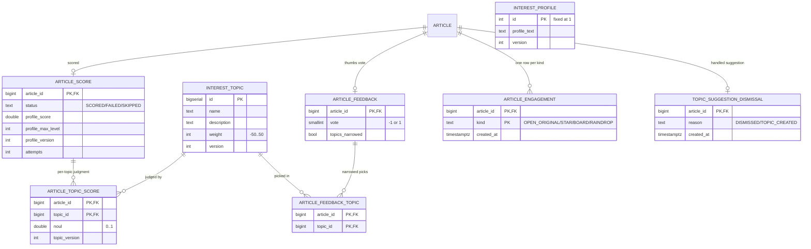
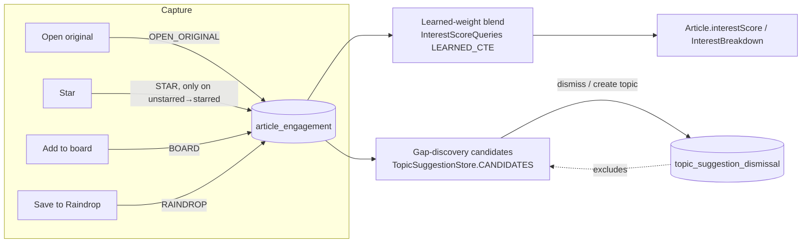

# Domain Concepts

## Entities and schema evolution

Flyway migrations tell the story of how the domain grew:

- **`V1__initial_schema.sql`**: `feed` and `article` tables (core RSS reader), plus `integration_config` (generic key/value integration settings, unique per `type`).
- **`V2__folders_boards_and_feed_folder.sql`**: adds `folder` (feed grouping, with `display_order` for drag-to-reorder) and `board`/`board_article` (curated collections a user saves articles into — see "read later" in `docs/backlog.md`), plus `feed.folder_id`.
- **`V3__article_image_url.sql`**: adds `article.image_url` (thumbnail extracted from feed content).
- **`V4__strip_raindrop_api_token.sql`**: removes a legacy `apiToken` field that used to live inside `integration_config.config` JSON — the token moved to `myfeeder.raindrop.api-token` (env-var-backed config property) instead of being stored in the DB. See [Raindrop Integration](../integrations/raindrop.md). This migration is unusual in that it can't be re-triggered by normal Flyway test startup (see `V4StripRaindropApiTokenMigrationTest` in [Testing Guide](../testing/guide.md) for the pattern used to test it).
<!-- openwiki: broken internal link [#extracted-content-reader-view-caching-and-aging] heading anchor "extracted-content-reader-view-caching-and-aging" does not exist in /openwiki/domain/concepts.md. Fix the href or restore the target, then delete this comment. -->
- **`V5__article_extracted_content.sql`**: adds `article.extracted_content` (`TEXT`), a cache of the readable content extracted from the article's original page for the reader view (see [`Article.extractedContent` caching](#extracted-content-reader-view-caching-and-aging) below).
- **`V6__interest_scoring.sql`**: the complete interest-ranking schema in one migration — `interest_profile` (singleton row, id fixed at 1), `interest_topic`, `article_score`, `article_topic_score` (child of `article_score`, one row per judged topic), `article_feedback` (one thumbs vote per article) and `article_feedback_topic` (child picks of a narrowed vote). See [Interest Scoring Workflow](../workflows/interest-scoring.md) for how these tables are populated and blended into a display score; this page only covers their shape and invariants.
- **`V7__engagement.sql`**: the v0.3.0 schema — `article_engagement` (one sticky row per article and `EngagementKind`, `PRIMARY KEY (article_id, kind)`) and `topic_suggestion_dismissal` (one row per article, no un-dismiss). See [Engagement and Suggestions Workflow](../workflows/engagement-and-suggestions.md) for how engagement feeds the learned-weight blend and the gap-discovery suggestion predicate; this page covers only the storage shape and stickiness rules.

### `Feed` (`model/Feed.java` / table `feed`)
Tracks a subscribed source: `url`, `title`, `description`, `siteUrl`, `feedType` (RSS/Atom/JSON — `FeedType` enum), `pollIntervalMinutes`, `folderId`, and **poll health state**: `lastPolledAt`, `lastSuccessfulPollAt`, `errorCount`, `lastError`, `etag`, `lastModifiedHeader`. The last four fields exist purely to support conditional GETs and backoff — see [Feed Lifecycle Workflow](../workflows/feed-lifecycle.md).

### `Article` (`model/Article.java` / table `article`)
One article from a feed: `feedId` (FK, cascade delete), `guid` (dedup key, unique with `feedId`), `title`, `url`, `author`, `content`, `summary`, `imageUrl`, `publishedAt`, `fetchedAt`, `read`, `starred`, `extractedContent` (V5). `content`/`summary`/`extractedContent` get nulled out by `RetentionService` after `full-content-days`. The entity also carries four `@Transient` (not persisted, never part of the `article` table) fields populated by services for specific API responses:

- `interestScore` — the 0-100 display badge from the blend CTE (`InterestScoreQueries`); `null` when the article is unscored. Set on every list/detail read via `withScores`/`findByIdWithBreakdown`.
- `interestBreakdown` — the exact "Why N?" breakdown (`InterestBreakdown`); only populated on `GET /api/articles/{id}`, omitted (via `@JsonInclude(NON_NULL)`) elsewhere.
- `feedback` — the stored thumbs vote (`ArticleFeedback`); only populated on `GET /api/articles/{id}` and the feedback endpoints.
- `engagement` — the list of `EngagementKind`s recorded for the article; only populated on `GET /api/articles/{id}` and the feedback endpoints, `[]` when there are none.

**Sort order rule (important, easy to get wrong):** articles are sorted by `COALESCE(published_at, fetched_at)`, **not** by `id`. Batch-fetched articles (e.g. from a bulk OPML import or a feed with a backlog of items) get sequential DB IDs but widely varied publication dates, so `ORDER BY id` does not produce chronological order. Cursor pagination therefore uses a composite `(published_at, id)` comparison — `ArticleController`/`ArticleService` still expose a single article ID as the cursor, but the service looks up that cursor article's date to build the SQL comparison.

**Pagination shape:** all list endpoints return `PaginatedResponse<T>` (`{items, nextCursor}` — the field is `items`, not `articles`). Controllers fetch `limit + 1` rows and delegate the "does another page exist / trim the extra row" logic to `PaginatedResponse.of(fetched, limit, idExtractor)` (see `controller/PaginatedResponse.java`) — don't reimplement that trimming logic per-controller.

**Reading pane fetch-by-ID:** the reading pane fetches the selected article directly via `GET /api/articles/{id}` (`useArticle(id)`), not by searching the paginated list query client-side. This avoids the reading pane and the article list disagreeing about filters/sort — a pattern also leaned on by `useKeyboardShortcuts` (see [Architecture Overview](../architecture/overview.md)) to resolve the "current article" on views where the visible list and the hook's list diverge.

#### `extracted_content`: reader view caching and aging

`ArticleExtractionService.extract(articleId)` backs the reader view: it looks up `article.extracted_content` first (`ArticleRepository.findExtractedContent`); if non-null, it returns the cached HTML immediately without any network call. On a cache miss it fetches the article's original page through `FeedFetcher` (keeping the SSRF guard, size cap and User-Agent shared with feed polling), decodes the bytes (HTTP header charset first, else jsoup's BOM/meta-tag detection), and runs Mozilla Readability (`Readability4J`) to extract readable content. A successful extraction is cached via `ArticleRepository.saveExtractedContent` before returning; a failure (no readable content, fetch error) throws without writing anything, so the next request retries the fetch rather than caching a failure. A missing article is a 404; an article with no `url` is a 400.

`RetentionService.cleanupOldContent()` (scheduled, `myfeeder.retention.cleanup-cron`) clears both `content` and `extracted_content` together via `ArticleRepository.clearContentOlderThan(cutoff)` once `fetched_at` is older than `full-content-days` — the reader-view cache ages out on the same schedule as the raw feed content, not independently.

### `Folder` (`model/Folder.java` / table `folder`)
A named grouping of feeds with a user-controlled `displayOrder` (drag-to-reorder in the sidebar, `c47a2a0`/`4cc1a1b`). A feed's `folderId` is nullable (`ON DELETE SET NULL`), so deleting a folder ungroups its feeds rather than deleting them.

### `Board` / `BoardArticle` (`model/Board.java`, `BoardArticle.java` / tables `board`, `board_article`)
<!-- openwiki: broken internal link [#engagement-and-suggestion-tables] heading anchor "engagement-and-suggestion-tables" does not exist in /openwiki/domain/concepts.md. Fix the href or restore the target, then delete this comment. -->
A board is a named, user-created collection (e.g. "Read Later"); `board_article` is the join table (`UNIQUE(board_id, article_id)` — adding the same article twice is a no-op, see `BoardService.addArticle`). `BoardService.getOrCreateByName` backs the "Read Later" quick-action so it doesn't need a separate creation step in the UI. Adding an article to any board also records a `BOARD` engagement row (`EngagementKind.BOARD`, best-effort via `ArticleEngagementStore.recordQuietly`, outside any transaction) — see [Engagement stickiness rules](#engagement-and-suggestion-tables) below for what removing the article or deleting the board does (and does not) do to that engagement row.

### `IntegrationConfig` (`model/IntegrationConfig.java` / table `integration_config`)
Generic per-integration settings row (`type` unique, JSON `config` blob, `enabled` flag). Currently the only consumer is Raindrop.io — see [Raindrop Integration](../integrations/raindrop.md) for how `RaindropConfig` is deserialized from the `config` column and how the token itself is deliberately **not** stored here (V4 migration).

## Interest-ranking tables (V6/V7)

These tables back the scoring/blending math and the engagement/suggestion workflows described in [Interest Scoring Workflow](../workflows/interest-scoring.md) and [Engagement and Suggestions Workflow](../workflows/engagement-and-suggestions.md). This section documents only their shape, ownership and invariants.

### `InterestProfile` (`model/InterestProfile.java` / table `interest_profile`)
A **singleton** row seeded by V6 with `id = 1` (`CHECK (id = 1)`), so it is always `UPDATE`-able via `InterestProfileRepository.save()` rather than requiring an insert-or-update dance. `profileText` (free text, max 2,000 UTF-16 code units, enforced in `InterestService.updateProfile`), `version` and `updatedAt`. `version` is a **plain column, not an optimistic-locking field**: `InterestService` bumps it by exactly 1 only when `profileText` actually changes (an unchanged save leaves `version` untouched); an empty text is a valid way to clear the profile.

### `InterestTopic` (`model/InterestTopic.java` / table `interest_topic`)
A user-authored rubric entry: `name` (short display label, ≤40 chars, shown in UI chips — never sent to the scoring model), `description` (≤500 chars, the text the scoring judge evaluates), `weight` (points, `-50..+50`, default 20), and `version`. As with the profile, `version` is a plain column that `InterestService.updateTopic` bumps by 1 only when the trimmed `description` changes — editing only `name` or `weight` never bumps it. `InterestService` enforces a hard cap of 25 topics (`MAX_TOPICS`) as a count-then-insert inside one transaction (not serialized against concurrent creates, but this is a single-user app). Deleting a topic cascades to its `article_topic_score` and `article_feedback_topic` rows (V6 `ON DELETE CASCADE`) but never touches `topic_suggestion_dismissal`, which has no topic reference at all.

**Cold start:** `InterestService.isColdStart()` is the single predicate used everywhere a caller needs to know whether scoring/ranking is meaningful yet: true only when the trimmed `profileText` is blank **and** there are zero topics. The status endpoint and the scoring gate call this method rather than reimplementing the check.

### `ArticleScore` / `ArticleTopicScore` (`model/` has no POJO — accessed via `ArticleScoreStore`; tables `article_score`, `article_topic_score`)
One row per judged article (`article_id` PK, `FK ... ON DELETE CASCADE` to `article`): `status` (`SCORED`/`FAILED`/`SKIPPED`), the profile judgment (`profile_score`, `profile_max_level`, `profile_confidence`, `profile_version`), `model`, `request_id`, `attempts` and `last_error`. `SCORED` is write-once from the scoring service's perspective; `FAILED` accumulates `attempts`; `SKIPPED` is terminal. `article_topic_score` is a child of `article_score` (not of `article` directly — its FK targets `article_score(article_id)`), so deleting a score row (e.g. a "Re-score unread" operation) also removes its per-topic `noul` judgments. Each topic row's `topic_version` records the topic description's version at judgment time, which lets `ArticleScoringService` detect a rubric change mid-call and discard the result instead of storing it.

### `ArticleFeedback` (`model/ArticleFeedback.java` — a record wrapping a stored vote; tables `article_feedback`, `article_feedback_topic`)
One thumbs vote per article (`article_id` PK, `FK ... ON DELETE CASCADE`): `vote` (`1` or `-1`), `topics_narrowed`. `ArticleFeedbackStore.upsert` replaces any earlier vote for the article under row-lock, serializing concurrent votes on the same article. When `topicIds` is non-null the vote is "narrowed" and only those picks (stored as `article_feedback_topic` child rows) count toward the per-topic learned adjustment; when narrowed with **zero** picks, the vote penalizes nothing (it still exists, but matches no topic). An un-narrowed vote moves every topic the article matched. The `ArticleFeedback` model record itself (`vote`, `narrowed`, `topics`) is the API-facing shape returned by `ArticleFeedbackStore.find` and attached to `Article.feedback`; `ArticleFeedback.Topic` is one narrowed pick (`topicId`, `name`), listed in topic-id order.

### `EngagementKind` (`model/EngagementKind.java`, enum)
`OPEN_ORIGINAL, STAR, BOARD, RAINDROP` — the ways a user engages with an article. The declaration order is also the API and display order (`ArticleEngagementStore.kinds` sorts by this natural enum order before returning).

### `SuggestionDismissalReason` (`model/SuggestionDismissalReason.java`, enum)
`DISMISSED, TOPIC_CREATED` — why a suggested topic was handled. The names equal the V7 `topic_suggestion_dismissal.reason` CHECK values. `DISMISSED` comes from the suggestion's Dismiss action; `TOPIC_CREATED` comes from a topic saved with a `sourceArticleId`. Both hide the suggestion permanently — see below.

### `InterestBreakdown` (`model/InterestBreakdown.java`, record)
The exact "Why N?" breakdown attached to `Article.interestBreakdown` on `GET /api/articles/{id}`: `raw` (unrounded total), `total` (`ROUND(raw)`, may exceed 0-100), `display` (the capped/floored badge value), `rows` (one `PROFILE` or `TOPIC` row per contributing factor, ordered by absolute points) and `nonMatching` (judged topics that did not match, i.e. `noul <= 0.5`). A `TOPIC` row's `weight` always equals `baseWeight + learnedWeight`, and `learnedWeight` always splits into `thumbsWeight + engagementWeight` — the exact math behind those splits lives in [Interest Scoring Workflow](../workflows/interest-scoring.md), not here.

### Engagement and suggestion tables (V7)

**`ArticleEngagementStore`** (`repository/ArticleEngagementStore.java`) is the only writer of `article_engagement`. `record(articleId, kind)` is an idempotent `INSERT ... ON CONFLICT (article_id, kind) DO NOTHING`, so repeating the same kind never refreshes `created_at` — the stored timestamp is the **first** time that (article, kind) pair was recorded, which matters for the suggestion window (see below). `recordQuietly` wraps `record` for the save paths (starring, adding to a board) and never throws: a logged WARN on failure can never fail the user's star/board save, because every statement here autocommits on its own and opens no transaction of its own.

**Stickiness rules (verified against `V7EngagementMigrationTest`):**
- Un-starring an article (`PATCH` with `starred: false`) does **not** delete its `STAR` engagement row — only a transition from unstarred to starred records a new row in the first place (`ArticleService.updateState`); un-starring records nothing and deletes nothing.
- Removing an article from a board (`BoardService.removeArticle`) does not touch `article_engagement` at all — nothing in that table references `board` or `board_article`, so the removal is invisible to engagement.
- Deleting a board (`BoardService.delete`) likewise leaves engagement untouched, for the same reason.
- Deleting an **article** cascades its engagement rows (`article_engagement.article_id` has `ON DELETE CASCADE` to `article`), and deleting a **feed** cascades through its articles to their engagement rows as well.
- The only way to clear an article's engagement deliberately is `ArticleService.forgetEngagement` (`DELETE /api/articles/{id}/engagement`, the reading-pane "Forget" action), which deletes every engagement row for that article and nothing else — it does not touch the star, board memberships or thumbs vote, and a later re-open records engagement again (no tombstone).

**`TopicSuggestionStore`** (`repository/TopicSuggestionStore.java`) is the only reader **and** writer of `topic_suggestion_dismissal`; the ranking SQL in `InterestScoreQueries` never reads it (a guarded invariant). `handle(articleId, reason)` is `INSERT ... SELECT ... ON CONFLICT (article_id) DO NOTHING`: **one row per article, and there is no un-dismiss** — once an article's suggestion is handled (by Dismiss or by creating a topic from it via `sourceArticleId`), it is permanently excluded from gap-discovery candidates, even after a later new engagement. A stale/missing article id inserts nothing and never blocks the caller (e.g. a topic save with a dangling `sourceArticleId`). Deleting the topic later does not un-dismiss the row (Phase 8 decision): the dismissal is about the *article*, not the topic.

See [Interest Scoring Workflow](../workflows/interest-scoring.md) for how engagement becomes a learned-weight term in the blend, and [Engagement and Suggestions Workflow](../workflows/engagement-and-suggestions.md) for the full capture and gap-discovery suggestion lifecycle (candidate predicate, dismissal, UI).

## API surface (by domain)

| Domain | Controller | Base path |
|---|---|---|
| Feed | `FeedController` | `/api/feeds` |
| Article | `ArticleController` | `/api/articles` |
| Folder | `FolderController` | `/api/folders` |
| Board | `BoardController` | `/api/boards` |
| Integration | `IntegrationConfigController` | `/api/integrations` |
| OPML | `OpmlController` | `/api/opml` |
| Interest | — (routes under `/api/interest`) | `/api/interest` |

Request bodies are typed records per action (e.g. `FeedUpdateRequest`, `CreateBoardRequest`, `MoveFeedToFolderRequest`, `ArticleStateRequest`, `MarkReadRequest`) rather than raw `Map` — see [Architecture Overview](../architecture/overview.md) for the HTTP-layer conventions and exception-to-status mapping shared by all these controllers.

## Business rules worth remembering

- **Article dedup key is `(feed_id, guid)`**, enforced at the DB level and checked in `FeedPollingService` before insert.
- **`read`/`starred` are independent booleans**, both patchable via `PATCH /api/articles/{id}` (`ArticleStateRequest`). "Mark read" also supports bulk operations by article ID list, by feed, or by "older than N days" (`MarkReadRequest` — see `docs/backlog.md` for the UI preset days: 1/3/7/14).
- **OPML import** (`OpmlService` + `OpmlImportService`) has explicit XXE protection in the XML parser — preserve this if you touch `OpmlService`'s parsing code. Import matches existing feeds by URL (update in place) and folders by case-insensitive name (create if missing); only newly created feeds publish `FeedSavedEvent`.
- **Profile/topic version bumps are change-detected, not blind increments**: `InterestProfile.version` and `InterestTopic.version` only increase by 1 when the underlying text (`profileText`, `description`) actually differs from the stored value; cosmetic saves (same text, or editing only a topic's `name`/`weight`) leave the version untouched. Scoring compares the topic/profile version at judgment time against the current version to detect and discard stale results.
- **Engagement capture is best-effort and never blocks the triggering save**: `ArticleEngagementStore.recordQuietly` catches `DataAccessException`, logs a WARN with only the kind/article id/exception class, and lets the star or board-add that triggered it succeed regardless.
- **There is no un-dismiss for a suggestion**: once `topic_suggestion_dismissal` has a row for an article (via Dismiss or via creating a topic with `sourceArticleId`), that article never reappears in gap-discovery candidates, even after further engagement or a topic edit/delete.
