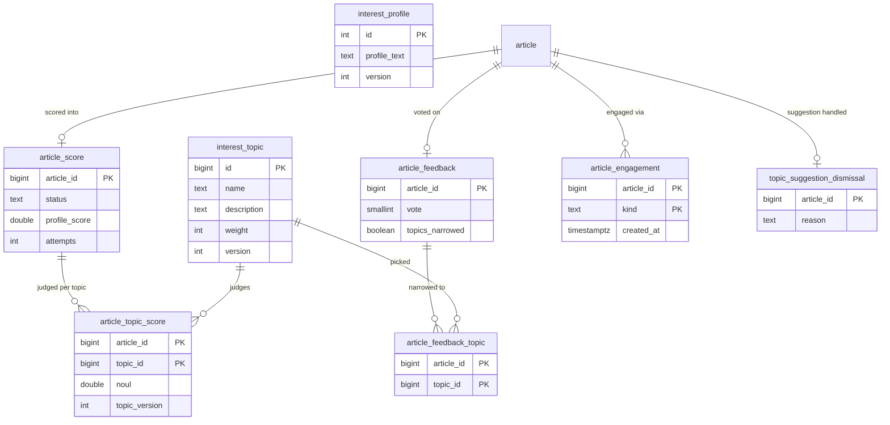
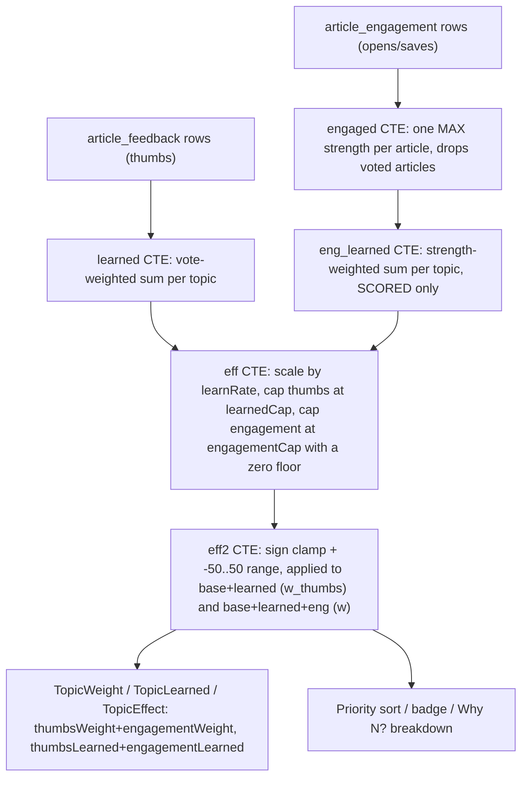
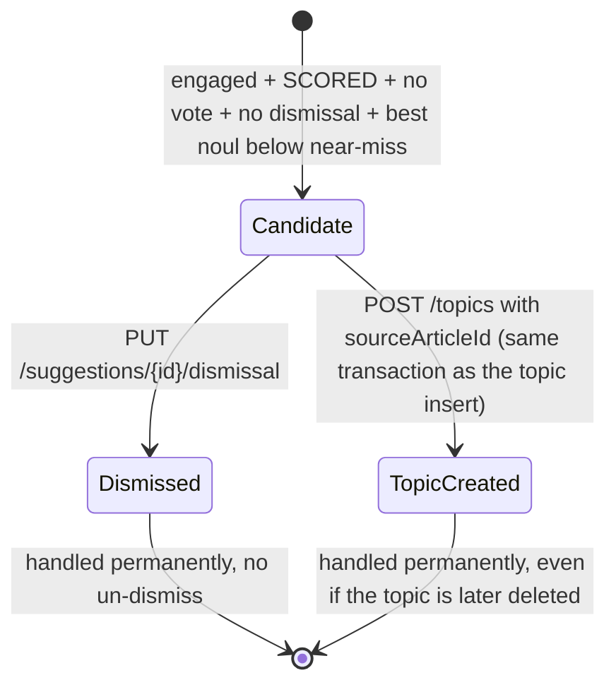

# Interest Scoring Domain Model

> **Scope note:** this page covers the V6/V7 interest-ranking schema only. The core content model
> (`Feed`, `Article`, `Folder`, `Board`, `IntegrationConfig`) and migrations V1-V5 are owned by
> [Domain Concepts](concepts.md). For the full end-to-end request/scoring/learning flow — ingest,
> sweep, Jev call, thumbs voting, engagement capture and the calibration-tuning workflow — see
> [Interest Ranking Workflow](../workflows/interest-ranking.md). For how the app owns and calls the
> Jev (TypeSafe) client, see [Jev TypeSafe Integration](../integrations/jev-typesafe.md).

## Schema overview

`V6__interest_scoring.sql` creates the complete interest-scoring schema in one migration (later
phases add no further interest-scoring tables beyond V7):

- **`interest_profile`** — a singleton row (`id = 1`, `CHECK (id = 1)`), seeded by the migration
  itself so it is always `UPDATE`-able. `profile_text` is free text fed into the Jev profile
  question; `version` is a plain integer column (not optimistic locking) that `InterestService`
  bumps only when `profile_text` actually changes.
- **`interest_topic`** — up to 25 rows (enforced in `InterestService`, not the schema). `name` is a
  short display label never sent to Jev; `description` is what the Noul question judges; `weight`
  is an integer in `-50..50` (`CHECK (weight BETWEEN -50 AND 50)`); `version` bumps only when
  `description` changes (name/weight edits do not bump it).
- **`article_score`** — one row per judged article, `article_id` PK with `ON DELETE CASCADE` to
  `article`. `status` is `SCORED` (write-once), `FAILED` (counts `attempts`, retried up to
  `ArticleScoreStore.MAX_ATTEMPTS` = 3), or `SKIPPED` (terminal, e.g. no GUID or no judgeable text).
  `profile_score`/`profile_max_level`/`profile_confidence`/`profile_version` are all `NULL` when no
  profile question was sent (empty profile text).
- **`article_topic_score`** — child of `article_score` (`ON DELETE CASCADE`), one row per
  `(article_id, topic_id)` with the judged `noul` (`CHECK (noul BETWEEN 0 AND 1)`) and the
  `topic_version` the judgment was stamped against. Deleting a score row (Re-score) cascades away
  its nouls; deleting a topic cascades away its judgments.
- **`article_feedback`** — at most one thumbs vote per article (`article_id` PK, `ON DELETE
  CASCADE`), `vote` constrained to `1`/`-1`, and `topics_narrowed` marking whether the vote was
  scoped to specific topics.
- **`article_feedback_topic`** — child rows naming the picked topics of a narrowed vote; no `CHECK`
  ties the picks to the vote direction. When `topics_narrowed` is false, the vote applies to every
  topic the article matched; when true, only these child rows count, and zero child rows penalize
  nothing.

`V7__engagement.sql` (v0.3.0) adds two further tables, with no backfill of historical data:

- **`article_engagement`** — one sticky row per `(article_id, kind)` (`PRIMARY KEY (article_id,
  kind)`), `kind` constrained to `OPEN_ORIGINAL`, `STAR`, `BOARD`, `RAINDROP` (`EngagementKind`,
  whose declaration order is also the API/display order). `created_at` is kept per kind so decay
  stays possible later, and because the store uses `ON CONFLICT DO NOTHING`, each kind keeps its
  *first* recording — repeating the same kind never refreshes its timestamp. Rows are sticky:
  unstarring, removing a board, or deleting a board, keep the engagement; deleting the article or
  feed cascades it away; "Forget" (`DELETE /api/articles/{id}/engagement`) removes all of an
  article's rows explicitly, with no tombstone.
- **`topic_suggestion_dismissal`** — one row per `article_id` once its suggestion is handled.
  `reason` is constrained to `DISMISSED` or `TOPIC_CREATED` (`SuggestionDismissalReason`). There is
  no column referencing `interest_topic`, so deleting a topic never touches this table. There is no
  un-dismiss path, so a handled article never returns as a suggestion, even after a later
  engagement.

`ArticleEngagementStore` is the only writer of `article_engagement` (plus the reader used for the
`GET /api/articles/{id}` `engagement` field and Forget). `TopicSuggestionStore` is the only reader
and writer of `topic_suggestion_dismissal` — `InterestScoreQueries`, which owns the ranking SQL,
never reads it (guarded by `V7EngagementMigrationTest.rankingSqlReadsEngagementButNotDismissals`).


*The six V6 tables plus V7's `article_engagement` and `topic_suggestion_dismissal`; `interest_profile` is a singleton with no foreign keys.*

## Cold start

`InterestService.isColdStart()` is the single cold-start predicate: the profile text is blank
after trim **and** there are zero rows in `interest_topic`. The status endpoint, the sweep's
per-article scoring gate (`ArticleScoringService.score`), and every other cold-start check reuse
this method rather than reimplementing the condition — a change to what counts as "configured"
only has to happen here.

## Scoring eligibility window

An article is eligible for scoring (`ArticleScoreStore.ELIGIBLE`) when:

```
a."read" = false AND COALESCE(a.published_at, a.fetched_at) > now - window-days
```

with `window-days` = 14 (`myfeeder.interest.*` config, read as a cutoff `Instant` by
`MyfeederProperties.Interest.eligibilityCutoff()`). An eligible article still *needs* scoring
(`ArticleScoreStore.NEEDS_SCORING`) only when it has no `article_score` row at all, or has a
`FAILED` row with `attempts < MAX_ATTEMPTS` (3). The sweep, the per-article dispatch recheck, the
`/api/interest/status` counts, and Re-score's confirmation count all build on this one predicate
pair so they can never disagree about which articles are in scope.

Transient failures — HTTP 429, 5xx, a connection/timeout failure, an open circuit breaker, a
missing API key, or 401/403 (`ScoringFailure.isTransient`) — write **no** `article_score` row and
burn **no** attempt. This keeps a Jev outage or a bad key from exhausting an article's 3 attempts
while the breaker or the key is fixed; only a *non*-transient failure (e.g. an invalid judge
response) writes a `FAILED` row and consumes an attempt, bounding each article at 3 billed Jev
calls.

## Score invalidation on rubric change

`ArticleScoringService.score` snapshots the profile and every topic's version **before** calling
`jevApiClient.judge(...)`. Because that call can take tens of seconds (with retries), the rubric
can change mid-call — most notably just before a Re-score. After `judge()` returns successfully,
the service re-reads the profile version and every topic's version and compares them
(`sameRubric`) against the snapshot:

- If either the profile version or any topic's version-set differs, the service **discards** the
  judgment: it stores nothing and records no attempt, leaving the article for the sweep to re-pick
  against the now-current rubric.
- A name- or weight-only edit never bumps a topic's `version`, so it does not trigger invalidation
  — only a changed `description` (or changed `profile_text`) does.

This makes a write-once `SCORED` row never pin a replaced rubric, at the cost of a wasted (but
billed) Jev call when the rubric changes during an in-flight score.

## The learned-weight model

Interest scoring blends two kinds of signal into each topic's *effective weight*: the stored base
`weight` from `interest_topic`, and a **learned** adjustment derived at query time from
`article_feedback` (thumbs) and `article_engagement` (opens/saves). Nothing about the learned
adjustment is stored — it is recomputed on every read, so removing or flipping a vote, or
forgetting an engagement, undoes its effect exactly.

`InterestScoreQueries.LEARNED_CTE` computes this blend in SQL, through five CTEs:

1. **`learned`** — sums `vote x max(0, (noul - 0.5) x 2)` per topic over votes on `SCORED`
   articles, honoring a narrowed vote's picked topics only.
2. **`engaged`** — collapses `article_engagement` to one `MAX` strength per article (`OPEN_ORIGINAL`
   → `engagement.open-weight`, `STAR`/`BOARD`/`RAINDROP` → `engagement.save-weight`), dropping any
   article that has a thumbs vote at all — a vote on an article replaces its engagement
   contribution entirely, and removing the vote restores it.
2. **`eng_learned`** — sums `strength x hinge` per topic over `SCORED` articles only, with no age or
   read-state window (an engaged-but-unscored article contributes nothing and stays ineligible for
   scoring itself — `ArticleScoreStore` never looks at engagement).
3. **`eff`** — scales the thumbs sum by `learnRate` and clamps it to `+/- learnedCap`
   (`learned_raw` / `learned`); scales the engagement sum the same way and additionally floors it
   at zero and caps it at `engagementCap` (`eng_raw` / `eng`). Both thumbs and engagement are forced
   to 0 for a topic whose base weight is negative, and `engagementCap = 0` disables engagement
   entirely regardless of the weights.
4. **`eff2`** — applies the sign clamp (a positive base never crosses below 0; a negative base
   never crosses above 0; a zero base may move either way) and the `-50..50` range, once each, to
   two sums: `base + learned` → `w_thumbs` (the thumbs-only effective weight) and
   `base + learned + eng` → `w` (the final effective weight the ranking blend uses).

Every query that reports topic weights — the Priority sort, the display badge, "Why N?"
breakdowns, `GET /api/interest/topics/learned`, and the thumbs-vote response — is built from this
same CTE, so they can never disagree.

### Split fields and the applied cap/clamp rule

Because thumbs are resolved before engagement (`w_thumbs` settles first, then `eng` is layered on
top of it), the applied learned adjustment splits cleanly into a thumbs part and an engagement
part by subtracting 6-decimal-rounded SQL values:

- **`thumbsWeight` / `engagementWeight`** (on `TopicContribution`, used by "Why N?" rows): sum to
  `learnedWeight = weight - baseWeight`.
- **`thumbsLearned` / `engagementLearned`** (on `TopicWeight`, `TopicLearned`, `TopicEffect`): sum
  to `learned` (the capped learned total before the sign clamp/range are applied).
- **`TopicWeight`** (`InterestScoreQueries.topicWeights`/`allTopicWeights`) additionally exposes
  `learnedRaw` (uncapped thumbs points), `effective` (`w`, the clamped final weight), and
  `thumbsEffective` (`w_thumbs`, the thumbs-only clamped weight).
- **`TopicLearned`** (service-facing, for the topic editor) and **`TopicEffect`** (on
  `FeedbackResult`, the before/after of one thumbs-vote write) both carry the same
  `thumbsLearned`/`engagementLearned` split plus a `limit` field.

`LearnedLimit.of(weight, learnedCap, engagementCap)` names which rule actually held a topic's
weight back, checked in this precedence: `LEARNED_CAP` (the uncapped thumbs points reach
`learnedCap`) → `SIGN_CLAMP` (`base + learned` would cross zero) → `WEIGHT_RANGE` (`|base +
learned|` exceeds 50) → `ENGAGEMENT_CAP` (reported only when no stronger bound applies, and the
uncapped engagement points reach `engagementCap`) → `NONE`. `LearnedLimit.engagementAtCap` is the
single rule behind both the `ENGAGEMENT_CAP` case and the standalone `engagementAtCap` flag exposed
on `TopicLearned`/`TopicWeight` consumers, so a topic can report `engagementAtCap = true` while a
*different*, stronger limit (e.g. `SIGN_CLAMP`) is the one actually reported.


*How a topic's effective weight is derived at query time from stored thumbs votes and engagement rows; nothing in this flow is persisted.*

This page documents the schema and derivation only; for the end-to-end request flow (ingest →
sweep → Jev call → score write → vote/engagement capture → re-read), see the learning sections of
[Interest Ranking Workflow](../workflows/interest-ranking.md). The three engagement constants
(`myfeeder.interest.blend.engagement.open-weight`/`save-weight`/`cap`) and the tier/near-miss
thresholds are tuned with `scripts/interest-calibration-replay.sh`, a read-only replay of the exact
`InterestScoreQueries` blend SQL against a copy of the data — see that workflow page for the tuning
procedure and the acceptance rules it applies.

## Topic suggestion (gap discovery) lifecycle

`GET /api/interest/suggestions` lists engaged articles that no topic covers well, using
`TopicSuggestionStore.CANDIDATES`. A candidate article must satisfy all of:

- it has at least one `article_engagement` row whose kind's first `created_at` falls inside the
  suggestion window (`TopicSuggestionService.WINDOW_DAYS`, 30 days);
- it has a `SCORED` row in `article_score`;
- it has **no** row in `article_feedback` (an unvoted article only);
- it has **no** row in `topic_suggestion_dismissal` (not already handled); and
- its best noul over every `article_topic_score` row (any topic, either weight sign; 0 when it has
  no rows) is below `myfeeder.interest.suggestions.near-miss` (0.35).

Results are ordered by badge ascending (recomputed from `InterestScoreQueries.displayScores` in a
second step — the ranking SQL itself is never touched by suggestion logic), then by latest
engagement newest-first, then by id descending, capped at `MAX_SUGGESTIONS` (10) plus a `total`
count. A candidate whose badge disappears between the two steps is silently dropped and not
counted.


*A suggestion's lifecycle: once it writes `DISMISSED` or `TOPIC_CREATED` into `topic_suggestion_dismissal`, it never resurfaces.*

Lifecycle details:

- **Dismiss** (`PUT /api/interest/suggestions/{articleId}/dismissal`, bodyless, 204, idempotent,
  404 for an unknown article) writes `reason = DISMISSED` via `TopicSuggestionStore.handle`.
- **Topic-with-source** — `POST /api/interest/topics` accepts an optional `sourceArticleId`;
  `InterestService.createTopic` writes `reason = TOPIC_CREATED` inside the *same* `@Transactional`
  method that inserts the topic, so the topic row and the dismissal row commit or roll back
  together. A 400 from the 25-topic cap or field validation happens before either write, so nothing
  is written. `PUT /topics/{id}` (update) ignores `sourceArticleId` — only create can mark a
  suggestion handled this way.
- `TopicSuggestionStore.handle` is one `INSERT ... SELECT ... ON CONFLICT (article_id) DO NOTHING`
  statement: it keeps the *first* reason recorded, a stale/missing article id inserts nothing and
  never blocks the topic save, and it opens no transaction of its own (so it joins whatever
  transaction the caller is already in).
- **No un-dismiss**: there is no API or store method that removes a `topic_suggestion_dismissal`
  row. Deleting the topic that was created from a suggestion does **not** revive the suggestion
  (the table has no FK to `interest_topic`), and a later new engagement on the same article does
  not revive it either.
- Jev is never called anywhere in this flow — listing, dismissing, and creating a topic from a
  suggestion are all pure-SQL operations.

## Ownership and ordering recap

| Table | Writer(s) | Reader(s) of note |
|---|---|---|
| `interest_profile` | `InterestService` | `ArticleScoringService`, `InterestScoreQueries` (via version stamps) |
| `interest_topic` | `InterestService` | `InterestScoreQueries`, `ArticleScoringService`, `TopicSuggestionService` |
| `article_score` | `ArticleScoreStore` | `InterestScoreQueries`, `TopicSuggestionStore` |
| `article_topic_score` | `ArticleScoreStore` | `InterestScoreQueries`, `TopicSuggestionStore` |
| `article_feedback` / `article_feedback_topic` | `ArticleFeedbackService` | `InterestScoreQueries` (`LEARNED_CTE`), `TopicSuggestionStore` |
| `article_engagement` | `ArticleEngagementStore` | `InterestScoreQueries` (`LEARNED_CTE`), `TopicSuggestionStore` |
| `topic_suggestion_dismissal` | `TopicSuggestionStore` (sole writer) | `TopicSuggestionStore` (sole reader) |

See [Domain Concepts](concepts.md) for the `Feed`/`Article`/`Folder`/`Board` schema (V1-V5) that
`article_score`, `article_feedback` and `article_engagement` all reference via
`article_id REFERENCES article(id) ON DELETE CASCADE`, and
[Interest Ranking Workflow](../workflows/interest-ranking.md) for how these tables are populated
and consumed across a request's lifetime.
