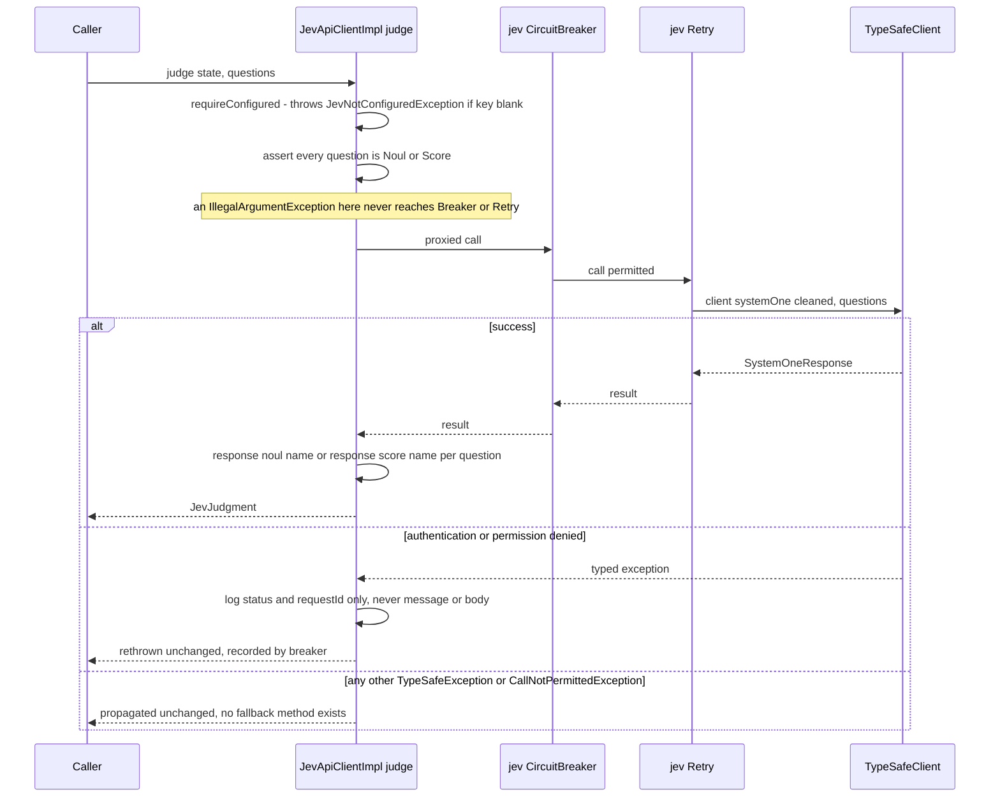

# Jev (TypeSafe) Scoring Integration

Jev is the TypeSafe AI model myfeeder calls to score articles against a user's interest profile ("interest scoring"). This page documents the **transport and resilience boundary** around that call: the `TypeSafeClient` bean, the single Resilience4j retry/circuit-breaker layer, structured event logging, and how TypeSafe exceptions map to HTTP responses. How scoring results are consumed — the scoring executor, sweep scheduling, eligibility windows, and the learned-weight blend — is documented in the [Interest Scoring workflow](../workflows/interest-scoring.md), not here.

It is the Jev counterpart to the [Raindrop.io Integration](raindrop.md), but the two designs differ in one important way: Raindrop's resilience layer swallows a "not configured" exception around a fallback method and rethrows it; Jev's `judge()` has **no fallback at all** — every exception, typed or generic, propagates unchanged to the caller.

## `JevApiClientImpl.judge()`

`JevApiClientImpl` (`org.bartram.myfeeder.integration.JevApiClientImpl`) wraps `org.springaicommunity.typesafe.TypeSafeClient` and is the only place in the app that calls Jev's `systemOne` endpoint.


*Control flow of `JevApiClientImpl.judge()`: the question-type guard runs before the billed HTTP call and outside the breaker/retry, and nothing is ever translated into a fallback value.*

Key behaviors:

- **No `fallbackMethod`.** `@CircuitBreaker(name = "jev")` and `@Retry(name = "jev")` are applied with no fallback (D-08), unlike Raindrop's client. Typed TypeSafe SDK exceptions (`TypeSafeAuthenticationException`, `TypeSafeBadRequestException`, `TypeSafeRateLimitException`, etc.) and Resilience4j's own `CallNotPermittedException` (thrown when the breaker is OPEN) all propagate out of `judge()` unchanged. Callers — and ultimately `GlobalExceptionHandler` — see the real exception type, never a generic wrapper.
- **Configuration check bypasses the breaker.** `isConfigured()` carries no resilience annotations at all (D-04): a configuration probe must never consume a breaker call slot or count toward its metrics. `requireConfigured()` throws `JevNotConfiguredException` *before* the annotated call is entered.
- **Question-type guard runs before the billed call.** Jev's `Question` model includes `Noul`, `Score`, and `Choice` answer types, but the app's scoring rubric only ever asks `Noul` or `Score` questions. `judge()` asserts this with `Assert.isTrue` for every entry in the `questions` map *before* calling `client.systemOne(...)`. This check happens inside the proxied method body, so it runs before any HTTP request is sent — a `Choice` question would otherwise be billed by TypeSafe and then dropped when `JevJudgment` is built. The resulting `IllegalArgumentException` is listed under `ignore-exceptions` for the `jev` circuit breaker instance (D-14), so a caller bug that sends an unsupported question type never counts as a breaker failure.
- **Auth-exception log line never echoes TypeSafe's message or body.** `TypeSafeAuthenticationException` and `TypeSafePermissionDeniedException` (401/403) are caught, logged with `log.warn("TypeSafe rejected the API key (status {}, requestId {})", e.status(), e.requestId())`, and rethrown as-is. Only the numeric HTTP status and the request ID are logged — never `e.getMessage()` or the response body, which can echo request content back from TypeSafe.
- **State map is defensively cleaned, never mutated.** `judge()` copies the caller's `state` map into a new `LinkedHashMap` (preserving order) and removes null values before sending it, so the caller's original map is untouched and Jev always receives a JSON object with no nulls.
- **Answer validation is per-question.** After the call succeeds, `judge()` calls `response.noul(name)` or `response.score(name)` for every requested question, which lets the SDK throw `TypeSafeMissingAnswerException` / `TypeSafeAnswerTypeException` if an expected answer is absent or the wrong kind. Both are listed under the breaker's `ignore-exceptions` (they indicate a malformed model response or rubric mismatch, not a transport failure).

## `TypeSafeConfig`: the app-owned `TypeSafeClient` bean

`org.bartram.myfeeder.config.TypeSafeConfig` defines the `TypeSafeClient` bean itself instead of relying on the `spring-ai-typesafe` starter's auto-configuration:

- **Why the app owns the bean.** The starter's own `TypeSafeClient` bean asserts `spring.ai.typesafe.api-key` has text and fails context startup if it is blank. Because `TypeSafeConfig.typeSafeClient(...)` is annotated `@Bean` in an app-level `@Configuration`, Spring's `@ConditionalOnMissingBean` on the starter's bean backs off, and the starter's auto-configuration never runs. A missing or blank `MYFEEDER_TYPESAFE_API_KEY` only disables Jev calls (`isConfigured()` returns `false`); it never crashes the pod.
- **Blank-key-safe startup.** If `properties.getApiKey()` has no text, the bean method only logs a fixed, non-sensitive line — `"TypeSafe Jev not configured; interest scoring disabled"` — and still builds and returns a usable (if non-functional) client.
- **The key is read only through a `Supplier`, and never logged.** The client is built with `.apiKey(() -> Objects.requireNonNullElse(properties.getApiKey(), ""))` — the `Supplier` overload accepts a blank key at build time, unlike the SDK's `String` overload (which asserts non-blank text and would throw). The key value itself — not its length, not a prefix — is never written to a log line anywhere in this integration.
- **Explicit `baseUrl`, no `TYPESAFE_*` environment fallback.** `.baseUrl(properties.getBaseUrl())` is set explicitly from `spring.ai.typesafe.*` configuration properties so the underlying SDK never silently falls back to reading its own `TYPESAFE_*` environment variables.
- **A Jev-only Reactor Netty request factory.** `TypeSafeConfig` builds a `ReactorClientHttpRequestFactory` with its own timeouts — connect timeout `5s` (`JEV_CONNECT_TIMEOUT`), read timeout `spring.ai.typesafe.timeout` (`30s` in `application.yaml`) — and sets it on a `.clone()` of the auto-configured `RestClient.Builder`. Cloning (rather than mutating) the shared builder keeps the User-Agent customizer and observation instrumentation that the rest of the app relies on (see the runbook's outbound `RestClient` User-Agent note), while giving Jev calls their own transport and timeouts that are never reused for feed fetches or any other outbound HTTP call. Feed fetches and Raindrop calls continue to use `spring.http.clients` timeouts (`connect-timeout: 5s`, `read-timeout: 30s`) on the unmodified auto-configured client.
- **`jevRetryInterval` customizes the wait function, not the layer.** The `RetryConfigCustomizer` bean `jevRetryInterval` reads the base wait duration from `resilience4j.retry.instances.jev.wait-duration` (`1s`) via `Binder` (not `@Value Duration`, because `ApplicationContextRunner`-based tests have no `Duration` conversion service registered) and installs an `IntervalBiFunction`: if the last thrown exception was a `TypeSafeRateLimitException` carrying a non-null `retryAfterMs()`, the wait is that value clamped to `[0, MAX_RETRY_AFTER_MS]` (`10_000L` ms, D-07); otherwise it backs off exponentially from the base (`1s`, then `2s` for attempt 2).

## Single retry layer

TypeSafe's own SDK has a built-in retry policy, but myfeeder disables it entirely:

```yaml
spring:
  ai:
    typesafe:
      retry:
        max-retries: 0
```

The Resilience4j `jev` `Retry` instance (configured in `application.yaml`) is the **only** retry layer:

- `max-attempts: 3`, `wait-duration: 1s` (doubled per attempt by `jevRetryInterval`, or replaced by a clamped `retryAfterMs` for 429s, as above).
- `retry-exceptions` lists exactly `TypeSafeRateLimitException` (429), `TypeSafeInternalServerException` (5xx, including its `TypeSafeOverloadedException` subclass for 529/overloaded), and `TypeSafeApiConnectionException` (including its `TypeSafeApiTimeoutException` subclass for connect/read timeouts). These are the only conditions retried — transient server and connection failures.
- `ignore-exceptions` includes `JevNotConfiguredException`, so a disabled integration never burns a retry attempt.
- `400` (`TypeSafeBadRequestException`), `422` (`TypeSafeUnprocessableEntityException`), and `401`/`403` (`TypeSafeAuthenticationException`/`TypeSafePermissionDeniedException`) are **never** retried — they are per-request client errors or auth failures, not transient conditions, and retrying them would waste attempts or spam a rejected key.

Keeping SDK retries at `max-retries: 0` avoids a retry-inside-a-retry: without it, a single logical `judge()` call could silently retry twice (once inside the SDK, once in Resilience4j), multiplying load against TypeSafe and making the circuit breaker's failure/slow-call counts meaningless.

## The `jev` circuit breaker

The `jev` `CircuitBreaker` instance (`application.yaml`, `resilience4j.circuitbreaker.instances.jev`) is tuned distinctly from `raindrop`'s:

| Setting | Value |
|---|---|
| `sliding-window-type` | `COUNT_BASED` |
| `sliding-window-size` | 20 |
| `minimum-number-of-calls` | 10 |
| `failure-rate-threshold` | 50% |
| `slow-call-duration-threshold` | 15s |
| `slow-call-rate-threshold` | 50% |
| `wait-duration-in-open-state` | 60s |
| `permitted-number-of-calls-in-half-open-state` | 3 |
| `automatic-transition-from-open-to-half-open-enabled` | `true` |

A window of the last 20 calls (once at least 10 have been made) is used to compute both the failure rate and the slow-call rate; either crossing 50% trips the breaker OPEN. After `wait-duration-in-open-state` (60s) the breaker transitions to `HALF_OPEN` automatically — it does not wait for the next call to arrive to make that transition, which matters because it means a paused scoring sweep resumes probing Jev again even with no inbound traffic.

`ignore-exceptions` for the `jev` breaker instance lists `JevNotConfiguredException`, `TypeSafeBadRequestException`, `TypeSafeUnprocessableEntityException`, `TypeSafeMissingAnswerException`, `TypeSafeAnswerTypeException`, and `IllegalArgumentException` (the question-type guard, see above) — none of these count as a breaker failure.

**`TypeSafeAuthenticationException` (401) and `TypeSafePermissionDeniedException` (403) are deliberately absent from that ignore list.** A bad or revoked API key is *recorded* as a breaker failure like any 5xx or connection error — so sustained authentication failures (e.g., a rotated key that was never updated in the deployment secret) will open the breaker exactly as a TypeSafe outage would, rather than silently failing every call forever without ever surfacing as a breaker trip.

## Jev event logging

`org.bartram.myfeeder.config.JevEventLogging` subscribes to the event publishers of the same `CircuitBreakerRegistry`/`RetryRegistry`-backed `jev` instances the `@CircuitBreaker`/`@Retry` annotations use (get-or-create by name, so it is the same object graph, not a separate registration) and logs three structured, fixed-text lines:

- `log.info("Jev retry attempt {} after {} (waiting {} ms)", attempts, exceptionSimpleName, waitMillis)` — on each retry.
- `log.warn("Jev retries exhausted after {} attempts: {}", attempts, exceptionSimpleName)` — fires only once a retryable call has used all its attempts without succeeding.
- `log.warn("Jev circuit breaker {} (failure rate {}%, slow-call rate {}%)", stateTransitionName, failureRate, slowCallRate)` — on every breaker state transition, using `StateTransition.name()` (e.g. `CLOSED_TO_OPEN`) rather than its prose `toString()`.

Every line carries only the triggering exception's simple class name and numeric counters — never an exception message, a response body, or the API key — matching the fixed-text discipline used throughout this integration.

In production, grep these lines directly out of pod logs:

```bash
kubectl -n myfeeder logs deploy/myfeeder | grep 'Jev '
```

This is the launch/rollout evidence channel: it proves the breaker stayed `CLOSED` during a backfill and that transient 429/5xx responses were absorbed by the retry layer, without needing a dedicated metric. A healthy rollout shows `Jev retry attempt` / `Jev retries exhausted` lines consistent with expected transient failure rates and **no** `CLOSED_TO_OPEN` transition line. See the [Operations Runbook](../operations/runbook.md) for the broader deploy/rollout process.

## Exception-to-HTTP-status mapping

`GlobalExceptionHandler` maps Jev-specific exceptions to `ProblemDetail` responses. Every handler uses fixed, app-authored text — none of them echo `ex.getMessage()` or a TypeSafe response body, because TypeSafe error messages/bodies can echo request content back to the caller:

| Exception | HTTP status | Detail text |
|---|---|---|
| `JevNotConfiguredException` | 503 Service Unavailable | the exception's own fixed message (app-authored, not TypeSafe output) |
| `CallNotPermittedException` (breaker OPEN) | 503 Service Unavailable | `"Jev is temporarily unavailable"`, title `"Jev unavailable"` |
| `TypeSafeBadRequestException` / `TypeSafeUnprocessableEntityException` | 422 | `"Jev rejected the request (HTTP ‹status›)"` — only the numeric status is interpolated |
| any other `TypeSafeException` (catch-all: 429, other 5xx, 401/403, connection/read timeouts, missing-answer) | 503 Service Unavailable | `"The Jev request failed. Try again later."` |

The catch-all `TypeSafeException` handler is deliberately broad — it is what a caller sees for rate limiting, server errors, timeouts, and a rejected API key alike, since none of those distinctions are safe or useful to expose verbatim to an API consumer. Only `JevNotConfiguredException` and the two request-shape exceptions (`TypeSafeBadRequestException`/`TypeSafeUnprocessableEntityException`, both 422) get distinct status codes.

## Related pages

- [Interest Scoring workflow](../workflows/interest-scoring.md) — the scoring executor, sweep scheduling, eligibility windows, and how `judge()` results feed the learned-weight blend.
- [Raindrop.io Integration](raindrop.md) — the other outbound third-party integration, contrasted above for its fallback-rethrow pattern.
- [Architecture Overview](../architecture/overview.md) — where this integration sits in the overall system.
- [Operations Runbook](../operations/runbook.md) — deployment, secrets, and the `kubectl logs | grep 'Jev '` rollout check.
