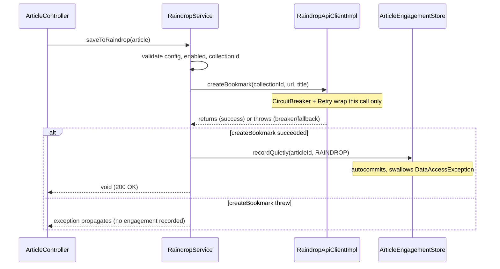

# Raindrop.io Integration

Raindrop.io is a bookmarking service. myfeeder lets a user push a saved `Article` into a chosen Raindrop collection via `POST /api/articles/{id}/raindrop`. This is the only outbound third-party integration currently implemented (Dropbox/Google Drive export is backlog-only — see `docs/backlog.md` and the Quickstart backlog).

## Why the code is split into `RaindropService` + `RaindropApiClientImpl`

This split (commit `2e33949`, "move Raindrop resilience annotations to the API client") exists specifically so that **business validation runs outside the circuit breaker** and only the real HTTP call is wrapped:

- **`RaindropService`** (in `integration/`, but the business-rule layer) looks up the `IntegrationConfig` row for `IntegrationType.RAINDROP`, checks `enabled`, deserializes `RaindropConfig` (which holds the selected `collectionId`), and throws `IllegalStateException` (not configured/disabled, →409) or `IllegalArgumentException` (no collection picked, →400) *before* ever calling the API client. It also exposes `listCollections()`, cached via `@Cacheable("raindrop-collections")` (backed by Redis), so the Settings UI's collection picker doesn't hit Raindrop's API on every render.
- **`RaindropApiClientImpl`** (implements `RaindropApiClient`) owns the actual `RestClient` calls (`listCollections`, `createBookmark`) and carries the `@CircuitBreaker(name = "raindrop")` + `@Retry(name = "raindrop")` annotations. This is a **separate Spring bean** deliberately: Resilience4j's annotations are AOP-proxy-based, so if `RaindropService` called an annotated method on *itself* (self-invocation), the proxy — and the resilience behavior — would be bypassed. Putting the annotated methods on a distinct bean that `RaindropService` calls through avoids that trap.

**Convention for external integrations generally:** follow this same pattern — `@CircuitBreaker`/`@Retry` on the API-client bean, not the service, with business-rule checks happening in the service before the client call. The newer Jev/TypeSafe integration reuses exactly this shape (`JevApiClientImpl` carries `@CircuitBreaker(name = "jev")` + `@Retry(name = "jev")`, its own breaker name and tuning), so Raindrop remains the reference example; see [Jev (TypeSafe) Scoring Integration](jev-typesafe.md) for that integration's details and for the shared Resilience4j mechanics (aspect ordering, `ignore-exceptions`, `application.yaml` config shape) rather than repeating them here.

## The fallback rethrow trap (and why it matters)

Resilience4j's `@CircuitBreaker` fallback method wraps *any* throwable reaching it into a generic 5xx by default. `RaindropApiClientImpl`'s fallback methods (`listCollectionsFallback`, `createBookmarkFallback`) explicitly `instanceof`-check for `RaindropNotConfiguredException` and rethrow it as-is (documented at the call site, commit `86d7008`) — because that exception must reach `GlobalExceptionHandler` and become a 503, not get papered over as a 409 "circuit breaker opened" error. Everything else gets wrapped as `IllegalStateException("Raindrop.io is currently unavailable", throwable)` → 409.

For this rethrow to actually take effect, `RaindropNotConfiguredException` is also listed under `ignore-exceptions` for **both** the circuit breaker and retry instances in `application.yaml` — otherwise a simply-unconfigured token would count as a "failure," open the breaker, and burn retry attempts for no reason:

```yaml
resilience4j:
  circuitbreaker:
    instances:
      raindrop:
        failure-rate-threshold: 50
        wait-duration-in-open-state: 30s
        sliding-window-size: 10
        minimum-number-of-calls: 5
        ignore-exceptions:
          - org.bartram.myfeeder.integration.RaindropNotConfiguredException
  retry:
    instances:
      raindrop:
        max-attempts: 3
        wait-duration: 1s
        exponential-backoff-multiplier: 2
        ignore-exceptions:
          - org.bartram.myfeeder.integration.RaindropNotConfiguredException
```

See [Jev (TypeSafe) Scoring Integration](jev-typesafe.md) for how a second integration tunes this same `ignore-exceptions`/breaker/retry mechanism for a different failure profile (429s, aspect ordering) without re-deriving it from scratch.

## Configuration and secret handling

The Raindrop **API token is a config property, not a DB value**: `myfeeder.raindrop.api-token` binds to env var `MYFEEDER_RAINDROP_API_TOKEN` (see `MyfeederProperties.Raindrop`). `V4__strip_raindrop_api_token.sql` (see [Domain Concepts](../domain/concepts.md)) removed an earlier design where the token lived inside `integration_config.config`'s JSON blob — don't reintroduce that. `RaindropApiClientImpl.requireConfigured()` throws `RaindropNotConfiguredException` whenever the token is blank, which is the trigger for the whole ignore-exceptions/rethrow chain above.

In deployment, the token flows: local env var → `deploy.sh` (`MYFEEDER_RAINDROP_API_TOKEN`, optional — a warning is printed if unset, integration is simply disabled) → Helm `--set secrets.raindropApiToken` → chart secret. See [Operations Runbook](../operations/runbook.md).

## Successful saves also record a RAINDROP engagement

`RaindropService.saveToRaindrop` calls `raindropApiClient.createBookmark(...)` and, only once that call returns without throwing, calls `ArticleEngagementStore.recordQuietly(article.getId(), EngagementKind.RAINDROP)` before logging success. Two placements matter here:

- **Outside the breaker bean**: the engagement write happens in `RaindropService`, after the call into the `@CircuitBreaker`/`@Retry`-annotated `RaindropApiClientImpl` bean has already completed. A circuit-breaker trip, a retry exhaustion, or the not-configured fallback all throw before `saveToRaindrop` reaches the `recordQuietly` call, so a blocked or failed save never records an engagement.
- **Outside any transaction boundary**: `ArticleEngagementStore` opens no transaction — each statement is `INSERT ... ON CONFLICT (article_id, kind) DO NOTHING`, autocommitted on its own — and `recordQuietly` catches `DataAccessException` and logs a WARN (article id, kind, exception class only — never the message) instead of propagating. This means a failed engagement insert can never abort or roll back the user's Raindrop save; the bookmark is still created in Raindrop.io and the HTTP response to the user still succeeds even if the local engagement row never lands.

This mirrors how the other two save-like actions record engagement (STAR on an unstarred→starred `ArticleService.updateState`, BOARD on `BoardService.addArticle`): all three call the same best-effort `recordQuietly` helper outside their own transaction/resilience boundaries, so a bookmarking/starring/board-add action is never reverted by an engagement-write failure.



*What happens around `RaindropService.saveToRaindrop`: the engagement write only runs after a successful bookmark call, and it cannot undo that call if it fails.*

The recorded `RAINDROP` row later feeds the interest-ranking engagement term (`EngagementKind.RAINDROP` contributes at the "save" weight alongside STAR and BOARD, collapsed to one MAX strength per article): see [Interest Ranking Workflow](../workflows/interest-ranking.md) for how `article_engagement` rows are blended into learned topic weights, capped, and surfaced in "Why N?" breakdowns.

## Testing this integration

`RaindropServiceTest` covers the business-rule layer (not-configured/disabled/no-collection paths, cache behavior, and that the engagement write happens only after a successful `createBookmark`). `RaindropApiClientImplTest` covers the HTTP client and the fallback rethrow behavior specifically. See [Testing Guide](../testing/guide.md).
