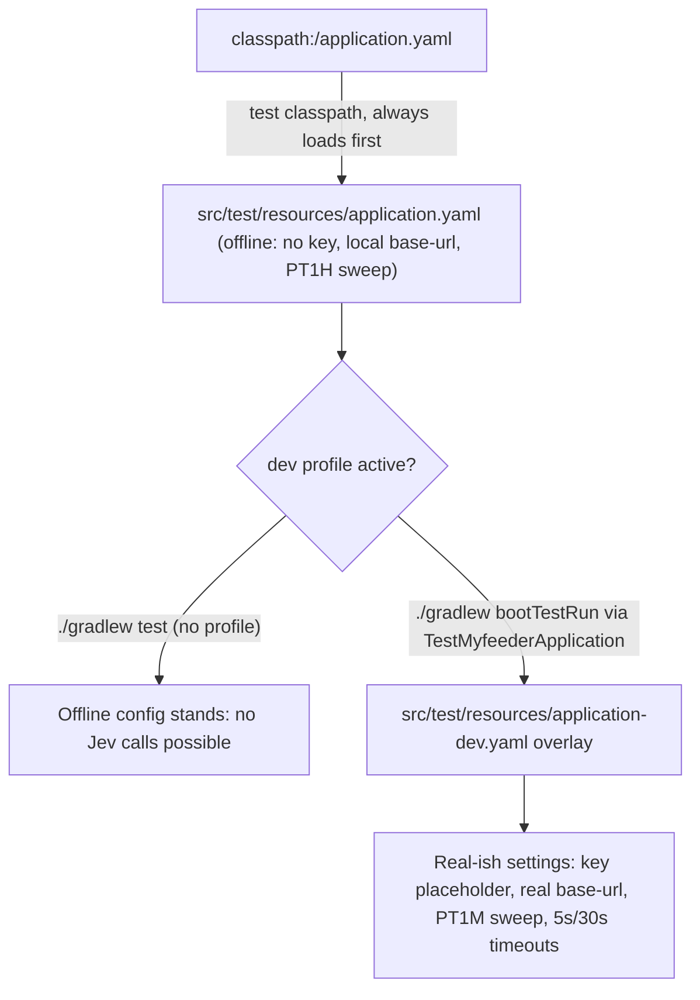

# Testing Guide

## Backend test patterns

| Layer | Pattern | Example |
|---|---|---|
| Service unit tests | Mockito, `@ExtendWith(MockitoExtension.class)`, `@Mock`/`@InjectMocks` | `FeedServiceTest`, `FeedPollingServiceTest`, `ArticleServiceTest`, `RaindropServiceTest`, `InterestServiceTest`, `ArticleScoringServiceTest`, `ArticleFeedbackServiceTest`, `TopicSuggestionServiceTest` |
| Controller tests | `@WebMvcTest` + `MockMvc` + `@MockitoBean` for service deps | `ArticleControllerTest`, `FeedControllerTest`, `BoardControllerTest`, `InterestControllerTest`, `InterestRescoreControllerTest` |
| Repository tests | `@DataJdbcTest` + `@Import(TestcontainersConfiguration.class)` against real Postgres | under [`src/test/java/.../repository/`](repo://src/test/java/org/bartram/myfeeder/repository) |
| Parser tests | Plain unit tests against sample feed files | `FeedParserTest`, samples in `src/test/resources/feeds/` |
| Full integration | `@SpringBootTest` + `@Import(TestcontainersConfiguration.class)`, verifies all beans wire | `MyfeederApplicationTests` |
| API integration tests | `@SpringBootTest(webEnvironment = RANDOM_PORT)`-style, real HTTP + real Postgres, exercise a full vertical slice | `FeedbackApiIntegrationTest`, `PriorityApiIntegrationTest`, `EngagementApiIntegrationTest`, `TopicSuggestionApiIntegrationTest`, `InterestApiIntegrationTest`, `InterestRescoreApiIntegrationTest` |
| Migration tests | See [Migration test pattern](#migration-test-pattern-v4-through-v7) below | `V4StripRaindropApiTokenMigrationTest`, `V6InterestScoringMigrationTest`, `V7EngagementMigrationTest` |

Run all backend tests: `./gradlew test` (requires Docker for Testcontainers). Run one class: `./gradlew test --tests "org.bartram.myfeeder.MyfeederApplicationTests"`.

`src/test/resources/application.yaml` must define `myfeeder.*` properties and a dummy `spring.ai.anthropic.api-key` for the context to load.

### Gotchas specific to backend tests

- **`@WebMvcTest` omits `BuildPropertiesAutoConfiguration`** — the `BuildProperties` bean (used by `VersionController`) is absent in controller-slice tests. Either `@Autowired(required = false)` and handle `null`, or `@Import` a test config exposing a `BuildProperties` bean from a `Properties` literal. The same caveat applies to other actuator/`info.*` auto-configured beans.
- Resilience4j-annotated methods (`RaindropApiClientImpl`, `JevApiClientImpl`) are AOP-proxy-based — testing fallback behavior means going through the proxy, not calling the private fallback method directly; see `RaindropApiClientImplTest` and `JevResilienceTest` for the pattern.
- **`bootTestRun` loads an offline test `application.yaml`, not the real one** — see [bootTestRun / dev-profile gotcha](#boottestrun--dev-profile-gotcha-never-let-gradlew-test-touch-jev) below; this trips up any test author who assumes `./gradlew test` and `./gradlew bootTestRun` see the same config.

### `bootTestRun` / dev-profile gotcha: never let `./gradlew test` touch Jev

`src/test/resources/application.yaml` shadows `src/main/resources/application.yaml` on the test classpath (Spring Boot loads only the first `classpath:/application.yaml` it finds), so both `./gradlew test` and `./gradlew bootTestRun` start from the **test** yaml, not main's. That test yaml is deliberately offline: no TypeSafe API key placeholder, a local Jev `base-url` of `http://127.0.0.1:9`, and a first interest-scoring sweep after `PT1H` (so a slow local run never fires a sweep by accident).

`TestMyfeederApplication` (the entry point `./gradlew bootTestRun` actually runs) activates the `dev` Spring profile via `withAdditionalProfiles("dev")`, so `src/test/resources/application-dev.yaml` layers on top and restores the real-ish settings a developer running the app locally needs: the key placeholder, the real Jev base URL, a `PT1M` first sweep, the 5s/30s HTTP timeouts, the app name, and the Raindrop token placeholder. Plain `./gradlew test` never adds this profile, so every `@SpringBootTest`/`@DataJdbcTest` stays on the offline test yaml.


*How the test classpath's `application.yaml` resolves with and without the `dev` profile overlay.*

`DevProfileConfigTest` is the guard that keeps this split honest:

- `devProfileRestoresLiveMainSettings` / `withoutTheProfileTheSuiteConfigStaysOffline` prove the two states above by running Spring Boot's real `ConfigData` pipeline (no Docker needed).
- `devOverlayResolvesEveryMainKeyToMainsValue` asserts the test yaml plus the dev overlay resolve **every** key in main `application.yaml` to main's literal value (as raw strings, never resolved placeholders), so the dev overlay can't silently drift from main.
- `noTestActivatesTheDevProfile` scans every test source file (except itself and `TestMyfeederApplication`) for any profile-activation token (`withAdditionalProfiles`, `@ActiveProfiles`, `SPRING_PROFILES`, etc.) and fails if one is found — the only test allowed to activate `dev` is `TestMyfeederApplication`'s own entry point.

**Never export `SPRING_AI_TYPESAFE_*` or `SPRING_PROFILES_ACTIVE=dev` in the shell that runs `./gradlew test`** (including via `.envrc`): either would make the suite call the billed Jev API instead of the offline test configuration. `./gradlew bootRun` (Docker Compose) loads main `application.yaml` directly and is unaffected.

### Migration test pattern (V4 through V7)

Flyway runs the full migration chain once at `@DataJdbcTest` startup, so a fresh test database can't naturally "re-run" an old migration against a legacy-shape row. Two sub-patterns exist depending on what the migration does:

- **Data-rewriting migrations** (e.g. `V4__strip_raindrop_api_token.sql`, which mutates existing rows): insert a legacy-shape row via `JdbcTemplate`, then re-execute the migration's SQL statement manually against it, then assert the post-migration shape. `V4StripRaindropApiTokenMigrationTest` is the canonical example — it inserts a `RAINDROP` config row with a leaked `apiToken`, re-runs the `UPDATE ... jsonb_build_object(...)` statement from `V4`, and asserts the token is gone and `collectionId` survives.
- **Pure schema-creation migrations** (e.g. `V6__interest_scoring.sql`, `V7__engagement.sql`, which only `CREATE TABLE`): since Flyway has already applied the migration before the test runs, there's nothing to "re-run" — instead the test asserts the resulting schema's shape, constraints and cascades directly against the already-migrated database (column lists via `information_schema.columns`, CHECK-constraint rejections, `ON DELETE CASCADE` behavior), and separately parses or `grep`s the migration SQL file itself for structural invariants. `V6InterestScoringMigrationTest` covers the six V6 tables (singleton `interest_profile`, weight-bounded `interest_topic`, status/noul-bounded `article_score`/`article_topic_score`, vote-bounded `article_feedback`/`article_feedback_topic`) and their cascades. `V7EngagementMigrationTest` covers `article_engagement`/`topic_suggestion_dismissal`'s columns, enum/CHECK constraints, one-row-per-kind and one-dismissal-per-article uniqueness, and cascade-vs-keep behavior on article/feed/board/topic deletes; its `v7OnlyCreatesTables` test strips comments from `V7__engagement.sql` and asserts every statement is a bare `CREATE TABLE` (no backfill, no index); `namesPassTheReplayWriteKeywordCheck` guards that no engagement enum value or column name accidentally contains a SQL write keyword (reusing the keyword list from `InterestCalibrationReplaySqlTest`); and **`rankingSqlReadsEngagementButNotDismissals` guards that `InterestScoreQueries` and the calibration replay SQL read `article_engagement` but never `topic_suggestion_dismissal`** — that table is read and written only by `TopicSuggestionStore`, and the ranking SQL must never couple to it.

## Interest scoring and engagement test patterns

These tests back the behavior described in [Interest Scoring Workflow](../workflows/interest-scoring.md) and [Engagement and Suggestions Workflow](../workflows/engagement-and-suggestions.md); see also [Jev Scoring Integration](../integrations/jev-scoring.md).

| Area | Tests | What they prove |
|---|---|---|
| Blend/learned ranking SQL | `InterestScoreQueriesTest`, `InterestScoreQueriesEngagementTest`, `InterestScoreQueriesZeroEngagementTest`, `InterestScoreQueriesLatencyTest` | `InterestScoreQueriesTest` is the base suite for score ordering, cursor pagination, badge/breakdown math, and the thumbs-only learned model. `InterestScoreQueriesEngagementTest` adds engagement-specific cases (open vs. save weight, one engaged article counting once, vote-replaces-engagement, forget-restores-engagement). `InterestScoreQueriesZeroEngagementTest` proves cap-0 reproduces the frozen v0.2.1 blend exactly (fixture `src/test/resources/interest/v021-unread-blend.sql`), so turning engagement off is a true no-op. `InterestScoreQueriesLatencyTest` asserts the extended learned CTE stays within 10x baseline + 250ms at ~20k engagement rows. |
| Engagement/thumbs split | `InterestLearnedGridTest` | Proves the exact thumbs-vs-engagement weight split across a 1,456-cell grid of (base, thumbs, engagement) combinations, matching an exact oracle rather than sampled cases. |
| Thumbs feedback | `ArticleFeedbackServiceTest`, `FeedbackApiIntegrationTest` | Vote write/delete rules, narrowed-vote topic picks, `LearnedLimit` precedence (LEARNED_CAP → SIGN_CLAMP → WEIGHT_RANGE → ENGAGEMENT_CAP → NONE), and `engagementReplaced` reporting. `FeedbackApiIntegrationTest` exercises the same rules end-to-end through `PUT`/`DELETE /api/articles/{id}/feedback` and `GET /api/interest/topics/learned`, including `thumbsLearned`/`engagementLearned`/`engagementAtCap` fields. |
| Engagement capture | `ArticleEngagementStoreTest`, `EngagementApiIntegrationTest` | `ArticleEngagementStoreTest` proves `recordQuietly` is idempotent (`ON CONFLICT DO NOTHING`) and swallows failures (logging only the exception class). `EngagementApiIntegrationTest` proves open/star/board/Raindrop capture end-to-end, stickiness across unstar/board-removal/board-delete, cascading deletes, the `neverCallsJev` guard, and that engagement raises ranking without writing weights or calling Jev. |
| Priority / ranking consistency | `PriorityApiIntegrationTest` | `engagedArticleAgreesEverywhereAfterRefresh` proves that after a post-engagement refresh, the Priority list position, the badge, and the "Why N?" breakdown all agree (closing the D-09 stale-position gap documented on `InterestScoreQueries.priorityPageAfter`). |
| Gap discovery (topic suggestions) | `TopicSuggestionStoreTest`, `TopicSuggestionServiceTest`, `TopicSuggestionApiIntegrationTest` | `TopicSuggestionStoreTest` proves the `CANDIDATES` predicate (engaged, SCORED, no vote, no dismissal, best noul below the near-miss threshold, 30-day window keyed on first-per-kind `created_at`) and that `handle(...)` is a single `INSERT ... ON CONFLICT (article_id) DO NOTHING` keeping the first reason. `TopicSuggestionServiceTest` proves ordering (badge ascending, then latest engagement, then id descending) and the 10-item cap with `total`. `TopicSuggestionApiIntegrationTest` exercises the full `/api/interest/suggestions` + dismissal + create-topic-from-suggestion flow, including `aFailedDismissalInsertRollsBackTheTopic` (the topic-create-with-`sourceArticleId` and the dismissal-insert commit or roll back together) and a `neverCallsJev` check run after every test in the class. |
| Engagement calibration replay | `InterestCalibrationReplaySqlTest`, `InterestCalibrationReplayRunTest` | `InterestCalibrationReplaySqlTest` is a drift guard: it asserts `scripts/interest-calibration-replay.sql` copies the app's blend/learned/engaged SQL verbatim (byte-for-byte per named section), rejects invalid engagement constants before connecting, and keeps the backfill simulation isolated to its own CTE. `InterestCalibrationReplayRunTest` is an end-to-end run of the replay script against Testcontainers Postgres through host `psql`, cross-checking its output against live `GET /api/articles/{id}` badges. |
| V7 migration guard | `V7EngagementMigrationTest` | See [Migration test pattern](#migration-test-pattern-v4-through-v7) above — in particular `rankingSqlReadsEngagementButNotDismissals`. |

Run the full interest/engagement slice on its own: `./gradlew test --tests "org.bartram.myfeeder.repository.Interest*" --tests "org.bartram.myfeeder.repository.TopicSuggestion*" --tests "org.bartram.myfeeder.controller.*Api*"` (adjust the pattern as needed; all of these still require Docker for Testcontainers).

## Frontend test patterns

Vitest + React Testing Library. Run: `cd src/main/frontend && npm test`.

Representative tests live next to their source: `ArticleList.test.tsx`, `AppShell.test.tsx`, `MarkOlderReadDialog.test.tsx`, `SettingsDialog.test.tsx`, `InterestsDialog.test.tsx`, `InterestBadge.test.tsx`, `ScoreRow.test.tsx`, `WhyBreakdown.test.tsx`, `TopicRow.test.tsx`, `FeedbackBar.test.tsx`, `FeedbackNotice.test.tsx`, `PriorityBanner.test.tsx`, `PriorityList.test.tsx`, `useKeyboardShortcuts.test.ts`, `useFolders.test.ts`, `useOpml.test.ts`, `useTheme.test.ts`, `useVersion.test.ts`, `useInterest.test.tsx`, `useFeedback.test.ts`, `usePriorityArticles.test.ts`, `useEngagement.test.ts`, `hooks/engagementReaction.test.ts`, `hooks/engagementRefresh.test.ts`, `api/client.test.ts`.

### Gotcha: `vi.mock` of `preferencesStore` is full-replacement

`SettingsDialog.test.tsx` (and similar tests) `vi.mock` the entire `preferencesStore` module. Adding a new export to `preferencesStore` requires updating **every** mock that consumes it, or tests fail with `No "X" export is defined on the mock`. Prefer:

```ts
vi.mock('../stores/preferencesStore', async (importOriginal) => ({
  ...await importOriginal(),
  usePreferences: /* override */,
}))
```

for new tests touching `preferencesStore`, rather than a full manual replacement object.

### Type-checking

Use `npx tsc -b` from `src/main/frontend/` — plain `tsc --noEmit` returns success even with real type errors, because the root `tsconfig.json` has `files: []` and relies on project references (`./tsconfig.app.json`, `./tsconfig.node.json`). `npm run build` already runs `tsc -b && vite build`, so a clean build is also a sufficient type-check.

## What to check when changing each major area

- **Feed lifecycle changes** ([Feed Lifecycle Workflow](../workflows/feed-lifecycle.md)): `FeedPollingSchedulerTest`, `FeedPollingServiceTest`, `FeedServiceTest`, `OpmlImportServiceTest` — the backoff/self-adjusting-interval logic in particular has a history of subtle bugs (`933950e`, `c95abec`) worth re-reading before touching `computeEffectiveInterval` or `pollAndAdjust`.
- **Domain/API changes** ([Domain Concepts](../domain/concepts.md)): the relevant `*ControllerTest` plus `PaginatedResponseTest` if pagination/cursor logic is touched; `ArticleServiceTest` for sort-order/cursor comparison logic.
- **Raindrop changes** ([Raindrop Integration](../integrations/raindrop.md)): `RaindropServiceTest` (business rules) and `RaindropApiClientImplTest` (resilience/fallback behavior) — both must stay green if you touch the ignore-exceptions config in `application.yaml`.
- **Interest scoring changes** ([Interest Scoring Workflow](../workflows/interest-scoring.md), [Jev Scoring Integration](../integrations/jev-scoring.md)): `InterestServiceTest`, `InterestQuestionsTest`, `ArticleStateBuilderTest`, `ArticleScoringServiceTest`/`ArticleScoringFlowTest` (mid-call rubric-version discard), `ScoringQueueTest`/`ScoringIsolationTest` (scoring executor and isolation from the polling thread), `InterestPreviewServiceTest`/`InterestPreviewControllerTest`, `InterestRescoreServiceTest`/`InterestRescoreApiIntegrationTest`, `JevApiClientImplTest`/`JevResilienceTest` (breaker/retry behavior), and the `InterestScoreQueries*` family in the table above for any ranking-SQL change. Any change to the blend/learned constants must keep `DevProfileConfigTest` green and update both main `application.yaml` and, if the value differs from the test yaml, `src/test/resources/application-dev.yaml`.
- **Engagement/suggestions changes** ([Engagement and Suggestions Workflow](../workflows/engagement-and-suggestions.md)): `ArticleEngagementStoreTest`, `EngagementApiIntegrationTest`, `InterestScoreQueriesEngagementTest`/`InterestScoreQueriesZeroEngagementTest`/`InterestScoreQueriesLatencyTest`, `InterestLearnedGridTest`, `TopicSuggestionStoreTest`/`TopicSuggestionServiceTest`/`TopicSuggestionApiIntegrationTest`, `PriorityApiIntegrationTest`, `FeedbackApiIntegrationTest` (engagement interacts with the vote split), and `V7EngagementMigrationTest` if the schema is touched. Never let a change make the ranking SQL or the calibration replay read `topic_suggestion_dismissal` — `V7EngagementMigrationTest.rankingSqlReadsEngagementButNotDismissals` will fail. Tuning the three engagement constants should go through `scripts/interest-calibration-replay.sh`, guarded by `InterestCalibrationReplaySqlTest`/`InterestCalibrationReplayRunTest`.
- **Frontend keyboard/state changes** ([Architecture Overview](../architecture/overview.md)): `useKeyboardShortcuts.test.ts` is the most complex frontend test file — covers chord handling and the current-article resolution fallback.
