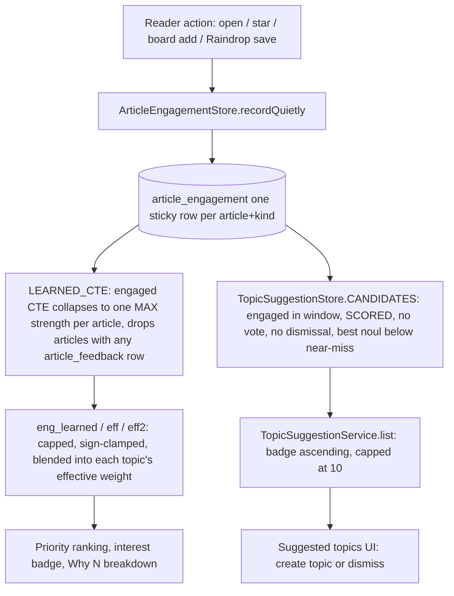

## Overview

Myfeeder derives two different things from the same raw signal — a reader opening, starring,
boarding, or Raindrop-saving an article:

1. **Learned topic weights.** `InterestScoreQueries`'s blend CTEs turn engagement (and thumbs
   votes) into a per-topic nudge on top of each topic's configured base weight, consumed by the
   Priority ranking, the interest badge, and the "Why N?" breakdown.
2. **Topic suggestions (gap discovery).** `TopicSuggestionStore` and `TopicSuggestionService` look
   for engaged, scored articles that matched *no* topic well, surfacing them as "Suggested topics"
   the user can turn into a new topic or dismiss.

Both read the same `article_engagement` table, but apply different predicates and never interact:
voting removes an article from the learned-weight engagement pool but has no bearing on whether it
is a suggestion candidate (suggestions require no vote at all, by construction).

*How one engagement event feeds both the learned-weight blend and the suggestion candidate predicate from the same `article_engagement` source, then diverges.*

## Engagement capture

### Data model and writer

`article_engagement` (migration `V7__engagement.sql`) holds one sticky row per
`(article_id, kind)`, `kind` one of `EngagementKind`'s four values in declaration order —
`OPEN_ORIGINAL, STAR, BOARD, RAINDROP` (the enum order is also the API/display order). The row's
`created_at` is kept for a possible future decay feature but is not currently read by the ranking
CTEs; `TopicSuggestionStore` does read it, as the article's "latest engagement" time.

`ArticleEngagementStore` is the sole writer and reader of this table:

- `record` is an idempotent `INSERT ... ON CONFLICT (article_id, kind) DO NOTHING`, so a repeat of
  the same kind keeps the row's original `created_at`.
- `recordQuietly` wraps `record` in a try/catch over `DataAccessException`, logging only the kind,
  article id, and the exception's simple class name at WARN — never the message or cause — and
  never rethrowing.
- No method here opens a transaction on purpose. Each statement autocommits on its own, so a failed
  engagement insert can never abort the save that triggered it.
- `kinds(articleId)` returns the article's recorded kinds in enum order; `deleteAll(articleId)`
  (Forget) removes every row for the article with no tombstone, so a later open records again.

### The three write paths

Every production write to `article_engagement` goes through `recordQuietly`, from three call
sites, each best-effort and outside any transaction so engagement capture can never fail the user
action that triggered it:

| Call site | Kind | Trigger rule |
|---|---|---|
| `ArticleService.updateState` | `STAR` | Only an unstarred-to-starred transition earns a `STAR` row; unstarring deletes nothing (engagement is sticky — stars, board membership, and thumbs votes all survive the opposite UI action). |
| `BoardService.addArticle` | `BOARD` | Recorded after the save-or-already-present branch: a re-add to a board still credits engagement, but a save that throws records nothing. Two different boards collapse to the same one `BOARD` row (the primary key is `(article_id, kind)`). |
| `RaindropService.saveToRaindrop`, after `createBookmark` returns | `RAINDROP` | Recorded only once the Raindrop API call has succeeded; validation failures and the API client's own failures always throw before this line, so a blocked or failed save records nothing, and a created bookmark can never be mis-reported as an error that would invite a duplicate save. |

`ArticleService.recordOpen` (via `OPEN_ORIGINAL`, called from the `PUT /api/articles/{id}/engagement/open`
endpoint) is the one capture path that uses the throwing `record`, not `recordQuietly` — the request's
whole job is to record that one action, so there is nothing else for a failure to avoid breaking. The
frontend path to it is fire-and-forget (see below), which is where the real "never block the user"
guarantee for opens comes from.

### Cascade and stickiness rules

- `article_engagement.article_id` cascades on article delete (and transitively on feed delete).
- Engagement is sticky: once earned, a kind's row is never removed by the opposite action (unstar,
  board removal). Only `forgetEngagement` (the explicit "Forget" action) deletes a given article's
  rows, and it deletes every kind at once — there is no partial forget.
- A thumbs vote on an article removes that article's contribution to engagement-driven learning
  entirely (see below) without touching the `article_engagement` rows themselves; deleting the vote
  restores the engagement contribution exactly, because it is derived at read time, not stored.

### Open-engagement path and the post-engagement UI reaction

`useOpenOriginal` (frontend) is the single entry point for every "Open Original" affordance (both
ReadingPane buttons and the `o` keyboard shortcut); in-body links and Copy Link never report
engagement. Its sequence matters:

1. `window.open(article.url, '_blank', 'noopener')` runs synchronously inside the user's click or
   keydown, so the new tab keeps user activation and is never delayed by the network call.
2. Only after that, `articlesApi.recordOpen(article.id)` fires a `PUT /api/articles/{id}/engagement/open`.
   This is fire-and-forget: no `useMutation` (the global `MutationCache` would toast its errors), no
   client-side dedupe (every open sends a PUT), and every error — from the PUT or from what follows —
   is swallowed with no toast.
3. Only once the PUT succeeds does `afterEngagement(qc, articleId, onPriority)` run, shared by every
   engagement action (open, star, board add, Raindrop save, Forget) and by the vote hook's own
   `invalidateAfterLearnedChange` call:
   - `invalidateAfterLearnedChange` invalidates `['interest', 'learned']`, `['interest',
     'suggestions']`, and `['articles']`; off the Priority route it also invalidates every other
     loaded by-id article (excluding `['article', n, 'extracted']`), so a vote or engagement
     elsewhere in the app refreshes badges app-wide.
   - `afterEngagement` then refetches the article by id with `staleTime: 0` (the client's 30s
     default would otherwise hand back the stale pre-engagement article).
   - **On the Priority page only**, it compares the refetched `interestScore` against the loaded
     row's score. If they differ, it patches that one row in place via `patchPriorityArticle` and
     sets the "Ranking changed" flag. It never invalidates, resets, or refetches the `['priority']`
     query itself — the list in front of the user never re-sorts out from under a triage session.
     This is the documented D-09 staleness tradeoff: a *different*, unloaded row whose score has
     risen above the visible page between fetches is not surfaced until the user acts on the
     "Ranking changed" hint and refreshes; only the row the user just acted on is guaranteed to be
     current.
   - A failed PUT runs no reaction at all; a failed refetch inside `afterEngagement` is caught and
     silently swallowed, since the user's underlying action already succeeded.

`useForgetEngagement` and the board/star/Raindrop mutations share this same `afterEngagement`
reaction after their own successful API calls, giving every engagement-earning action — and
Forget — identical ranking-refresh behavior.

## Thumbs feedback

`ArticleFeedbackService` (`PUT`/`DELETE /api/articles/{id}/feedback`) stores or removes one
`article_feedback` row per article via `ArticleFeedbackStore`, each call wrapped in a single
`@Transactional` method:

- `vote(articleId, vote, topicIds)`: `vote` must be `1` or `-1`; `topicIds` null means an
  unnarrowed vote (and clears any earlier narrowing), while a non-null list must be non-empty, at
  most `InterestService.MAX_TOPICS` entries, and name only topics the article actually matched
  (duplicates are deduplicated).
- `clear(articleId)`: removes the vote; a no-op when there was none.
- Both route through `applyAndReport`, which looks up the article (404 if missing), reads the
  article's matched topic ids, snapshots each matched topic's `TopicWeight` *before* the write,
  performs the write, snapshots again *after*, and returns a `FeedbackResult` carrying each topic's
  before/after effective weight and its `LearnedLimit`. Because "before" is read through the same
  learned-model query used everywhere else, it already includes whatever engagement contribution
  the vote is about to replace — so the reported delta reflects the actual move, not just the
  thumbs-only part.
- `learnedTopics()` (`GET`, backing the Interests dialog's per-topic breakdown) returns every
  topic's base/learned/effective weight and limit from the same model, with no transaction and no
  write.

## The learned model: blending engagement and thumbs votes

`InterestScoreQueries.LEARNED_CTE` is the single source of truth for every topic's adjusted
weight, shared by the Priority sort, the interest badge, the "Why N?" breakdown, and
`ArticleFeedbackService.learnedTopics()`. It is read-only and never calls Jev. Its stages:

1. **`learned`** — sums `vote * max(0, (noul - 0.5) * 2)` per topic over `article_feedback` rows
   joined to SCORED articles, honoring `topics_narrowed`/`article_feedback_topic` picks: a narrowed
   vote only contributes to the topics it picked.
2. **`engaged`** — collapses `article_engagement` to one `MAX(strength)` row per article *before*
   any topic join, where `strength` is `:engagementOpenWeight` for an `OPEN_ORIGINAL` row and
   `:engagementSaveWeight` for any other kind (star, board, Raindrop). This is why multiple
   engagement kinds on one article never stack: a save beats an open, and each article counts
   exactly once. The `WHERE NOT EXISTS (... article_feedback ...)` clause drops every article that
   has *any* thumbs vote — the vote fully replaces the article's engagement contribution on every
   topic it matched, article-wide, not just the topics the vote named.
3. **`eng_learned`** — sums `strength * hinge` per topic over the `engaged` set joined to SCORED
   articles only, with no age or read-state window at all (unlike the scoring eligibility window
   used elsewhere).
4. **`eff`** — scales the thumbs sum by `:learnRate` and clamps it to `±:learnedCap`
   (`learned_raw` / `learned`); separately scales the engagement sum the same way and clamps it to
   `[0, :engagementCap]` (`eng_raw` / `eng`), with a zero floor so a negative engagement cap can
   never happen and a cap of `0` fully disables engagement learning regardless of the weight
   constants. Both the thumbs and engagement adjustments are forced to `0` for any topic whose
   stored base weight is negative.
5. **`eff2`** — applies one sign clamp plus the `±50` weight range, once, over the whole sum:
   `w_thumbs` is `base + learned` (the thumbs-only effective weight, exposed separately for the
   `engagementReplaced` comparison below), and `w` is `base + learned + eng` (the full effective
   weight actually used for ranking and the badge).

`TopicWeight` exposes `base`, `learnedRaw` (uncapped thumbs points), `learned` (capped thumbs +
capped engagement, pre-clamp — the sum `LearnedLimit` judges), `effective` (the clamped `base +
learned`), plus the split fields `thumbsLearned`, `engagementRaw`, `engagementLearned`, and
`thumbsEffective` (`w_thumbs`). Every value is rounded to 6 decimals, and the split fields are
computed by subtracting already-rounded values, so `baseWeight + thumbsWeight + engagementWeight =
weight` holds exactly rather than approximately.

### `LearnedLimit.of` precedence

`LearnedLimit` explains *why* a topic's weight didn't move as far as the nominal nudge would
suggest, judged in this fixed order over the 6-decimal `TopicWeight` values:

1. **`LEARNED_CAP`** — the uncapped thumbs points already reach `±learnedCap` (`|learnedRaw| >=
   learnedCap`; exactly the cap counts).
2. **`SIGN_CLAMP`** — `base + learned` would cross zero, so the effective weight is held at `0`
   (landing exactly on `0` is not itself a clamp).
3. **`WEIGHT_RANGE`** — `|base + learned|` would exceed `InterestService.MAX_WEIGHT` (50; exactly
   50 is not a clamp).
4. **`ENGAGEMENT_CAP`** — reported only when none of the above bind, and the uncapped engagement
   points reach the engagement cap (`engagementAtCap`: `engagementCap > 0 && engagementRaw >=
   engagementCap`). A cap of `0` disables engagement entirely, so this can never fire, and a
   negative-base topic's `engagementRaw` is always `0` in SQL, so it can never reach the cap either.
5. **`NONE`** — otherwise.

`ArticleFeedbackService.applyAndReport` additionally computes an `engagementReplaced` flag per
topic: true when both `engagementLearned` and `learnedRaw` differ (beyond float rounding noise)
between the before/after snapshots — i.e., this specific vote write both consumed the topic's
engagement contribution and changed the thumbs contribution. The frontend's `effectNote` (in
`utils/feedback.ts`) uses this for wording: a binding `LEARNED_CAP`/`SIGN_CLAMP`/`WEIGHT_RANGE`
note always wins over `engagementReplaced`; `ENGAGEMENT_CAP` is never worded in the toast; otherwise,
if `engagementReplaced` is set, the toast says "(replaces engagement)" for a new vote or
"(engagement restored)" for a vote removal; failing all of that, a topic with a negative base gets a
"(now …)" note so a softening 👍 on a disliked topic still reads as still-buried.

## Engagement tuning constants

`MyfeederProperties.Interest.Blend.Engagement` (bound under `myfeeder.interest.blend.engagement`)
holds three calibrated constants, validated at startup via `MyfeederProperties implements
Validator`:

- `openWeight` (default `0.25`) — strength of an `OPEN_ORIGINAL` engagement, as a fraction of one
  thumbs vote.
- `saveWeight` (default `0.5`) — strength of any save kind (`STAR`, `BOARD`, `RAINDROP`), as a
  fraction of one vote.
- `cap` (default `8`) — bound on the engagement points one topic can gain; `0` disables engagement
  learning entirely, whatever the weights are.

`Engagement.isValid(learnedCap)` enforces: `cap == 0`, **or** `0 <= openWeight < saveWeight < 1 &&
0 < cap < learnedCap`. A violation fails application startup with the fixed, value-free message
`MyfeederProperties.ENGAGEMENT_INVALID` — the refusal text never echoes the submitted numbers.
`Interest.Suggestions.nearMiss` (see below) is validated the same way, with its own fixed message.

Calibrated values live in exactly two files: the main `src/main/resources/application.yaml` and
`src/test/resources/application-dev.yaml` (the dev-profile overlay that restores main's live
values when running the test classpath locally). They are never set through a Helm `--set` or a
Kubernetes environment override — calibration is a committed configuration change, not a runtime
lever. `src/test/resources/application.yaml` deliberately keeps its own fixed, pre-calibration
constants, because several integration tests assert against those exact numbers.

`scripts/interest-calibration-replay.sh` is the tool for proposing new values: it replays the
Priority blend's math against production data to compare candidate constants, entirely read-only
(every `psql` session runs with `default_transaction_read_only=on`), validating each candidate
against the same `isValid` rule before connecting. See
[Operations Runbook](../operations/runbook.md#engagementinterest-calibration-replay) for the
command-line usage, data-floor/nudge decision rules, and where to record a calibration outcome —
this page documents only why the constants and the learned model exist, not the replay procedure.

## Gap discovery: topic suggestions

### Candidate predicate

`TopicSuggestionStore.CANDIDATES` selects every article that is:

- Present in `article_engagement` with **any** kind, grouped so only its latest `created_at`
  (`MAX(g.created_at)`) across all its kinds matters — re-opening an already-engaged article does
  not refresh its suggestion window, but earning a *new* kind of engagement (e.g. starring an
  article already opened) does advance it, because that kind's own first `created_at` is more
  recent.
- Joined to a SCORED `article_score` row (unscored, `FAILED`, or `SKIPPED` articles never
  qualify).
- **Not** present in `article_feedback` at all (`NOT EXISTS`) — any vote, up or down, narrowed or
  not, removes an article from suggestion candidacy permanently (until the vote is cleared).
- **Not** present in `topic_suggestion_dismissal` (`NOT EXISTS`) — a dismissed or
  already-topic-created article never resurfaces.
- Scored, across every one of its topic rows regardless of that topic's weight sign, with a best
  `noul` **strictly below** `:nearMiss` (`myfeeder.interest.suggestions.near-miss`, default `0.35`,
  validated `0 < nearMiss <= 0.5`). An article matching no topic at all has a best `noul` of `0`
  (via `COALESCE(..., 0)`), which always clears the threshold. This near-miss exclusion is what
  keeps a topic the user is already close to defining from being suggested again under a near-
  duplicate name.
- Having its latest engagement strictly inside the lookback window: `TopicSuggestionService`
  passes `Instant.now().minus(WINDOW_DAYS)` (30 days) as the `cutoff`, and the `HAVING MAX(...) >
  :cutoff` clause excludes anything older.

`TopicSuggestionStore` is also the only class that reads `topic_suggestion_dismissal` at all — the
ranking SQL in `InterestScoreQueries` never does, and a dedicated migration test guards that
separation so the two concerns (ranking vs. suggestion gating) cannot accidentally merge.

### Ordering and cap

`TopicSuggestionService.list()` runs the candidate query, looks up each candidate's badge via
`InterestScoreQueries.displayScores` (the identical badge computation used everywhere else — since
every suggestion's best `noul` is below 0.5, its badge is necessarily the profile contribution
alone, with no topic contribution), drops any candidate whose SCORED row vanished before the badge
lookup completed (dropped, not counted), then sorts by:

1. Badge ascending ("surprise" order — the least-expected-interesting articles the reader still
   engaged with surface first).
2. Latest engagement, most recent first.
3. Article id descending.

The first `MAX_SUGGESTIONS` (10) rows are returned as `items`; the full qualifying count (after the
badge-dropped filter, before the 10-row cap) is returned as `total`, which the UI shows as "(10 of
N)".

### Dismiss / create-topic lifecycle

Both lifecycle endpoints write into the same `topic_suggestion_dismissal` table through
`TopicSuggestionStore.handle(articleId, reason)`, an `INSERT ... ON CONFLICT (article_id) DO
NOTHING`:

- **`DISMISSED`** — `TopicSuggestionService.dismiss(articleId)` (reached from `PUT
  /api/interest/suggestions/{articleId}/dismissal`) 404s for a missing article, otherwise calls
  `handle` with `DISMISSED`. This is immediate and permanent: there is no un-dismiss endpoint or UI
  affordance. A repeat dismiss is a no-op that keeps whichever reason was recorded first.
- **`TOPIC_CREATED`** — `InterestService.createTopic(..., sourceArticleId)` is `@Transactional`:
  when `sourceArticleId` is non-null, the new `interest_topic` row and the `TOPIC_CREATED`
  dismissal row are written **in the same transaction**, so a topic is never saved without its
  suggestion being hidden (and vice versa — if the dismissal insert were to fail, the whole
  transaction, topic included, rolls back). `handle` itself opens no transaction of its own, so
  inside `createTopic` it simply joins that method's existing transaction. A `sourceArticleId`
  naming a since-deleted article inserts nothing and never throws (the `INSERT ... SELECT ... FROM
  article WHERE id = :articleId` silently matches zero rows), so a stale suggestion id can never
  block a topic save. The topic-count cap (25) and field validation are checked before any write,
  so a 400 from either leaves no partial state.

Deleting a topic later does **not** resurrect the suggestion it was created from — the dismissal
row has no foreign key to `interest_topic` and is never touched by a topic delete.

`SuggestionDismissalReason` is a two-value enum (`DISMISSED`, `TOPIC_CREATED`) whose names are
exactly the V7 migration's `topic_suggestion_dismissal.reason` CHECK constraint values.

### Refresh triggers

The frontend's `['interest', 'suggestions']` query (`useTopicSuggestions`, `staleTime: 0`) is
invalidated by `invalidateAfterLearnedChange` — i.e., by every engagement action and every vote —
and refetched fresh on every Interests-dialog open, so an article engaged with since the dialog was
last opened can appear, and an article just voted on or dismissed disappears, without a page
reload.

## Divergence between the two consumers

Although both the learned-weight blend and the suggestion predicate start from
`article_engagement`, they diverge in several ways worth keeping distinct:

- The blend's `engaged` CTE drops an article the instant it has *any* vote, because the vote
  replaces engagement's contribution; the suggestion predicate excludes voted articles too, but for
  the opposite conceptual reason — a vote means the user already has an explicit, stronger signal,
  so there's nothing left to "discover."
- The blend only ever nudges a topic the article already matched above the hinge threshold (`noul >
  0.5`); the suggestion predicate specifically looks for articles that *failed* to clear a much
  higher bar (`noul < nearMiss`, well below 0.5) on every topic — it is explicitly hunting for gaps
  in topic coverage, not reinforcing existing topics.
- The blend has no age or read-state window on engagement at all; suggestions apply a fixed
  30-day rolling window on the latest engagement.
- The blend is engine behind ranking (Priority order, badge, "Why N?") — it is read on effectively
  every list and detail request. The suggestion predicate is read only when the Interests dialog's
  "Suggested topics" section is open, and never feeds back into ranking.

## Related pages

- [Interest Scoring Workflow](interest-scoring.md) — the full scoring pipeline (profile match,
  Jev judging, the blend CTE's raw-score math) that `InterestScoreQueries` is part of.
- [Jev Scoring Integration](../integrations/jev-scoring.md) — HTTP resilience, retries, and the
  scoring executor; neither engagement capture nor suggestions ever call Jev.
- [Raindrop Integration](../integrations/raindrop.md) — the Raindrop API client and config that
  `RaindropService.saveToRaindrop` wraps before recording the `RAINDROP` engagement kind.
- [Operations Runbook](../operations/runbook.md) — the calibration replay script's operational
  procedure, data-floor and nudge decision rules, and where tuned constants get committed.
- [Domain Concepts](../domain/concepts.md) — shared vocabulary (topics, weights, badges, noul).
- [Testing Guide](../testing/guide.md) — test layering conventions referenced by the
  engagement/feedback/suggestion test suites cited above.
