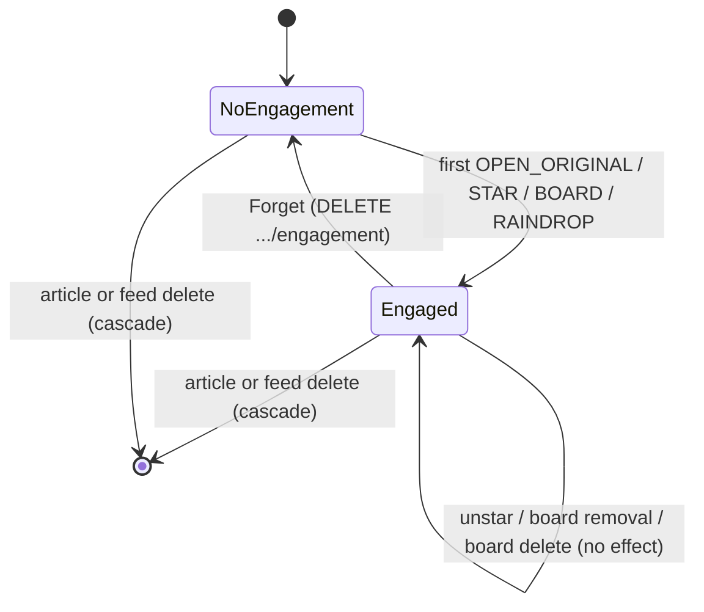
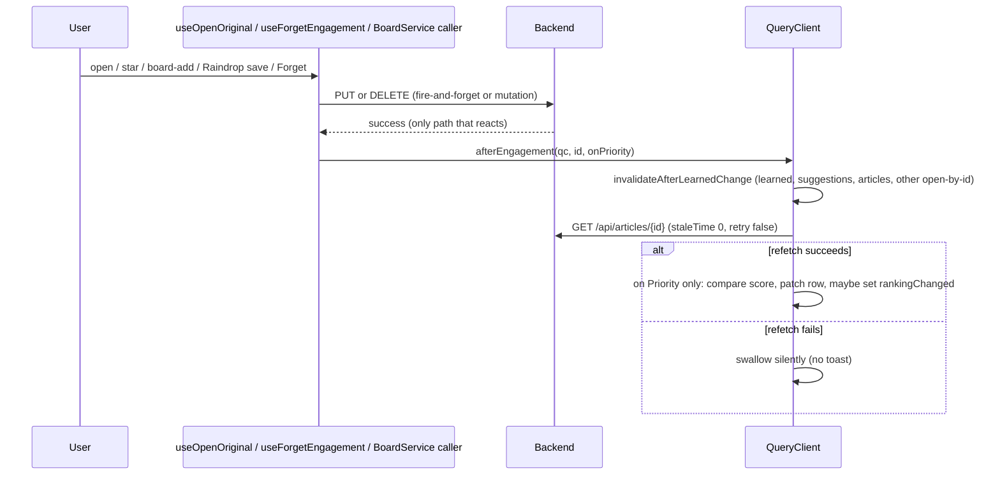

# Engagement Capture & Post-Engagement Reactions

Engagement capture (v0.3.0) records that a user *acted on* an article — opened its original
link, starred it, added it to a board, or saved it to Raindrop.io — as a durable signal distinct
from an explicit thumbs vote. The recorded rows are read by the learned-weight blend described in
the [Interest Scoring workflow](interest-scoring.md); this page covers only what counts as
engagement, where each kind is recorded, its lifecycle, and the frontend contract that reacts to a
successful engagement. It intentionally does not re-derive the scoring SQL.

## The four engagement kinds

`EngagementKind` is a closed enum whose declaration order is also the API and display order:

```java
public enum EngagementKind {
    OPEN_ORIGINAL, STAR, BOARD, RAINDROP
}
```

Each kind is recorded at exactly one point in the backend, always *after* the user's own write has
already succeeded:

| Kind | Recorded by | Trigger |
|---|---|---|
| `OPEN_ORIGINAL` | `ArticleService.recordOpen` | Every Open Original entry point (`useOpenOriginal`, both ReadingPane buttons and the `o` key) fires a fire-and-forget `PUT /api/articles/{id}/engagement/open` after the original tab is already open |
| `STAR` | `ArticleService.updateState` | Only an unstarred→starred transition; unstarring records nothing |
| `BOARD` | `BoardService.addArticle` | Any board add (any board, Read Later, the `b` key); a re-add of an article already on that board still credits the engagement |
| `RAINDROP` | `RaindropService.saveToRaindrop` | Right after `raindropApiClient.createBookmark(...)` returns normally |

### `OPEN_ORIGINAL`: fire-and-forget from the client

`useOpenOriginal` (`hooks/useEngagement.ts`) opens the original URL in a new tab synchronously
inside the user's click or keydown — so the popup keeps user activation — and only afterwards
issues the `PUT`. The request never blocks, delays or cancels the tab opening. It deliberately
avoids `useMutation` (the global `MutationCache` would toast any error) and performs no
client-side dedupe, so every open sends a `PUT`; the server makes it idempotent (below). Every
error — from the `PUT` or from the subsequent reaction — is swallowed silently; a failed `PUT`
runs no reaction at all, and in-body links and Copy Link never call this hook, so they are never
captured as engagement.

`ArticleService.recordOpen` 404s on a missing article and otherwise calls
`ArticleEngagementStore.record`, which is a plain idempotent `INSERT ... ON CONFLICT DO NOTHING`:
a repeated open keeps the first row's timestamp. A database failure here propagates as a 5xx
(not swallowed) because there is no underlying "real" write to protect — recording *is* the
request — but the fire-and-forget client ignores it regardless.

### `STAR`, `BOARD`, `RAINDROP`: best-effort, after a write that must not fail

The other three kinds are recorded from inside a service method whose primary job is something
else (saving a star, adding a board membership, calling the Raindrop API), so they go through
`ArticleEngagementStore.recordQuietly` instead of `record`:

- `ArticleService.updateState` persists the star/read change via `articleRepository.save(article)`
  first, and only afterwards — best-effort, outside any transaction — calls
  `recordQuietly(id, STAR)` when the article was newly starred (`!article.isStarred()` before the
  change).
- `BoardService.addArticle` inserts the `BoardArticle` row when it doesn't already exist, then
  unconditionally calls `recordQuietly(articleId, BOARD)` — so a re-add still credits the
  engagement even though no new membership row is created.
- `RaindropService.saveToRaindrop` calls `recordQuietly(article.getId(), RAINDROP)` immediately
  after `raindropApiClient.createBookmark(...)` returns normally, and before the success log line.
  This call sits in `RaindropService` itself, **outside** the `@CircuitBreaker`/`@Retry`-annotated
  `RaindropApiClientImpl` bean — see the [Raindrop.io integration](../integrations/raindrop.md) for
  why that split exists. Validation errors and a thrown (or breaker-short-circuited) bookmark call
  both skip the `recordQuietly` call entirely, so a failed or blocked save records nothing, and a
  created bookmark is never later reported as an error that could invite a duplicate save.

### `ArticleEngagementStore.recordQuietly`: why it must never abort the caller's write

```java
public void recordQuietly(long articleId, EngagementKind kind) {
    try {
        record(articleId, kind);
    } catch (DataAccessException e) {
        log.warn("Engagement {} not recorded for article {}: {}", kind, articleId, e.getClass().getSimpleName());
    }
}
```

`record` itself is the same idempotent `INSERT ... ON CONFLICT (article_id, kind) DO NOTHING` used
by `recordOpen`. `recordQuietly` wraps it in a `catch (DataAccessException)` that logs at WARN —
kind, article id and only the exception's simple class name, never its message or cause — and
otherwise does nothing: it never rethrows and never returns a value the caller could branch on.

This matters because none of `ArticleService.updateState`, `BoardService.addArticle` or
`RaindropService.saveToRaindrop` opens a transaction around the engagement insert, and
`ArticleEngagementStore` itself opens no transaction on purpose: every statement autocommits on
its own. The user's star, board-add or Raindrop save is the request that actually matters to them;
a lost or momentarily-unavailable engagement row is an acceptable loss, but failing (or rolling
back) the star, the board membership, or reporting a successful bookmark save as an error is not.
Coupling the engagement insert to the same transaction as the primary write — or letting its
exception propagate — would mean a flaky engagement insert could abort a save the user believes
already succeeded.

## Storage and lifecycle (`article_engagement`)

```sql
CREATE TABLE article_engagement (
    article_id BIGINT NOT NULL REFERENCES article(id) ON DELETE CASCADE,
    kind TEXT NOT NULL CHECK (kind IN ('OPEN_ORIGINAL', 'STAR', 'BOARD', 'RAINDROP')),
    created_at TIMESTAMPTZ NOT NULL DEFAULT NOW(),
    PRIMARY KEY (article_id, kind)
);
```

One sticky row per `(article_id, kind)`, introduced by `V7__engagement.sql` with no backfill. The
`created_at` column is kept so time-based decay of the signal stays possible later, even though
nothing currently reads it that way. Lifecycle rules:

- **Sticky, not an undo mirror.** Engagement survives actions that look like "the opposite" of
  what earned it: unstarring an article, removing it from a board, or deleting the board it was
  added through all leave the `article_engagement` row untouched. `ArticleService.forgetEngagement`
  is explicit that it "is not an undo of the save" — stars, board memberships and the thumbs vote
  stay intact regardless of what happens to engagement.
- **Cascades with the article.** The foreign key is `ON DELETE CASCADE`, so deleting an article —
  or deleting a feed whose articles cascade-delete — removes its engagement rows along with it.
  No separate cleanup job is needed.
- **`Forget` is the only deliberate removal path.** `DELETE /api/articles/{id}/engagement`
  (`ArticleService.forgetEngagement` → `ArticleEngagementStore.deleteAll`) deletes every engagement
  kind recorded for the article at once. There is no per-kind forget, no tombstone, no confirm
  dialog and no undo: a later open, star, board-add or Raindrop save simply records again from
  scratch. The only UI entry point is the **Forget** button in `ScoreRow`'s "Engaged: ..." line.



## The `ScoreRow` UI: display and `Forget`

`ScoreRow` renders under the article title whenever the article is scored, engaged, or both; it
renders nothing for an unscored, unengaged article. The engaged half reads
`Engaged: <kinds>, ... · Forget`, listing the recorded kinds in the same server (enum declaration)
order via a fixed label map:

```ts
const ENGAGEMENT_LABEL: Record<EngagementKind, string> = {
  OPEN_ORIGINAL: 'opened',
  STAR: 'starred',
  BOARD: 'on a board',
  RAINDROP: 'saved to Raindrop',
}
```

The **Forget** button calls `useForgetEngagement()`, a `useMutation` wrapping
`articlesApi.forgetEngagement(id)` (`DELETE /api/articles/{id}/engagement`). There is no confirm
step and no success toast; a failure falls through to the global `MutationCache` error toast and
runs no reaction. On success, `onSuccess` fires `afterEngagement` (below), so the Engaged line
disappears once the article is refetched.

`findByIdWithBreakdown` (the only query backing `GET /api/articles/{id}` and the feedback
responses) attaches the engagement kinds via `ArticleEngagementStore.kinds`, which returns them
sorted into enum order; list endpoints never carry engagement, matching how they never carry the
thumbs vote either.

## The shared frontend reaction contract: `afterEngagement`

Every successful engagement action — open, star, board add, Raindrop save, and Forget — funnels
through one shared function, `afterEngagement(qc, id, onPriority)` in
`hooks/engagementReaction.ts`, called only after the triggering action has already succeeded.
`useVoteFeedback` (the thumbs-vote hook) shares the same refresh set via
`invalidateAfterLearnedChange`, so engagement and voting behave consistently, but a vote is not
itself an engagement action.



`afterEngagement` does two things in sequence:

1. **`invalidateAfterLearnedChange(qc, id, onPriority)`** invalidates `['interest', 'learned']`,
   `['interest', 'suggestions']` and `['articles']` unconditionally. When the acted-on article is
   *not* the one open on the Priority view (`!onPriority`), it also invalidates every other loaded
   `['article', otherId]` query — i.e., every other article open by id, so their badges and "Why
   N?" breakdowns stay correct if they share a topic with the engaged article. It never invalidates
   `['priority']` itself: the Priority list query is never reset or refetched by an engagement
   reaction, so the list being triaged never re-sorts out from under the user.
2. **Refetch the engaged article by id** with `staleTime: 0` and `retry: false` (one GET per
   action), because the query client's normal 30s default staleness would otherwise hand back the
   pre-engagement article. This refetch is what makes the reading pane's badge, "Why N?" and
   `ScoreRow`'s Engaged line update.

If, and only if, the acted-on article is the one open on the Priority view (`onPriority`):
a pending vote mutation on the same article (checked via `qc.isMutating({ mutationKey:
['feedback'], ... })`) short-circuits the comparison, because the vote's own response will patch
the row more authoritatively. Otherwise, the refetched `interestScore` is compared against the
score currently loaded in the Priority row (`priorityRowScore`); if they differ,
`patchPriorityArticle(qc, id, { interestScore: score })` patches that single row in place and
`usePriorityStore.getState().setRankingChanged(true)` lights the "Ranking changed" hint. The
Priority list's query cache (`['priority']`) is touched only through this in-place patch — never
invalidated, reset, or refetched — so the triaged list keeps its current order and page state; the
user decides when to accept a re-sort via the "Ranking changed" affordance.

`afterEngagement` **never rejects**: the whole body after the invalidations runs in a `try/catch`
that swallows any error from the refetch (or from `qc.query`) with no toast, because the
triggering action already succeeded and a background refresh failing is not something the user
needs to react to. Callers `void` the returned promise inside a plain block body rather than
returning it from a mutation's `onSuccess`, which would otherwise keep the mutation "pending" until
the background GET finished.

`afterEngagement` never runs for actions that are not engagement: unstarring, removing an article
from a board, and read/unread toggles (`useArticles`'s state mutation patches the Priority row
directly via `patchPriorityArticle`, bypassing `afterEngagement` entirely) never trigger a
reaction, consistent with none of those being recorded as engagement on the backend either.

## What is *not* captured as engagement

The following user actions are deliberately **not** recorded as engagement, even though some of
them resemble "the user looked at this article":

- In-body links clicked inside rendered article content
- Copy Link
- Text selection
- Reader view
- Auto-mark-read (scroll/view-based automatic read marking)
- Bulk mark-read (`PUT /api/articles/mark-read` by ids, feed, or age cutoff)
- OPML import
- Feed polling/fetching

Only the four explicit actions in the table above — opening the original link via the dedicated
entry points, starring, adding to a board, and saving to Raindrop — ever reach
`ArticleEngagementStore`.

## How engagement feeds scoring

`InterestScoreQueries`' learned-weight CTE reads `article_engagement` as a capped,
thumbs-overridable up-vote on the topics an engaged, SCORED article matched: each article
contributes at most one `MAX`-collapsed strength (a save outweighs an open, each article counts
once), any article with a thumbs vote is excluded entirely (the vote replaces the engagement
signal; removing the vote restores it), and the aggregated contribution is capped before being
blended into each topic's effective weight. See the
[Interest Scoring workflow](interest-scoring.md) for the full blend, the engagement/open weight
constants, and how gap discovery (topic suggestions) separately reads the same table. This page
does not re-derive that SQL.

## Related pages

- [Interest Scoring workflow](interest-scoring.md) — the learned-weight blend and gap discovery
  that consume `article_engagement`
- [Raindrop.io integration](../integrations/raindrop.md) — where the `RAINDROP` engagement call
  sits relative to the circuit breaker and retry-annotated client bean
- [Domain Concepts](../domain/concepts.md) — `Article`, `Board`, and related domain model entities
- [Architecture Overview](../architecture/overview.md) — how services, repositories and the React
  Query frontend fit together more broadly
