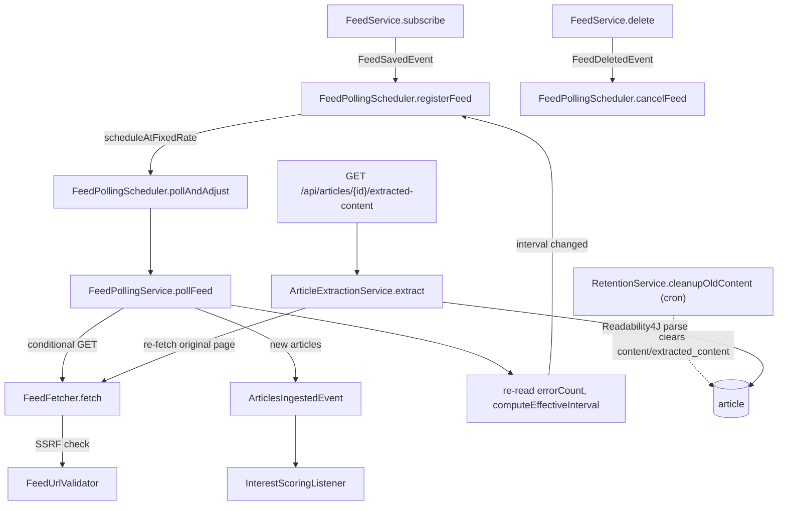

# Feed Lifecycle Workflow

This is the core business process of myfeeder: get new articles from subscribed feeds into the database reliably, without hammering slow or broken feeds, and make full article text available on demand for feeds that only ship a snippet. New articles produced here feed directly into interest scoring — see [Interest Ranking Workflow](../workflows/interest-ranking.md) for the next stage.



## 1. Subscribe

`FeedService.subscribe(feedUrl, folderId)`:
1. Calls `FeedFetcher.fetch(url)` — an **unconditional** GET (see [Architecture Overview](../architecture/overview.md) on `FeedFetcher` being the single fetch path).
2. Parses the response with `FeedParser` (ROME for RSS/Atom, Jackson for JSON Feed) into a `ParsedFeed`. `FeedParser.parse` throws `FeedParseException` (→422) if the result has no title and no articles — this guards against "200 OK with garbage" responses that would otherwise violate the `feed.title NOT NULL` constraint.
3. Saves a new `Feed` row with `pollIntervalMinutes` from `myfeeder.polling.default-interval-minutes`.
4. Publishes `FeedSavedEvent(saved)` via `ApplicationEventPublisher` — this is what actually schedules polling (see step 2). `FeedService.update` publishes the same event after a title/interval edit, so an interval change takes effect immediately through the same re-registration path rather than a separate code path.

`OpmlImportService.importOpml` follows the same "create feed → publish `FeedSavedEvent`" pattern per new feed when bulk-importing an OPML file (existing feeds by URL are updated in place, not re-published).

## 2. Event-driven scheduling

**Never call `FeedPollingScheduler.registerFeed`/`cancelFeed` directly from new feed-mutating code.** Publish `FeedSavedEvent` or `FeedDeletedEvent` instead — this decouples the scheduler from the services that mutate feeds.

`FeedPollingScheduler` listens with:
```java
@TransactionalEventListener(phase = TransactionPhase.AFTER_COMMIT, fallbackExecution = true)
```
on both `onFeedSaved`/`onFeedDeleted`. `AFTER_COMMIT` ensures the scheduler only reacts once the feed row is actually durable; `fallbackExecution = true` makes it still fire in non-transactional contexts (e.g. tests without a transaction). On app startup, `onStartup()` (`@EventListener(ApplicationReadyEvent.class)`) registers every existing feed.

`registerFeed` computes an **effective interval** (see backoff below) and schedules `pollAndAdjust` via `TaskScheduler.scheduleAtFixedRate`.

## 3. Poll + dedup

`FeedPollingService.pollFeed(feedId)`:
1. Conditional fetch via `FeedFetcher.fetch(url, etag, lastModifiedHeader)` — sends `If-None-Match`/`If-Modified-Since`. A 304 short-circuits (just updates `lastPolledAt`).
2. On 200, re-parses and **dedups articles by `(feed_id, guid)`** using `articleRepository.existsByFeedIdAndGuid` before inserting — this is the mechanism that prevents duplicate articles across polls.
3. On success: `errorCount` resets to 0, `lastError` cleared, `lastSuccessfulPollAt` updated, and any newly inserted article ids are published as `ArticlesIngestedEvent(feedId, newIds)` (skipped entirely when there are no new articles).
4. On any exception: `errorCount` increments and `lastError` is recorded, but the exception is swallowed (logged, not rethrown) — a single bad poll never crashes the scheduler thread.

### Ingestion hands off to interest scoring

`FeedPollingService.publishIngested` runs the `ArticlesIngestedEvent` publish in its own try/catch, *after* the success bookkeeping (`errorCount`/`lastError`/`lastSuccessfulPollAt`) is already saved — `pollFeed` has no transaction, so a scoring-side failure here must never be mistaken for a poll failure. `InterestScoringListener` consumes the event with `@TransactionalEventListener(AFTER_COMMIT, fallbackExecution = true)`, checks `JevApiClient.isConfigured()`, and enqueues the new ids onto `ScoringQueue` (`submitIngested`) — it never scores inline and never throws back into the caller. See [Interest Ranking Workflow](../workflows/interest-ranking.md) for what happens to an article after it's enqueued (the scoring sweep, Jev judging, and blend).

## 4. Backoff — the interval self-adjusts after every poll

After `pollFeed` returns (success or failure), `FeedPollingScheduler.pollAndAdjust` **re-reads the feed's current error state from the DB** and recomputes the effective interval via `computeEffectiveInterval`:

- If `errorCount >= backoffThreshold` (default 5), the interval is `pollIntervalMinutes * 2^(errorCount / backoffThreshold)` (exponent capped at 30 and the multiplication done in `long` arithmetic so a heavily-failing feed can't overflow into a negative `Duration`, which would make `scheduleAtFixedRate` throw and crash startup), capped at `maxIntervalMinutes` (default 1440 = 24h).
- Otherwise, the interval is just the feed's configured `pollIntervalMinutes`.

If the desired interval differs from the currently scheduled one, the task is cancelled and replaced with a new `scheduleAtFixedRate` starting one full interval from now. This means backoff **engages progressively** as a feed keeps failing, and **clears immediately** once it succeeds again — without ever needing an external cron sweep. The interval re-evaluation itself is wrapped in a try/catch that logs a warning and keeps the current schedule on failure, so a transient DB blip during re-evaluation can't silently unschedule a feed.

There's an inherent, accepted race: a concurrent external `registerFeed`/`cancelFeed` (e.g. the user edits the feed at the same moment a poll completes) could in theory conflict with this self-replacement. The code comment in `FeedPollingScheduler` explicitly accepts this as fine for a single-user deployment.

## 5. Deletion

`FeedService.delete(id)` deletes the row (cascades to articles via FK `ON DELETE CASCADE` — see [Domain Concepts](../domain/concepts.md)) and publishes `FeedDeletedEvent(id)`, which the scheduler uses to cancel the scheduled task. `FeedPollingScheduler.pollAndAdjust` also self-cancels if `pollFeed` throws `NotFoundException` (feed deleted mid-flight).

## 6. Retention (separate, unrelated cron)

`RetentionService.cleanupOldContent()` is a plain `@Scheduled(cron = myfeeder.retention.cleanup-cron)` job (default daily at 03:00) that clears `content` **and `extracted_content`** on articles whose `fetched_at` is older than `full-content-days` (default 30) via `articleRepository.clearContentOlderThan` (a single `UPDATE ... SET content = NULL, extracted_content = NULL WHERE fetched_at < :cutoff AND (content IS NOT NULL OR extracted_content IS NOT NULL)`). This is independent of the polling/backoff mechanism above — it only trims stored content, it does not delete or unschedule anything. Because a cached extraction ages out with the rest of the content, re-opening reader view on an old article re-fetches and re-extracts rather than silently going stale.

## 7. Reader View / content extraction

Many feeds ship only a title and a short summary, leaving the stored `article.content`/`summary` empty or thin. `GET /api/articles/{id}/extracted-content` (`ArticleController.extractedContent` → `ArticleExtractionService.extract`) fills that gap by fetching the article's original page and pulling out the readable body:

1. Looks up the `Article`; 404 (`NotFoundException`) if it doesn't exist, 400 (`IllegalArgumentException`) if it has no URL.
2. Checks `article.extracted_content` first (`articleRepository.findExtractedContent`); a cache hit returns immediately without any network call.
3. On a cache miss, calls `FeedFetcher.fetch(article.getUrl())` — the **same** fetch path as subscribe/poll, so the SSRF guard (`FeedUrlValidator`) and the `DEFAULT_MAX_FEED_BYTES` size cap both apply to this re-fetch too. Decodes the bytes with jsoup (header charset if declared, else jsoup's own BOM/meta-tag detection), then runs Readability4J's `Readability4J(url, html).parse()` to extract the readable article.
4. If extraction yields no content/text, throws `FeedParseException` (→422); if the fetch itself fails, `FeedFetchException` (→422) is thrown by `FeedFetcher`.
5. On success, caches the extracted HTML on `article.extracted_content` (`articleRepository.saveExtractedContent`) before returning `ExtractedContent{title, contentHtml}`, so subsequent requests hit the cache.

**Never bypass `FeedFetcher` with a raw `RestClient` call for this or any other outbound fetch** — doing so would silently drop both the SSRF guard and the size cap, since those protections live only in `FeedFetcher`/`FeedUrlValidator`, not in `RestClient` itself.

On the frontend, `ReadingPane` decides reader view automatically: `readerView` defaults to `true` only when the selected article has neither `content` nor `summary`, and resets to that default whenever the selected article changes. A manual "📖 Reader View"/"📖 Feed View" toggle lets the user override the auto choice per article. `useExtractedArticle` (TanStack Query, `staleTime: Infinity`, `retry: false`) fetches `GET /api/articles/{id}/extracted-content` only while reader view is active, since the server already caches it and extraction failures are deterministic. Whichever HTML is shown — feed content or extracted content — is run through `DOMPurify.sanitize`, and the extracted-content path additionally passes `FORBID_TAGS: ['style']` / `FORBID_ATTR: ['style']` so a publisher's embedded styling (e.g. dark backgrounds) is stripped and the app's own theme applies.

## FeedFetcher: the single fetch path and its guards

`FeedFetcher` is used by subscribe, poll, and reader-view extraction — it is the only place in the codebase that should issue an outbound HTTP GET for feed or article-page content. Its responsibilities:

- **SSRF guard**: before every request, `FeedUrlValidator.validate(url)` requires an `http`/`https` scheme and resolves the host, rejecting loopback, link-local, RFC1918/site-local, any-local, multicast, carrier-grade-NAT (`100.64.0.0/10`), limited-broadcast, and IPv6 unique-local (`fc00::/7`) addresses. A violation throws `IllegalArgumentException` → 400. This matters because a feed URL (and, by extension, an article URL used for extraction) is caller-supplied and could otherwise be used to probe internal services, the database host, or a cloud metadata endpoint. Known accepted gaps (documented on the validator, acceptable for the single-user LAN deployment): no protection against DNS rebinding/TOCTOU between validation and the actual connection, and redirects are not re-validated per hop.
- **Size cap**: the body read is bounded to `DEFAULT_MAX_FEED_BYTES` (10 MiB) via `readNBytes(maxFeedBytes + 1)`; exceeding it throws `FeedFetchException` → 422. This bounds heap use so a huge or unbounded response can't OOM the pod.
- **Conditional requests**: `fetch(url, etag, lastModified)` sets `If-None-Match`/`If-Modified-Since` when given; a 304 response returns `FetchResult.notModified304()` without allocating a body. `fetch(url)` (used by subscribe and extraction) is the unconditional overload.
- **Raw bytes out, charset resolution elsewhere**: `FeedFetcher` returns the raw body bytes plus the `Content-Type` header in `FetchResult`; it does not decode text itself for feeds. `FeedParser` resolves the charset — an explicit header charset wins, else BOM/XML-prolog detection via ROME's `XmlReader`, else UTF-8. (`ArticleExtractionService` decodes page bytes itself via jsoup, using the same header-charset-first approach, since Readability4J needs an HTML string, not raw feed bytes.)

Don't fetch feed or article content with a raw `RestClient` call — both the SSRF guard and the size cap would be lost.

## What to watch out for when changing this

- Any new code path that creates/updates/deletes a `Feed` must publish the corresponding event — don't add a second way to register/cancel scheduled polling.
- `computeEffectiveInterval` is the single place backoff math lives, inside `FeedPollingScheduler`; if you change the formula, there's exactly one place to change it.
- Any new outbound fetch of caller-influenced URLs (feeds or article pages) must go through `FeedFetcher`, not a raw `RestClient`, to keep the SSRF guard and size cap.
- A change to the ingest path should consider whether it affects interest scoring downstream — see [Interest Ranking Workflow](../workflows/interest-ranking.md) for how `ArticlesIngestedEvent` is consumed.
- Tests: `FeedPollingSchedulerTest`, `FeedPollingServiceTest`, `FeedServiceTest`, `OpmlImportServiceTest`, `FeedFetcherTest` (conditional headers, 304 mapping, raw-bytes-with-content-type), `FeedUrlValidatorTest` (SSRF allow/deny matrix), and `ArticleExtractionServiceTest` (cache hit/miss, extraction failure, missing article/URL) — see [Testing Guide](../testing/guide.md).
