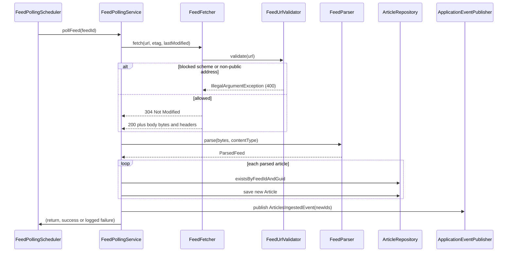
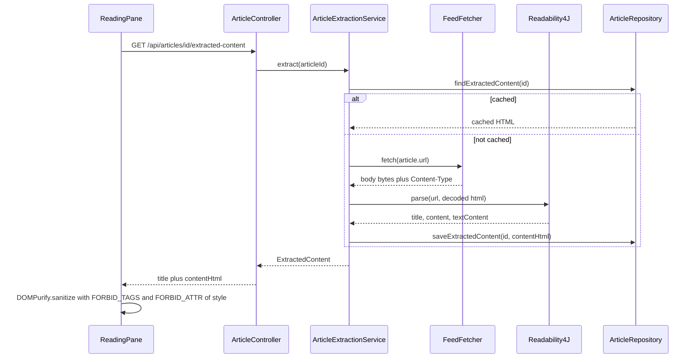

# Feed Lifecycle Workflow

This is the core business process of myfeeder: get new articles from subscribed feeds into the database reliably, without hammering slow or broken feeds, plus the on-demand reader-view extraction path that shares the same fetch/SSRF protections.

## 1. Subscribe

`FeedService.subscribe(feedUrl, folderId)`:
1. Calls `FeedFetcher.fetch(url)` — an **unconditional** GET (see [Architecture Overview](../architecture/overview.md) on `FeedFetcher` being the single fetch path).
2. Parses the response with `FeedParser` (ROME for RSS/Atom, Jackson for JSON Feed) into a `ParsedFeed`. `FeedParser.parse` throws `FeedParseException` (→422) if the result has no title and no articles — this guards against "200 OK with garbage" responses that would otherwise violate the `feed.title NOT NULL` constraint.
3. Saves a new `Feed` row with `pollIntervalMinutes` from `myfeeder.polling.default-interval-minutes`.
4. Publishes `FeedSavedEvent(saved)` via `ApplicationEventPublisher` — this is what actually schedules polling (see step 2).

`OpmlImportService.importOpml` follows the same "create feed → publish `FeedSavedEvent`" pattern per new feed when bulk-importing an OPML file (existing feeds by URL are updated in place, not re-published).

## 2. The single fetch path: `FeedFetcher`

Both subscribe and every poll go through one `FeedFetcher` method family (`fetch(url)` / `fetch(url, etag, lastModified)`). It owns two protections that any new fetch-adjacent code must not bypass by calling a raw `RestClient` directly:

- **SSRF guard (`FeedUrlValidator`)**: before dereferencing a caller-supplied URL, `validate(url)` requires an `http`/`https` scheme and resolves the host, rejecting any address that is loopback, link-local, RFC1918 site-local, any-local (`0.0.0.0`), or multicast, plus `fc00::/7` IPv6 unique-local, `100.64.0.0/10` carrier-grade NAT, `255.255.255.255`, and IPv4-mapped IPv6 addresses carrying a blocked IPv4 (checked by unwrapping to the embedded `Inet4Address`). A failure throws `IllegalArgumentException`, mapped by `GlobalExceptionHandler` to HTTP 400. This keeps a subscribed feed from steering the server at internal targets (the database, in-cluster services, a cloud metadata endpoint). Known accepted gaps for the single-user LAN deployment: no DNS-rebinding/TOCTOU protection (the validator's lookup and `RestClient`'s connect-time lookup can diverge) and no per-hop redirect re-validation.
- **Body size cap**: the response body is read with `readNBytes(maxFeedBytes + 1)` against `FeedFetcher.DEFAULT_MAX_FEED_BYTES` (10 MiB); exceeding it throws `FeedFetchException`, mapped to HTTP 422. This bounds heap use so one huge or streaming response can't OOM the pod.

`FeedFetcher.fetch(url, etag, lastModified)` also sends `If-None-Match`/`If-Modified-Since` when those are non-null and returns `FetchResult.notModified304()` on a 304; any other error status throws `FeedFetchException` (→422). A successful fetch returns the raw body bytes, the `Content-Type` header, and the response's ETag/Last-Modified — charset decoding is deliberately deferred to the caller (see next section), since the same bytes + header pair are later decoded differently by `FeedParser` (XML/JSON feeds) and `ArticleExtractionService` (arbitrary HTML pages).

## 3. Charset resolution (`FeedParser`)

`FeedParser.parse(rawContent, contentType)` resolves the document's charset in a fixed order, matching HTTP semantics:

1. An explicit `charset=` in the `Content-Type` header wins.
2. Otherwise, ROME's `XmlReader` raw-mode detection: byte-order-mark, then the XML prolog's `encoding=` attribute.
3. Otherwise, UTF-8.

`FeedParser.newXmlReader` picks between `new XmlReader(in, contentType, true)` (header present) and `new XmlReader(in, true)` (raw-mode detection) based on whether `contentType` contains `charset=`. Raw mode is intentional rather than ROME's HTTP-mode detection: HTTP mode applies RFC 3023's `us-ascii` default for `text/xml`, which would mojibake exactly the multi-byte characters this logic exists to preserve. JSON Feed documents skip this path entirely — Jackson auto-detects the UTF family from the byte stream, per the JSON Feed/RFC 8259 UTF-8-by-default convention. `FeedParser.detectFeedType` itself sniffs the raw bytes as ISO-8859-1 (which maps every byte to a char) purely to find ASCII markers like `{` or `<feed ... Atom`, independent of the document's real encoding.

## 4. Event-driven scheduling

**Never call `FeedPollingScheduler.registerFeed`/`cancelFeed` directly from new feed-mutating code.** Publish `FeedSavedEvent` or `FeedDeletedEvent` instead — this was a deliberate refactor (commit `9583ac2`) to decouple the scheduler from services.

`FeedPollingScheduler` listens with:
```java
@TransactionalEventListener(phase = TransactionPhase.AFTER_COMMIT, fallbackExecution = true)
```
on both `onFeedSaved`/`onFeedDeleted`. `AFTER_COMMIT` ensures the scheduler only reacts once the feed row is actually durable; `fallbackExecution = true` makes it still fire in non-transactional contexts (e.g. tests without a transaction). On app startup, `onStartup()` (`@EventListener(ApplicationReadyEvent.class)`) registers every existing feed.

`registerFeed` computes an **effective interval** (see backoff below) and schedules `pollAndAdjust` via `TaskScheduler.scheduleAtFixedRate`.

## 5. Poll + dedup

`FeedPollingService.pollFeed(feedId)`:
1. Conditional fetch via `FeedFetcher.fetch(url, etag, lastModifiedHeader)` — sends `If-None-Match`/`If-Modified-Since`. A 304 short-circuits (just updates `lastPolledAt`).
2. On 200, re-parses via `FeedParser.parse` and **dedups articles by `(feed_id, guid)`** using `articleRepository.existsByFeedIdAndGuid` before inserting — this is the mechanism that prevents duplicate articles across polls.
3. On success: `errorCount` resets to 0, `lastError` cleared, `lastSuccessfulPollAt` updated, and the new article ids are collected.
4. On any exception: `errorCount` increments and `lastError` is recorded, but the exception is swallowed (logged, not rethrown) — a single bad poll never crashes the scheduler thread.
5. After the success bookkeeping is saved, `FeedPollingService.publishIngested` publishes `ArticlesIngestedEvent(feedId, newIds)` when `newIds` is non-empty, wrapped in its own try/catch so a scoring-side failure can never flow back into the poll's error count. This event is how new articles reach interest scoring — see [Interest Scoring Workflow](interest-scoring.md) for what consumes it; this page does not duplicate that detail.


*Poll flow: one fetch path with the SSRF guard, charset-agnostic parsing, GUID dedup, and the scoring handoff event.*

## 6. Backoff — the interval self-adjusts after every poll

This is the trickiest part of the codebase and had two bugfix commits (`933950e`, `c95abec`) before landing correctly. After `pollFeed` returns (success or failure), `FeedPollingScheduler.pollAndAdjust` **re-reads the feed's current error state from the DB** and recomputes the effective interval via `computeEffectiveInterval`:

- If `errorCount >= backoffThreshold` (default 5), the interval is `pollIntervalMinutes * 2^(errorCount / backoffThreshold)`, capped at `maxIntervalMinutes` (default 1440 = 24h).
- Otherwise, the interval is just the feed's configured `pollIntervalMinutes`.

If the desired interval differs from the currently scheduled one, the task is cancelled and replaced with a new `scheduleAtFixedRate` starting one full interval from now. This means backoff **engages progressively** as a feed keeps failing, and **clears immediately** once it succeeds again — without ever needing an external cron sweep. The interval re-evaluation itself is wrapped in a try/catch that logs a warning and keeps the current schedule on failure, so a transient DB blip during re-evaluation can't silently unschedule a feed (fixed by `c95abec`).

There's an inherent, accepted race: a concurrent external `registerFeed`/`cancelFeed` (e.g. the user edits the feed at the same moment a poll completes) could in theory conflict with this self-replacement. The code comment in `FeedPollingScheduler` explicitly accepts this as fine for a single-user deployment.

## 7. Deletion

`FeedService.delete(id)` deletes the row (cascades to articles via FK `ON DELETE CASCADE` — see [Domain Concepts](../domain/concepts.md)) and publishes `FeedDeletedEvent(id)`, which the scheduler uses to cancel the scheduled task. `FeedPollingScheduler.pollAndAdjust` also self-cancels if `pollFeed` throws `NotFoundException` (feed deleted mid-flight).

## 8. Retention (separate, unrelated cron)

`RetentionService.cleanupOldContent()` is a plain `@Scheduled(cron = myfeeder.retention.cleanup-cron)` job (default daily at 03:00) that clears `content` **and `extracted_content`** on articles whose `fetched_at` is older than `full-content-days` (default 30), via `articleRepository.clearContentOlderThan`. This is independent of the polling/backoff mechanism above — it only trims stored content, it does not delete or unschedule anything. Because it also clears `extracted_content`, an aged-out article's cached reader-view extraction is re-fetched and re-extracted on its next request rather than retried from cache.

## 9. Reader-view extraction (shares the fetch path)

`GET /api/articles/{id}/extracted-content` (`ArticleController.extractedContent` → `ArticleExtractionService.extract`) gives the frontend a readable version of an article's original page when the feed itself carried little or no content:

1. Looks up the `Article`; 404 (`NotFoundException`) if missing, 400 (`IllegalArgumentException`) if it has no `url`.
2. Returns the cached `article.extracted_content` immediately if present (`articleRepository.findExtractedContent`) — no network call on a cache hit.
3. Otherwise calls `FeedFetcher.fetch(article.getUrl())` — the **same** fetch path as feed polling, so the SSRF guard and the 10 MiB body cap both apply to extraction fetches too. A failed fetch surfaces as `FeedFetchException` (→422).
4. Decodes the bytes with jsoup (`Jsoup.parse`, header-charset-or-null, then jsoup's own BOM/meta-tag detection — note this is jsoup's detection, not `FeedParser`'s ROME `XmlReader` path, since the input here is arbitrary HTML rather than a feed document), then runs Readability4J (`new Readability4J(url, html).parse()`) to extract the readable `content`/`title`/`textContent`.
5. If extraction yields no content HTML or only blank text, throws `FeedParseException` (→422). Otherwise caches the content HTML into `article.extracted_content` (`articleRepository.saveExtractedContent`) and returns `ExtractedContent{title, contentHtml}` (falling back to the stored article title when Readability4J found none).

On the frontend, `ReadingPane` auto-enables reader view when an article has no `content`/`summary`, with a manual "📖 Reader View" toggle otherwise. Extracted HTML is sanitized with `DOMPurify.sanitize(html, { FORBID_TAGS: ['style'], FORBID_ATTR: ['style'] })` — unlike the default sanitization applied to normal feed-supplied `content`/`summary`, the reader-view path additionally strips `style` tags/attributes so publisher page styling (e.g. dark backgrounds) can't leak through; the app's own theme renders instead.


*Reader-view extraction reuses FeedFetcher's SSRF guard and size cap, caches into `article.extracted_content`, and is sanitized client-side before render.*

## What to watch out for when changing this

- Any new code path that creates/updates/deletes a `Feed` must publish the corresponding event — don't add a second way to register/cancel scheduled polling.
- `computeEffectiveInterval` is duplicated conceptually only in `FeedPollingScheduler`; if you change backoff math, there's exactly one place to change it.
- Don't fetch feed or article-page content with a raw `RestClient` anywhere — both the SSRF guard and the size cap live only inside `FeedFetcher`, and both feed polling and reader-view extraction depend on them.
- If you change `FeedUrlValidator`'s blocked-address rules, remember the two accepted gaps (DNS rebinding/TOCTOU, no per-hop redirect re-validation) are deliberate, documented limitations for the single-user LAN deployment, not oversights to silently "fix" without re-checking the threat model.
- Tests: `FeedPollingSchedulerTest`, `FeedPollingServiceTest`, `FeedServiceTest`, `OpmlImportServiceTest`, `FeedUrlValidatorTest`, `FeedFetcherTest`, `FeedParserTest`, `ArticleExtractionServiceTest` — see [Testing Guide](../testing/guide.md).
