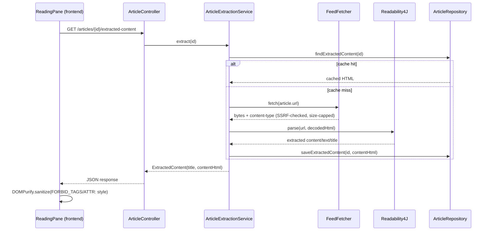

# Feed Lifecycle Workflow

This is the core business process of myfeeder: get new articles from subscribed feeds into the database reliably, without hammering slow or broken feeds, and let the reader fetch a clean readable copy of an article on demand.

## 1. Subscribe

`FeedService.subscribe(feedUrl, folderId)`:
1. Calls `FeedFetcher.fetch(url)` — an **unconditional** GET (see [Architecture Overview](../architecture/overview.md) on `FeedFetcher` being the single fetch path).
2. Parses the response with `FeedParser` (ROME for RSS/Atom, Jackson for JSON Feed) into a `ParsedFeed`. `FeedParser.parse` throws `FeedParseException` (→422) if the result has no title and no articles — this guards against "200 OK with garbage" responses that would otherwise violate the `feed.title NOT NULL` constraint.
3. Saves a new `Feed` row with `pollIntervalMinutes` from `myfeeder.polling.default-interval-minutes`.
4. Publishes `FeedSavedEvent(saved)` via `ApplicationEventPublisher` — this is what actually schedules polling (see step 2).

`OpmlImportService.importOpml` follows the same "create feed → publish `FeedSavedEvent`" pattern per new feed when bulk-importing an OPML file (existing feeds by URL are updated in place, not re-published).

## 2. Event-driven scheduling

**Never call `FeedPollingScheduler.registerFeed`/`cancelFeed` directly from new feed-mutating code.** Publish `FeedSavedEvent` or `FeedDeletedEvent` instead — this was a deliberate refactor (commit `9583ac2`) to decouple the scheduler from services.

`FeedPollingScheduler` listens with:
```java
@TransactionalEventListener(phase = TransactionPhase.AFTER_COMMIT, fallbackExecution = true)
```
on both `onFeedSaved`/`onFeedDeleted`. `AFTER_COMMIT` ensures the scheduler only reacts once the feed row is actually durable; `fallbackExecution = true` makes it still fire in non-transactional contexts (e.g. tests without a transaction). On app startup, `onStartup()` (`@EventListener(ApplicationReadyEvent.class)`) registers every existing feed.

`registerFeed` computes an **effective interval** (see backoff below) and schedules `pollAndAdjust` via `TaskScheduler.scheduleAtFixedRate`.

## 3. Poll + dedup

`FeedPollingService.pollFeed(feedId)`:
1. Conditional fetch via `FeedFetcher.fetch(url, etag, lastModifiedHeader)` — sends `If-None-Match`/`If-Modified-Since`. A 304 short-circuits (just updates `lastPolledAt`).
2. On 200, re-parses and **dedups articles by `(feed_id, guid)`** using `articleRepository.existsByFeedIdAndGuid` before inserting — this is the mechanism that prevents duplicate articles across polls.
3. On success: `errorCount` resets to 0, `lastError` cleared, `lastSuccessfulPollAt` updated.
4. On any exception: `errorCount` increments and `lastError` is recorded, but the exception is swallowed (logged, not rethrown) — a single bad poll never crashes the scheduler thread.
5. After the success bookkeeping is saved, if any articles were actually new, `pollFeed` publishes `ArticlesIngestedEvent(feedId, newIds)` from inside its own try/catch, so a failure to hand articles off can never reach the catch block that increments `errorCount` (invariant `SCOR-02`).

### New articles also feed interest scoring

`InterestScoringListener.onArticlesIngested` (`@TransactionalEventListener(phase = AFTER_COMMIT, fallbackExecution = true)`) picks up `ArticlesIngestedEvent` and, if `JevApiClient.isConfigured()`, hands the new article ids to `ScoringQueue.submitIngested` for asynchronous scoring. Because `pollFeed` runs with no transaction of its own, this listener executes inline on the polling thread — it only enqueues work (the actual scoring runs on the jev-score executor) and never throws, so a scoring-side failure cannot corrupt poll error bookkeeping. The full ingest-to-score pipeline, queue semantics, and scoring failure handling are documented in [Interest Scoring Workflow](interest-scoring.md) rather than repeated here.

## 4. Backoff — the interval self-adjusts after every poll

This is the trickiest part of the codebase and had two bugfix commits (`933950e`, `c95abec`) before landing correctly. After `pollFeed` returns (success or failure), `FeedPollingScheduler.pollAndAdjust` **re-reads the feed's current error state from the DB** and recomputes the effective interval via `computeEffectiveInterval`:

- If `errorCount >= backoffThreshold` (default 5), the interval is `pollIntervalMinutes * 2^(errorCount / backoffThreshold)`, capped at `maxIntervalMinutes` (default 1440 = 24h).
- Otherwise, the interval is just the feed's configured `pollIntervalMinutes`.

If the desired interval differs from the currently scheduled one, the task is cancelled and replaced with a new `scheduleAtFixedRate` starting one full interval from now. This means backoff **engages progressively** as a feed keeps failing, and **clears immediately** once it succeeds again — without ever needing an external cron sweep. The interval re-evaluation itself is wrapped in a try/catch that logs a warning and keeps the current schedule on failure, so a transient DB blip during re-evaluation can't silently unschedule a feed (fixed by `c95abec`).

There's an inherent, accepted race: a concurrent external `registerFeed`/`cancelFeed` (e.g. the user edits the feed at the same moment a poll completes) could in theory conflict with this self-replacement. The code comment in `FeedPollingScheduler` explicitly accepts this as fine for a single-user deployment.

## 5. Deletion

`FeedService.delete(id)` deletes the row (cascades to articles via FK `ON DELETE CASCADE` — see [Domain Concepts](../domain/concepts.md)) and publishes `FeedDeletedEvent(id)`, which the scheduler uses to cancel the scheduled task. `FeedPollingScheduler.pollAndAdjust` also self-cancels if `pollFeed` throws `NotFoundException` (feed deleted mid-flight).

## 6. Retention (separate, unrelated cron)

`RetentionService.cleanupOldContent()` is a plain `@Scheduled(cron = myfeeder.retention.cleanup-cron)` job (default daily at 03:00) that clears `content`, `summary`, **and `extracted_content`** text on articles older than `full-content-days` (default 30) via `articleRepository.clearContentOlderThan`. The underlying query only touches rows where `content` or `extracted_content` is non-null, so the reader-view cache is aged out alongside feed-supplied content by the same job. This is independent of the polling/backoff mechanism above — it only trims stored content, it does not delete or unschedule anything.

## 7. Reader-view extraction (on demand, separate from polling)

Some feeds only supply a summary or publish dark/unstyled HTML, so myfeeder can fetch the article's original page and extract a clean readable version on request, independent of the poll cycle.

- Entry point: `GET /api/articles/{id}/extracted-content` (`ArticleController.extractedContent`) calls `ArticleExtractionService.extract(articleId)`.
- `extract` looks up the `Article`, requires a non-blank `url` (else `IllegalArgumentException` → 400), and first checks `articleRepository.findExtractedContent(articleId)` — the cached `article.extracted_content` column. A cache hit returns immediately with no network call.
- On a cache miss, it fetches the original page via `FeedFetcher.fetch(article.getUrl())` — the same **unconditional** fetch path used at subscribe time, so it goes through the same SSRF guard (`FeedUrlValidator`) and the same size cap (`DEFAULT_MAX_FEED_BYTES`, 10 MiB) as feed polling. There is no separate fetch path or weaker guard for extraction.
- The fetched bytes are decoded to a `String` via Jsoup, preferring the HTTP response's declared charset and otherwise falling back to Jsoup's BOM/meta-tag detection.
- The decoded HTML is parsed with **Readability4J** (`new Readability4J(url, html).parse()`). If extraction throws, or the result has no content/text (or blank text), `extract` throws `FeedParseException` (→422) — same exception type `FeedParser` uses for "200 OK with garbage" feeds.
- On success, the extracted content HTML is cached via `articleRepository.saveExtractedContent(articleId, contentHtml)` (writes `article.extracted_content`) so subsequent requests hit the cache. The returned `ExtractedContent` carries the extracted title when present, else falling back to the article's feed-supplied title.
- Failure modes: `NotFoundException` (404, missing article), `IllegalArgumentException` (400, no URL), `FeedFetchException` (422, fetch/size-cap failure from `FeedFetcher`), `FeedParseException` (422, decode or extraction failure).

### Frontend consumption

`ReadingPane` (`useExtractedArticle` hook) decides whether to show reader view:
- **Auto-enable**: if the article has no feed-supplied `content`/`summary`, reader view defaults on for that article; otherwise it defaults off. This choice resets to auto whenever the selected article changes.
- **Manual toggle**: the "📖 Reader View" / "📖 Feed View" toolbar button lets the user override the auto choice per article.
- When reader view is active, the extracted HTML is sanitized with `DOMPurify.sanitize(html, { FORBID_TAGS: ['style'], FORBID_ATTR: ['style'] })` before being rendered — this strips publisher inline styling (e.g. dark backgrounds) so the app's own theme applies; feed-supplied content (non-reader-view) is sanitized with default DOMPurify settings instead.



## What to watch out for when changing this

- Any new code path that creates/updates/deletes a `Feed` must publish the corresponding event — don't add a second way to register/cancel scheduled polling.
- `computeEffectiveInterval` is duplicated conceptually only in `FeedPollingScheduler`; if you change backoff math, there's exactly one place to change it.
- Scoring hookup: `ArticlesIngestedEvent` must only be published after a poll's own success bookkeeping is durable, and `InterestScoringListener`/`ScoringQueue.submitIngested` must never throw back into `pollFeed` — see [Interest Scoring Workflow](interest-scoring.md) for the invariant (`SCOR-02`) and its tests.
- Extraction reuses `FeedFetcher.fetch(url)` deliberately — if you add a new way to retrieve the original page (e.g. a dedicated client), you must re-apply `FeedUrlValidator` and the byte-size cap yourself, or you reopen the SSRF/OOM protections that polling already has.
- `RetentionService.cleanupOldContent` clears `extracted_content` together with `content`/`summary`; if a reader revisits an aged-out article, extraction will silently re-fetch and re-cache rather than fail.
- Tests: `FeedPollingSchedulerTest`, `FeedPollingServiceTest`, `FeedServiceTest`, `OpmlImportServiceTest`, `RetentionServiceTest`, `ArticleExtractionServiceTest`, `ArticleControllerTest` (extracted-content route) — see [Testing Guide](../testing/guide.md).
</content>
