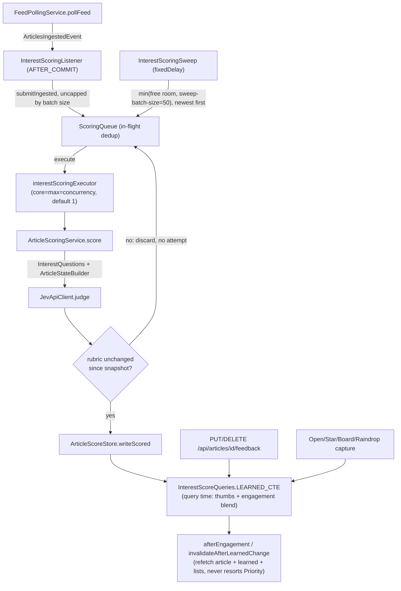
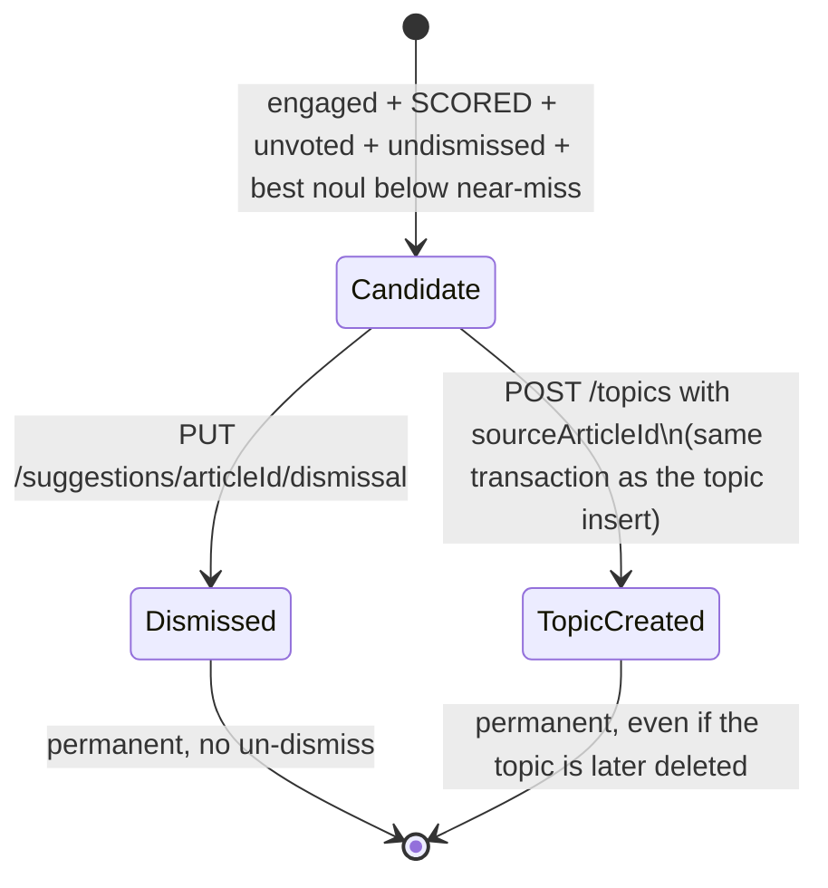

# Interest Ranking Workflow

This is the second major pipeline in myfeeder, after feed ingestion (see
[Feed Lifecycle Workflow](feed-lifecycle.md)): turning newly ingested articles into a ranked
Priority list, by sending them to the external Jev (TypeSafe) scoring API and then blending the
stored results with two kinds of user signal — thumbs feedback and engagement (opens/saves) — at
query time. It also covers gap discovery: surfacing engaged-but-uncovered articles as topic
suggestions.

This page focuses on the *workflow*: what triggers scoring, how articles move through the queue,
how the learned-weight blend reacts to feedback and engagement, and the operational levers for
throttling the pipeline. For the underlying schema (tables, columns, versioning) see
[Interest Scoring Domain Model](../domain/interest-scoring.md); for the Jev client's own
retry/breaker mechanics see [Jev (TypeSafe) Scoring Integration](../integrations/jev-typesafe.md).

## End-to-end pipeline


*Ingest publishes an event that enqueues scoring alongside the periodic sweep; a single-concurrency executor calls Jev; the write is query-time-blended with feedback/engagement on every read, and the frontend refreshes without resorting the Priority list.*

## 1. Getting onto the queue

Two independent paths put an article id onto `ScoringQueue`, both converging on the same in-flight
dedup set:

- **On ingest**: `FeedPollingService` publishes `ArticlesIngestedEvent(feedId, newIds)` after a
  poll inserts new articles. `InterestScoringListener` consumes it with
  `@TransactionalEventListener(AFTER_COMMIT, fallbackExecution = true)` — it runs inline on the
  polling thread, checks `JevApiClient.isConfigured()`, and calls `ScoringQueue.submitIngested(ids)`.
  It never scores inline and never throws back into the poll (an exception here must never be
  mistaken for a poll failure). `submitIngested` is **not capped by `sweep-batch-size`** — every
  newly ingested id that still needs scoring (filtered through the same eligibility predicate the
  sweep uses) is submitted.
- **On the periodic sweep**: `InterestScoringSweep.sweep()` runs with `fixedDelay` =
  `myfeeder.interest.sweep-delay` (default `PT2M`) after `sweep-initial-delay` (`PT1M`). It is the
  *only* drain loop for interest scoring, so it covers the launch backfill, recovery after an
  outage, a key added later, the first scoring after the profile is written, and the Re-score
  drain — there is no second code path that re-enqueues a backlog. Each run:
  1. Returns immediately if `JevApiClient.isConfigured()` is false, if the `jev` circuit breaker is
     `OPEN` or `FORCED_OPEN`, or if `InterestService.isColdStart()` is true. `HALF_OPEN` is allowed
     to run, so the automatic `OPEN` → `HALF_OPEN` transition resumes scoring on its own.
  2. Computes `room = scoringQueue.remainingCapacity()` and skips the run if there is no free queue
     slot.
  3. Selects `min(room, sweep-batch-size)` eligible ids (`ArticleScoreStore.findNeedingScoring`,
     newest first — "newest first" means a large backlog never delays fresh arrivals), and submits
     them.
- Both paths submit through `ScoringQueue.submit(ids)`, which tracks ids in a
  `ConcurrentHashMap`-backed in-flight set: an id already queued or running is silently skipped, not
  resubmitted. `TaskRejectedException` (executor queue full) removes the id from the in-flight set
  so the next sweep run can retry it — a discarding rejection policy would have left it stuck
  forever with no retry path.

## 2. Scoring: the executor and the Jev call

Accepted ids are handed to `interestScoringExecutor` (`InterestScoringConfig`, threads
`jev-score-`): a `ThreadPoolTaskExecutor` whose core and max pool size both equal
`myfeeder.interest.concurrency` (default **1**), `queue-capacity` 1000, registered with
`defaultCandidate = false` so it never displaces Boot's `applicationTaskExecutor`. There is no
`@Async` anywhere in this path; work is handed to the executor explicitly. See
[Jev (TypeSafe) Scoring Integration](../integrations/jev-typesafe.md#concurrency-control-in-front-of-the-client-the-scoring-executor)
for why the client-side retry/breaker design assumes this single-concurrency funnel.

On the executor thread, `ArticleScoringService.score(articleId)`:

1. Re-checks `isConfigured()`/`isColdStart()` and loads the article candidate inside the
   eligibility window; an article that became read, aged out, or was already scored since being
   queued is silently skipped (the dispatch recheck).
2. Writes `SKIPPED` (no Jev call, no attempt) for an article with no GUID or no judgeable text.
3. **Snapshots the profile and every topic's version before calling Jev** — `InterestQuestions` and
   `ArticleStateBuilder` build the same question/state shapes the topic-preview endpoint uses, so
   preview and scoring always judge identically.
4. Calls `jevApiClient.judge(state, questions)`. A transient failure (429, 5xx, connection/timeout,
   open breaker, missing key, 401/403 — `ScoringFailure.isTransient`) writes **no** row and burns
   **no** attempt, so an outage can't exhaust an article's attempts; any other failure writes
   `FAILED` and consumes one of 3 attempts.
5. **Version-change discard check**: after `judge()` returns, the service re-reads the profile
   version and every topic's version and compares them against the pre-call snapshot
   (`sameRubric`). If either differs — most often because a Re-score landed mid-call — the service
   discards the judgment, stores nothing, records no attempt, and leaves the article for the sweep
   to re-pick against the now-current rubric. A name- or weight-only topic edit never bumps a
   version, so it never triggers this discard.
6. Validates the judgment shape (`isValid` — every expected noul present, finite, in `[0,1]`; the
   profile score finite and within its legend); an invalid answer is a `FAILED` attempt, not a
   silent write.
7. On success, `ArticleScoreStore.writeScored` persists the row inside its own transaction — the
   only transactional part of this service; the Jev HTTP call itself is never made inside a
   transaction, since that call can take tens of seconds with retries and must never hold a DB
   connection open.

See [Interest Scoring Domain Model](../domain/interest-scoring.md#score-invalidation-on-rubric-change)
for the schema-level detail of this discard rule and the eligibility window.

## 3. Engagement capture as an input signal

Engagement feeds the `engaged` CTE of the learned-weight blend (next section) through two distinct
capture paths — one client-initiated and fire-and-forget, the others server-side and quiet:

- **Opens**: every "↗ Open Original" entry point (both ReadingPane buttons and the `o` shortcut)
  goes through `useOpenOriginal` (`hooks/useEngagement.ts`). It calls `window.open` **first**,
  synchronously inside the click/keydown (so the popup keeps user activation), then sends a
  fire-and-forget, bodyless `PUT /api/articles/{id}/engagement/open` (204, idempotent, 404 for an
  unknown id). The request is wrapped so even a synchronous throw becomes a swallowed rejection —
  there is no toast and no client-side dedupe, so every open still sends a PUT. Only on a
  **successful** PUT does it run the post-engagement reaction (below).
- **Saves**: STAR, BOARD and RAINDROP are captured server-side, after the user's own write
  succeeds, through `ArticleEngagementStore.recordQuietly` — one `ON CONFLICT (article_id, kind) DO
  NOTHING` insert whose failure is logged at WARN with the ids and the exception's class name only:
  - `STAR` in `ArticleService.updateState`, only on an unstarred→starred transition.
  - `BOARD` in `BoardService.addArticle`, after the save-or-already-present branch, so re-adding an
    article to a board still credits it.
  - `RAINDROP` in `RaindropService`, right after `createBookmark` returns, outside the Raindrop
    breaker bean.
  - **None of these three call sites opens a transaction**: each `article_engagement` insert
    autocommits on its own, so a failed engagement write can never roll back or abort the user's
    actual save. This is a deliberate invariant — don't wrap a future save path's engagement call in
    the same `@Transactional` boundary as the save itself.
- Engagement rows are sticky: unstarring, removing from a board, or deleting a board keep the row;
  deleting the article or feed cascades it away. "Forget" (`DELETE /api/articles/{id}/engagement`,
  204, no tombstone) removes every kind at once, reachable from the reading pane's
  `Engaged: … · Forget` line.

**Feedback (thumbs) is a separate, votes-first signal**, not engagement: `PUT`/`DELETE
/api/articles/{id}/feedback` store or remove one `article_feedback` row through
`ArticleFeedbackService.vote`/`clear`. A thumbs vote on an article makes the `engaged` CTE drop that
article's engagement contribution entirely (the vote replaces it on every topic); removing the vote
restores the engagement contribution. `ArticleFeedbackService` reads stored scores only — it never
judges an article and never writes a topic's weight directly, since the adjustment is derived at
query time by the learned-weight blend.

### Post-engagement reaction: refresh without resorting

Open, star (a `starred: true` update only), board add (including Read Later), Raindrop save, and
Forget each call `afterEngagement(qc, id, onPriority)` (`hooks/engagementReaction.ts`) once the
action has already succeeded:

1. `invalidateAfterLearnedChange(qc, id, onPriority)` — shared with the thumbs-vote hook — marks
   `['interest', 'learned']`, `['interest', 'suggestions']` and `['articles']` stale, and (off
   Priority) every other currently-open by-id article except the one just acted on. It never
   touches `['article', n, 'extracted']` (the cached reader-view extraction) or `['priority']`
   itself.
2. It refetches `['article', id]` with `staleTime: 0, retry: false` — a plain `30s` staleTime would
   otherwise hand back the pre-engagement article — which is what drives the reading pane's badge
   and "Why N?" breakdown to update.
3. Only when on `/priority` (`useMatch('/priority')`), and only if the refetched score differs from
   the row already loaded in the Priority list, it patches that row in place via
   `patchPriorityArticle` and sets `rankingChanged`, which lights the "Ranking changed" hint.
4. **`['priority']` itself is never invalidated, reset, or refetched** by this reaction, so the list
   a user is actively triaging never silently re-sorts under them. An unloaded Priority row whose
   score rises above the viewport cursor can stay stale until a manual refresh — the "Ranking
   changed" hint is what prompts that refresh.
5. The reaction never rejects: a failed background refetch is swallowed silently, since the user's
   engagement action already succeeded.

Unstar, board removal, and read toggles deliberately do **not** trigger this reaction.
`PriorityApiIntegrationTest.engagedArticleAgreesEverywhereAfterRefresh` proves that, after a
manual refresh, the position, badges and "Why N?" breakdown all agree.

## 4. The learned-weight blend at query time

Nothing about the learned adjustment is stored — `InterestScoreQueries.LEARNED_CTE` recomputes it
on every read from `article_feedback` and `article_engagement`, so flipping or removing a vote, or
forgetting an engagement, undoes its effect exactly. The blend's full column-level SQL and record
shapes are documented in
[Interest Scoring Domain Model](../domain/interest-scoring.md#the-learned-weight-model); this
section covers the workflow-relevant rules:

- **Thumbs settle first, engagement layers on top.** The `learned` CTE sums vote-weighted nouls
  into a thumbs total; only *then* is a separately-scaled, separately-capped engagement term added.
  This ordering is why the response can report a clean `thumbsLearned`/`engagementLearned` split:
  `w_thumbs` (base + thumbs, clamped) settles before `w` (base + thumbs + engagement, clamped) is
  computed.
- **Engagement has its own cap, independent of the thumbs learned-cap.** `eng_raw` is floored at
  zero (engagement never lowers a weight) and capped at `myfeeder.interest.blend.engagement.cap`
  (default 8) — a smaller ceiling than the thumbs `learned-cap`, so no single open/save signal can
  swing a topic as far as a sustained run of votes can.
- **Negative-base topics are skipped entirely** for both thumbs and engagement scaling only insofar
  as engagement is concerned: the SQL forces a negative-base topic's `eng_raw`/`eng` to 0, so
  engagement can never pull a topic the user has actively down-weighted back toward positive.
- **Only `SCORED` articles count** in `eng_learned` — an engaged-but-unscored article contributes
  nothing to anyone's learned weight, and engagement is never itself a reason to score an article
  (`ArticleScoreStore` never looks at engagement when deciding eligibility).
- **`LearnedLimit.of` names which rule actually held a topic's effective weight back**, checked in
  this precedence:
  1. `LEARNED_CAP` — the uncapped thumbs points already reach `learnedCap` in either direction.
  2. `SIGN_CLAMP` — `base + learned` would cross zero (a positive base never goes negative, a
     negative base never goes positive).
  3. `WEIGHT_RANGE` — `|base + learned|` exceeds the `-50..50` range.
  4. `ENGAGEMENT_CAP` — reported only when none of the above bind, and the uncapped engagement
     points reach `engagementCap` (a cap of 0 disables engagement, so this can never fire).
  5. `NONE` — otherwise.

  `LearnedLimit.engagementAtCap` is the single boolean rule behind both the `ENGAGEMENT_CAP` case
  and the standalone `engagementAtCap` flag served on `TopicLearned`/`TopicWeight` — a topic can
  report `engagementAtCap = true` while a *stronger* limit like `SIGN_CLAMP` is the one actually
  named.

<!-- openwiki: mermaid parse failed and this diagram was converted to a text fence so it does not break rendering. Fix the diagram source and restore the mermaid fence. Parser error: Heuristic: an unescaped angle bracket inside a label breaks rendering; rephrase the label. -->
```text
flowchart LR
    Thumbs["article_feedback votes"] --> L["learned CTE: vote-weighted sum per topic"]
    Eng["article_engagement rows\n(drops any article with a vote)"] --> G["engaged CTE: one MAX strength per article"]
    G --> N["eng_learned CTE: strength-weighted sum, SCORED only"]
    L --> Cap1["eff: scale by learnRate, cap thumbs at learnedCap"]
    N --> Cap2["eff: scale by learnRate, floor+cap engagement at engagementCap\n(0 for a negative-base topic)"]
    Cap1 --> Clamp["eff2: sign clamp + -50..50 range\napplied to w_thumbs, then w"]
    Cap2 --> Clamp
    Clamp --> Rule["LearnedLimit.of:\nLEARNED_CAP -> SIGN_CLAMP -> WEIGHT_RANGE -> ENGAGEMENT_CAP -> NONE"]
```
*How a topic's effective weight is derived at query time, and the precedence rule that names the binding limit; see the domain page for the exact SQL.*

Every surface that reports a topic weight — Priority sort, the display badge, "Why N?" breakdowns,
`GET /api/interest/topics/learned`, and the thumbs-vote response (`FeedbackResult`/`TopicEffect`) —
is built from this one CTE, so none of them can disagree.

## 5. Gap discovery (topic suggestions)

`GET /api/interest/suggestions` surfaces engaged articles that no topic currently covers well — a
signal that the user's rubric may be missing a topic. `TopicSuggestionService.list()` drives this
entirely from stored data; **it never calls Jev**, for listing, dismissing, or creating a topic
from a suggestion.

### Near-miss predicate

`TopicSuggestionStore.candidates(...)` selects an article as a candidate only when **all** of:

- it has at least one `article_engagement` row whose kind's *first* recording falls within the last
  `TopicSuggestionService.WINDOW_DAYS` (30) days — because the store keeps only the first
  `created_at` per `(article, kind)`, repeating the same kind of engagement does **not** refresh the
  window;
- it has a `SCORED` row in `article_score`;
- it has **no** `article_feedback` row (an unvoted article only — a vote means the user already
  reacted to it directly);
- it has **no** `topic_suggestion_dismissal` row (not already handled); and
- its best noul over every `article_topic_score` row — any topic, either weight sign, 0 when it has
  no rows at all — is below `myfeeder.interest.suggestions.near-miss` (default 0.35).

### Ordering and cap

`TopicSuggestionService.list()` re-derives each candidate's badge from
`InterestScoreQueries.displayScores` — the same ranking SQL used everywhere else, in a second,
separate step; the ranking SQL itself never reads the dismissal table. Results are ordered badge
**ascending** (surprise order — the least score-explicable engaged articles surface first), then by
latest engagement newest-first, then by article id descending. At most `MAX_SUGGESTIONS` (**10**)
items are returned as `items`, alongside a `total` count of every qualifying candidate. A candidate
whose badge disappeared between the two steps (e.g. its score row was deleted concurrently) is
silently dropped and not counted in `total`.

### Dismiss / create-topic lifecycle


*A suggestion is handled exactly once; there is no path back to Candidate.*

- **Dismiss** (`PUT /api/interest/suggestions/{articleId}/dismissal`, bodyless, 204, idempotent,
  404 for an unknown article id) writes `reason = DISMISSED`.
- **Create topic from suggestion**: `POST /api/interest/topics` accepts an optional
  `sourceArticleId`; `InterestService.createTopic` writes `reason = TOPIC_CREATED` inside the
  *same* transaction that inserts the topic row, so the topic and the dismissal commit or roll back
  together. A 400 from the 25-topic cap or field validation writes neither.
- `TopicSuggestionStore.handle` is a single `INSERT ... SELECT ... ON CONFLICT (article_id) DO
  NOTHING` — it keeps the *first* reason recorded, a stale article id inserts nothing and never
  blocks the topic save, and it opens no transaction of its own (it joins whatever transaction the
  caller is already in).
- There is **no un-dismiss**: deleting a topic that was created from a suggestion does not revive
  the suggestion, and a later new engagement on the same article does not either.

Jev is never called anywhere in this flow — listing, dismissing, and creating a topic from a
suggestion are pure-SQL operations. See
[Interest Scoring Domain Model](../domain/interest-scoring.md#topic-suggestion-gap-discovery-lifecycle)
for the table-level detail.

## Resilience-relevant operational levers

These are the workflow-level levers for keeping the scoring sweep from overwhelming Jev or getting
stuck; the client's own retry/breaker tuning (attempt counts, wait durations, breaker thresholds)
lives in [Jev (TypeSafe) Scoring Integration](../integrations/jev-typesafe.md).

| Lever | Default | Effect |
|---|---|---|
| `myfeeder.interest.sweep-batch-size` | 50 | Caps how many ids the periodic sweep enqueues per run (does **not** cap ingest-triggered enqueues). Lower it to slow new-article intake into the queue. |
| `myfeeder.interest.sweep-delay` | `PT2M` | Time between sweep runs. Lengthen it to spread load further apart. |
| `myfeeder.interest.concurrency` | 1 | Core = max size of `interestScoringExecutor`. Keeping this at 1 is a deliberate design decision — raising it increases the request rate the `jev` breaker/retry must absorb, and is explicitly discouraged. |
| `kubectl -n myfeeder set env deploy/myfeeder MYFEEDER_INTEREST_SWEEPBATCHSIZE=20` | — | **Emergency lever, no release needed.** Relies on Spring Boot's relaxed env-var binding, restarts the pod immediately with the overridden batch size. Must be removed (`...SWEEPBATCHSIZE-`) once the tuned value lands in `application.yaml`, since a later Helm upgrade's three-way merge otherwise keeps the stale out-of-band override. |
| Redeploy with `MYFEEDER_TYPESAFE_API_KEY` unset | — | Full emergency stop: the not-configured degrade path disables scoring cleanly without touching the breaker or the sweep's other config. |

See [Operations Runbook](../operations/runbook.md#interest-scoring-operations) for the full
procedure, including when to reach for each lever.

## Calibration and tuning workflow

The constants that shape the blend and gap discovery — profile points, tier thresholds
(`myfeeder.interest.blend.tiers.high|neutral`), engagement open/save weights and cap
(`myfeeder.interest.blend.engagement.*`), and (separately, untuned by this process)
`myfeeder.interest.suggestions.near-miss` — are never tuned live. They are measured offline with
`scripts/interest-calibration-replay.sh`, which replays `InterestScoreQueries`' exact blend SQL,
verbatim, as a **read-only** `psql` session (`default_transaction_read_only=on`) against a copy of
production data:

```bash
MYFEEDER_PG_PASSWORD=... scripts/interest-calibration-replay.sh PP:HIGH:NEUTRAL[:OPEN:SAVE:CAP] [...]
```

- `PP:HIGH:NEUTRAL` are required; `OPEN:SAVE:CAP` are optional but must be given together, defaulting
  to the current `ENGAGEMENT_OPEN_WEIGHT`/`ENGAGEMENT_SAVE_WEIGHT`/`ENGAGEMENT_CAP` (0.25/0.5/8).
- Before opening any connection, it validates every candidate against the same rule
  `MyfeederProperties.Interest.Blend.Engagement.isValid` enforces at startup, rejecting an invalid
  combination with a fixed error rather than ever reaching Postgres with it.
- It writes one `.tsv` per candidate set, letting several candidates be compared from one invocation.
- Approved values are committed **only** to `application.yaml` (and `application-dev.yaml` when they
  differ from the test yaml's fixed fixture values) — **never** via Helm `--set` or a `kubectl set
  env` override (that path is reserved for the emergency throttle lever above, not for tuning).

Each run's rationale and outcome — the decision rules applied, whether defaults were kept or
changed — is recorded in a phase calibration note under `.planning/` before any yaml change is
committed. See [Operations Runbook](../operations/runbook.md#calibration-and-tuning-workflow) for
the full procedure and where notes live.

## Key proof tests

| Test | Proves |
|---|---|
| `InterestLearnedGridTest` | The exact thumbs/engagement split across a large (1,456-cell) parameter grid. |
| `InterestScoreQueriesEngagementTest` | The engagement term's behavior in `LEARNED_CTE` (caps, zero floor, negative-base skip, vote override). |
| `InterestScoreQueriesZeroEngagementTest` | Engagement cap 0 reproduces the frozen pre-engagement (v0.2.1) blend exactly. |
| `InterestCalibrationReplaySqlTest` | The calibration replay SQL stays in drift-lockstep with `InterestScoreQueries`, and its backfill/privacy/driver behavior. |
| `InterestCalibrationReplayRunTest` | An end-to-end calibration replay run against Testcontainers Postgres via host `psql`. |
| `TopicSuggestionStoreTest` | The near-miss candidate predicate and `handle`'s `ON CONFLICT DO NOTHING` first-reason semantics. |
| `TopicSuggestionServiceTest` | Ordering, the 10-item cap plus `total`, and dropping a candidate whose badge vanished. |
| `TopicSuggestionApiIntegrationTest` | End-to-end suggestion API behavior, including dismissal/topic-creation atomicity and that Jev is never called. |
| `PriorityApiIntegrationTest` | The ranked list, badges and "Why N?" breakdown agree after a refresh, including the engaged-article case. |

## What to watch out for when changing this

- Never resubmit an id already tracked in `ScoringQueue`'s in-flight set, and always release it on
  both success and failure (including `TaskRejectedException`) — an id stuck in-flight forever can
  never be re-enqueued by the sweep.
- Keep the version snapshot in `ArticleScoringService.score` *before* the Jev call, not after — the
  discard check only works because it compares against the pre-call state.
- A change to what counts as "configured" or "cold start" belongs in `InterestService.isColdStart()`
  only — the sweep, the per-article dispatch recheck, and the status endpoint all reuse it.
- Any engagement capture call site must stay outside a transaction boundary — wrapping it in the
  caller's `@Transactional` would let a failed engagement insert roll back the user's actual save.
- Never invalidate or refetch `['priority']` from the post-engagement/vote reaction — that is the
  invariant that keeps the Priority list from resorting under an actively triaging user.
- Tune blend/engagement/tier constants only through the calibration replay and a yaml commit; a
  `kubectl set env` override is for the emergency throttle lever, not for tuning.
