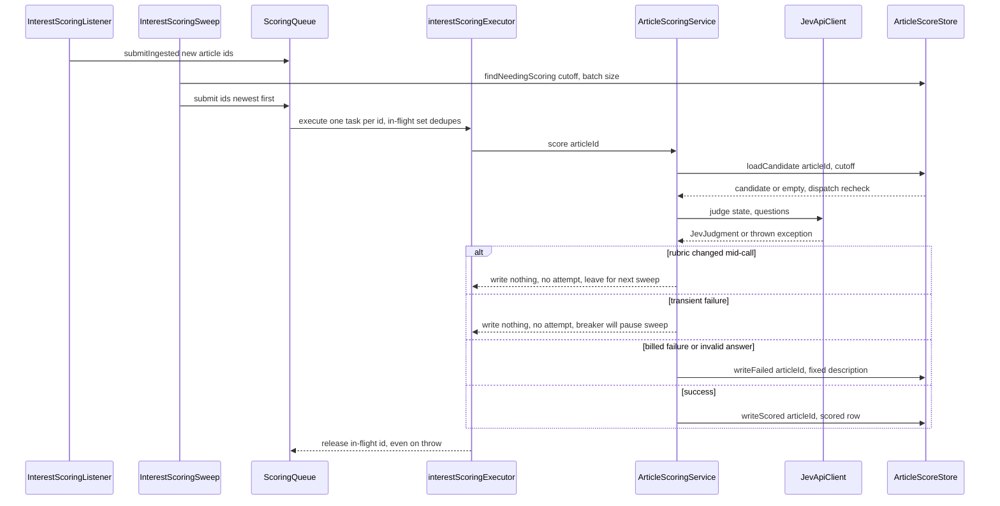

# Interest Scoring, Ranking & Gap Discovery

Interest scoring is myfeeder's largest subsystem: it judges every eligible article against a
user's interest profile and topics with one Jev call, blends that judgment with learned
adjustments derived from thumbs votes and engagement, ranks unread articles by the result on the
Priority view, and surfaces engaged-but-uncovered articles as topic suggestions. This page covers
the pipeline end to end — eligibility, the dedicated executor and sweep, score write rules,
calibration, the learned-weight blend, Priority ranking, and gap discovery. The Jev transport
itself (circuit breaker, retry, resilience) is documented in the
[Jev Integration](../integrations/jev.md); the data model and the exact blend SQL are documented
in [Domain Concepts](../domain/concepts.md); how engagement rows get written in the first place is
documented in [Engagement Capture Workflow](../workflows/engagement-capture.md); deploy-time
throttling and emergency-stop levers are documented in the
[Operations Runbook](../operations/runbook.md).

## Pipeline overview

Two independent paths enqueue article ids into the same in-process `ScoringQueue`: ingest-time
enqueue (`InterestScoringListener`, fired after a feed poll's transaction commits) and the
periodic `InterestScoringSweep`. Both hand ids to the same dedicated `interestScoringExecutor`
thread pool, which runs `ArticleScoringService.score()` — the only place that calls
`JevApiClient.judge()` — and writes the result through `ArticleScoreStore`.


*The two enqueue paths (ingest and sweep) converge on one executor and one scorer; the database is
the queue's actual source of truth, so either path can re-pick an id the other one dropped.*

## Eligibility

`ArticleScoreStore.ELIGIBLE` is the single predicate every query is built from — the sweep, the
dispatch recheck inside `score()`, the `/api/interest/status` counts, and Re-score all agree on
what is in scope:

```
a."read" = false AND COALESCE(a.published_at, a.fetched_at) > :cutoff
```

`cutoff` is `now - myfeeder.interest.window-days` (default 14 days), recomputed on every call
(`MyfeederProperties.Interest.eligibilityCutoff()`). An eligible article additionally *needs
scoring* when it has no `article_score` row, or a `FAILED` row with fewer than
`ArticleScoreStore.MAX_ATTEMPTS` (3) attempts.

**Transient vs. billed failures** determine whether an attempt is burned:

- **Transient** (`ScoringFailure.isTransient`): HTTP 429, 5xx (including "overloaded"), connection
  failures/timeouts, an open circuit breaker (`CallNotPermittedException`), a missing Jev key
  (`JevNotConfiguredException`), and 401/403 (`TypeSafeAuthenticationException`/
  `TypeSafePermissionDeniedException`). These write **no row** and burn **no attempt** — the
  outage or bad key is not the article's fault, and the circuit breaker is what actually pauses
  the sweep, not the attempt counter. 401/403 are deliberately classified transient here even
  though the breaker *does* record and can open on them (D-08 in source comments): they get no
  special per-article surfacing beyond that.
- **Billed/permanent** (everything else, including an unanticipated exception type and an invalid
  judge answer caught by `isValid`): writes a `FAILED` row via `store.writeFailed`, with fixed
  text (`ScoringFailure.describe` — exception class name plus HTTP status/request id for API
  errors, never the message or body). `FAILED` rows are retried until `attempts` reaches 3; the
  write-failed path itself (a DB error during `writeScored`) is also treated as a billed failure
  so the 3-attempt bound still holds even if persisting a successful judgment fails.

A `SKIPPED` row (no GUID, or no judgeable title/summary/content) is terminal and never retried —
first writer wins. `SCORED` is write-once: nothing overwrites it except deleting the row via
Re-score; writing a `SCORED` row is only allowed to replace an existing `FAILED` row. See
[Domain Concepts](../domain/concepts.md#article_score--article_topic_score) for the full
`article_score`/`article_topic_score` schema.

## `InterestScoringSweep`: the only drain loop

`InterestScoringSweep.sweep()` runs on the shared `@Scheduled` thread on a fixed delay
(`myfeeder.interest.sweep-delay`, default `PT2M`) after an initial delay
(`myfeeder.interest.sweep-initial-delay`, default `PT1M`). It is the one job that covers the
launch backfill, recovery after an outage, a key added later, the first scoring pass after the
profile is written, and the Re-score drain — because "needs scoring" lives entirely in the
database, one predicate-driven query covers every one of those cases without separate code paths.

Each run enqueues at most `min(ScoringQueue.remainingCapacity(), sweep-batch-size)` ids, newest
first, so a fresh arrival never waits behind a large backlog. It **skips entirely** when:

- Jev is unconfigured (`jevApiClient.isConfigured()` false — no API key);
- the `jev` circuit breaker is `OPEN` or `FORCED_OPEN` (checked by name against
  `CircuitBreakerRegistry`); **`HALF_OPEN` still runs** — the automatic OPEN→HALF_OPEN transition
  (`automatic-transition-from-open-to-half-open-enabled: true` in the `jev` breaker config)
  resumes scoring on its own without any sweep-side special case;
- the app is in cold start (`InterestService.isColdStart()` — blank profile and zero topics);
- the executor's queue has no free room (`remainingCapacity() <= 0`).

A `RuntimeException` anywhere in the sweep body is caught and logged (exception class name only);
the sweep never crashes the scheduler thread.

## `ScoringQueue` and the dedicated executor

`interestScoringExecutor` (`InterestScoringConfig`) is a `ThreadPoolTaskExecutor` with core pool
size *and* max pool size both set to `myfeeder.interest.concurrency` (default **1** — single
scoring thread) and a bounded queue (`myfeeder.interest.queue-capacity`, default **1000**). It is
registered as a non-default bean candidate so it never displaces Boot's `applicationTaskExecutor`;
consumers inject it by name with `@Qualifier(InterestScoringConfig.EXECUTOR)`. No `@Async`
annotation is used anywhere — work is handed to this executor explicitly, keeping the Jev HTTP
call off both the polling thread and the scheduler thread.

`ScoringQueue` tracks an `inFlight` set (`ConcurrentHashMap.newKeySet()`) of ids currently queued
or running, so neither enqueue path can submit the same id twice. When the executor's queue is
full, `executor.execute()` throws `TaskRejectedException` under the pool's default **abort**
rejection policy; `ScoringQueue.submit` catches it, **releases the id from `inFlight`**, and drops
it with a WARN log — the sweep's next pass will naturally re-pick it since the database still
shows it needing scoring. A discarding rejection policy was deliberately avoided: it would leave
the id marked in-flight forever with no way to re-enqueue it. The id is also released in a
`finally` block after `scorer.score(id)` returns or throws, so a scorer exception can never leak an
id stuck as permanently in-flight.

## `ArticleScoringService.score()`: one Jev call per article

`score(articleId)` runs with **no transaction** — a DB connection must never be held across the
HTTP call and its retries, which can take up to ~90 seconds. Only `ArticleScoreStore.writeScored`
is itself transactional (parent row then topic nouls, in one statement block). Control flow:

1. Re-check the single eligibility predicate (`isConfigured()`, `isColdStart()`) and re-load the
   candidate (`store.loadCandidate`) — this is the **dispatch recheck**: an id queued minutes ago
   may have been read, aged out of the window, or already scored by the time its turn comes up, in
   which case `loadCandidate` returns empty and the method returns immediately.
2. Skip (write `SKIPPED`) if the article has no GUID or no judgeable text
   (`ArticleStateBuilder.hasJudgeableText`).
3. **Snapshot the profile and topics *before* the call** (`InterestProfile`, `List<InterestTopic>`
   with their versions) — the stored result must reflect what was actually sent.
4. Call `jevApiClient.judge(state, questions)`. A thrown exception is classified by
   `ScoringFailure.isTransient`; see the eligibility section above for the resulting no-row vs.
   `writeFailed` split.
5. **Version-changed-mid-call discard rule**: after the call returns, `sameRubric()` compares the
   snapshot against the *current* profile version and topic-id→version map. If the profile text or
   any topic description changed while the ~90s call was in flight (e.g. the user edited the
   profile, or ran Re-score), the service **writes nothing and burns no attempt** — the article is
   simply left for the next sweep pass to re-pick against the now-current rubric. This exists
   because a write-once `SCORED` row would otherwise permanently pin a judgment made against a
   rubric that no longer exists, and charging it against the 3-attempt budget would be wasted.
6. Validate the answer shape (`isValid`): every requested noul finite and in `[0, 1]`, every
   requested profile score finite and in `[0, maxLevel]` with a finite confidence. An answer the
   schema would reject becomes a `writeFailed("invalid answer")`, not a silent discard or an
   infinite retry loop.
7. `store.writeScored(...)`. If that write itself throws, the call was already billed, so a failed
   attempt is recorded (`writeFailed("write failed")`) to keep the 3-attempt bound meaningful.

`ArticleScoringService` never checks the circuit breaker itself, so `judge()` can probe a
`HALF_OPEN` breaker directly — that probe call is what the sweep's `HALF_OPEN`-runs rule depends
on to actually resume scoring.

## Calibration: query-time constants, no re-score needed

The blend, tier and gap-discovery constants are **not** baked into stored scores — every read
derives the badge and the Priority sort from the *current* `application.yaml` values at query
time, over the raw nouls already stored in `article_topic_score`. Changing a calibrated constant
therefore re-ranks and re-badges every existing scored article immediately, with no re-score
needed:

| Constant | Path | Default |
|---|---|---|
| Profile points | `myfeeder.interest.blend.profile-points` | 100 |
| Learn rate | `myfeeder.interest.blend.learn-rate` | 2 |
| Learned cap (thumbs) | `myfeeder.interest.blend.learned-cap` | 20 |
| Engagement open weight | `myfeeder.interest.blend.engagement.open-weight` | 0.25 |
| Engagement save weight | `myfeeder.interest.blend.engagement.save-weight` | 0.5 |
| Engagement cap | `myfeeder.interest.blend.engagement.cap` | 8 |
| Badge tier high/neutral | `myfeeder.interest.blend.tiers.high` / `.neutral` | 70 / 22 |
| Gap-discovery near-miss | `myfeeder.interest.suggestions.near-miss` | 0.35 |

These values are validated at startup (`MyfeederProperties.validate`): the engagement block must
be either `cap == 0` (fully disabled) or `0 <= open-weight < save-weight < 1` and
`0 < cap < learned-cap`; `near-miss` must be in `(0, 0.5]`.

Tuning them is done with the `interest-calibration` skill
(`.claude/skills/interest-calibration/SKILL.md`), which drives
`scripts/interest-calibration-replay.sh` — a read-only psql replay of the verbatim
`InterestScoreQueries` blend against production data, drift-guarded by
`InterestCalibrationReplaySqlTest`. Approved values are committed straight to `application.yaml`
(and `application-dev.yaml` when a calibrated value diverges from the test fixtures' pinned
100/70/40 and 0.25/0.5/8) — **never** through Helm `--set` or ad hoc env overrides, so the running
config never silently diverges from what the next `helm upgrade` converges to and from what the
test suite assumes. See the [Operations Runbook](../operations/runbook.md#calibration-applicationyaml-only-never-helmenv)
for the operational framing of this rule.

The historical decision record for the one calibration run completed so far —
`.planning/milestones/v0.3.0-phases/12-calibration-release/12-CALIBRATION.md` (Phase 12,
2026-10-02) — tried to tune the three engagement constants against production engagement data but
found the data floor unmet (D-02: needs at least 30 engaged/SCORED/unvoted articles and at least 3
non-negative topics with nonzero engagement; prod had only 13 articles and 0 qualifying topics).
Decision **D-03** applied the thin-data fallback: the defaults — open-weight **0.25**, save-weight
**0.5**, cap **8** — were kept as-is and marked "revisit" rather than changed, because every grid
candidate in the replay produced an identical ranking to engagement fully disabled (every counted
article scored at most 0.10 on every non-negative topic, so no constant in the grid moved any
badge).

## The learned-weight blend

`InterestScoreQueries` (`InterestScoreQueries.LEARNED_CTE`) is the single source of truth for both
the Priority sort and every interest badge/breakdown, so the two can never disagree. It derives
each topic's effective weight at query time from two independently capped additive terms layered
on top of the topic's configured base weight — full schema, CTE SQL, and the sign-clamp/weight-range
math are documented in [Domain Concepts § The learned-weight model](../domain/concepts.md#the-learned-weight-model);
summarized here as a pipeline concern:

- **Thumbs (vote) CTE** (`learned`): sums `vote * hinge` per topic over stored `article_feedback`
  rows on `SCORED` articles only (honoring `topics_narrowed`/`article_feedback_topic` picks),
  scaled by `learn-rate` and clamped to `± learned-cap`.
- **Engagement CTE** (`engaged` / `eng_learned`): collapses `article_engagement` to one `MAX`
  strength per article (a save — `STAR`/`BOARD`/`RAINDROP` at `save-weight` — always beats a bare
  `OPEN_ORIGINAL` at `open-weight`), **excludes any article that has a thumbs vote at all**
  (no-vote-present filter — the vote always overrides engagement for that article; removing the
  vote restores the engagement contribution), is **restricted to `SCORED` rows**, sums
  `strength * hinge` per topic with no age or read-state window, scales by `learn-rate`, then caps
  the result at `engagement-cap` with a **zero floor** — and forces the contribution to zero
  outright for any topic with a negative base weight.
- Both terms feed `eff2`'s sign-clamp logic (a positive-base topic's effective weight is floored at
  0, a negative-base topic's is ceilinged at 0, both bounded to `±50`), applied once to
  `base + thumbs-capped` (`w_thumbs`) and again to `base + thumbs-capped + engagement-capped` (`w`,
  the actual blended weight used in both the badge and the Priority sort).
- **`LearnedLimit` precedence** (`LearnedLimit.of`) explains, per topic, which bound actually held
  back the nominal adjustment, checked in this order: `LEARNED_CAP` (uncapped thumbs points alone
  reach `learned-cap`) → `SIGN_CLAMP` (`base + learned` would cross zero) → `WEIGHT_RANGE`
  (`|base + learned|` would exceed ±50) → `ENGAGEMENT_CAP` (reported only when nothing above bound
  it, and uncapped engagement points reach `engagement-cap`) → `NONE`. This order supersedes an
  earlier phase's ordering specifically so the two *combined*-weight bounds are checked before the
  engagement-only one.

### UI wording rules

- **"Why N?" row parts** (`WhyBreakdown.tsx`): a topic row's label shows the Phase-5 form (`{name}
  {counts}% × {weight}`) unless its applied thumbs or engagement part rounds to a non-zero tenth, in
  which case it expands to `{name}  {counts}% × {weight} ({base} {±votes} votes {±engaged}
  engaged)`, omitting a part that rounds to exactly zero tenths from the label (but always listing
  it, zeros included, in the row's `title` tooltip when `baseWeight` is present). The parts printed
  are exactly the server's `thumbsWeight`/`engagementWeight` fields — never recomputed client-side
  — and "Why N?" never shows a `LearnedLimit` note.
- **Vote toast phrasing** (`useFeedback.ts` / `utils/feedback.ts`): a thumbs vote's success toast
  leads with an emoji + "Saved"/"Narrowed"/"All matched topics" (or "Vote removed · " for a
  clear), then one `effectNote` per listed topic (capped at 3, then "· +N more"). The note names
  whichever `LearnedLimit` bound (if any) held the topic back (`LEARNED_CAP` → "(learned at max/min
  ±N)", `SIGN_CLAMP` → "(can't cross 0)", `WEIGHT_RANGE` → "(weight at max/min ±50)";
  `ENGAGEMENT_CAP` is never worded in the toast). When no limit bound it, a vote that replaced the
  article's engagement contribution for that topic says "(replaces engagement)", and a removal that
  restores it says "(engagement restored)" instead.

## The Priority view: ranking and its distinct cursor

`GET /api/articles/priority` (`PriorityPage` controller / `PriorityService` / `InterestScoreQueries`)
ranks **unread** articles by the blended score above, falling back to date (newest first) for
unscored rows. Because the sort key is a live value that can change between two page fetches of
the same browse (a vote or new engagement moves a topic's weight), it cannot reuse the Long-cursor
`PaginatedResponse` scheme every other list endpoint uses. Instead it serves an **opaque,
self-describing cursor**: base64url of `<score>|<epochMicros>|<id>`, and the next page's SQL
compares against that literal served tuple — never the cursor article's live score — so the cursor
row's own later score change can never cause rows to be skipped. `PriorityService.page` checks the
cursor id still exists before querying and throws a 404 (not the normal-pagination 400) when it
doesn't, which is the same "restart from page 1" signal `PriorityPage.decodeCursor` returns for an
unreadable cursor string. Full cursor wire-format and edge-case details (far-future dates,
`-Infinity` scores, `+/-infinity` clamp risk) live in
[Domain Concepts § The Priority view's distinct cursor scheme](../domain/concepts.md#the-priority-views-distinct-cursor-scheme).

On the frontend, `usePriorityArticles` loads this as an infinite query with `staleTime: Infinity`
and focus/reconnect refetch disabled — any refetch of an infinite query would reload every loaded
page and re-sort the list under the user mid-triage, so only an explicit refresh re-ranks.
Engagement and votes instead **patch** the loaded row in place (`patchPriorityArticle`) without
invalidating the `['priority']` query.

### Tier thresholds and the "Ranking changed" hint

Badge tiers (`InterestBadge`, `tier-high`/`tier-neutral`/`tier-low`) come from
`GET /api/interest/status`'s `tiers` field (`TierThresholds`, backed by
`myfeeder.interest.blend.tiers.*`), read through React's `TierContext`. `useInterestTiers` fetches
status once (`staleTime: Infinity`, no polling) and falls back to a fixed `DEFAULT_TIERS` of
`{ high: 70, neutral: 40 }` until that first load resolves or if the server sends no tiers — a
display-only fallback distinct from the server's own configured default of `neutral: 22`.

The Priority refresh button's **"Ranking changed"** hint is lit (`usePriorityStore.setRankingChanged`)
whenever a learned-weight-affecting action could have moved an unloaded row's rank without the
visible list re-sorting: saving the profile or a topic, creating or deleting a topic, Re-score, a
thumbs vote on a Priority row, and — per `engagementReaction.ts`'s `afterEngagement` — any
engagement action (open, star, board add, Read Later, Raindrop save, Forget) taken **while on the
Priority view**, but only when the refetched article's score actually differs from the score the
loaded row was last served with (a vote in flight on the same article suppresses the compare, since
the vote's own response will patch the row). The hint and its paired "ranking changed since page 1
loaded" baseline (`baselineUnscored`) are cleared together by `resetHint()` whenever the list is
explicitly refreshed or re-entered; patching a row never clears it on its own.

## Gap discovery: topic suggestions (Phase 11)

`TopicSuggestionService`/`TopicSuggestionStore` surface engaged articles that no topic currently
covers, as candidates for a new topic — entirely from already-stored data: **Jev is never called**
for suggestions, only `InterestScoreQueries.displayScores` (the same blend used everywhere else) to
fetch each candidate's badge.

**Candidate predicate** (`TopicSuggestionStore.CANDIDATES`), all required: at least one
`article_engagement` row whose latest `created_at` across kinds is inside a 30-day window
(`TopicSuggestionService.WINDOW_DAYS`); a `SCORED` `article_score` row; no stored thumbs vote at
all (`article_feedback`); no existing `topic_suggestion_dismissal` row; and a best noul across
every topic (any weight sign, `0` if unmatched) strictly below the configured near-miss threshold
(`myfeeder.interest.suggestions.near-miss`, default 0.35) — an article that is already a
near-match to some topic is not suggested as a gap.

**Ordering and cap**: badge ascending ("surprise" order — the lowest-scoring, most unexpectedly
engaged articles come first), then latest engagement newest-first, then id descending as a tiebreak.
`TopicSuggestionService.MAX_SUGGESTIONS` (**10**) caps the `items` list; the full qualifying count
is reported separately as `total`, so the UI can show "Suggested topics (10 of 23)" when the list
is truncated. A candidate whose `SCORED` row vanished before the badge lookup (e.g. deleted
concurrently) is dropped entirely rather than counted with no badge.

**Dismiss/Create-topic lifecycle**: both paths converge on `TopicSuggestionStore.handle`, the
table's *only* writer, which does one
`INSERT INTO topic_suggestion_dismissal ... ON CONFLICT (article_id) DO NOTHING` — idempotent, and
there is **no un-dismiss path**:

- **Dismiss** (`PUT /api/interest/suggestions/{articleId}/dismissal` →
  `TopicSuggestionService.dismiss`) writes reason `DISMISSED`. It is immediate and permanent, with
  no confirmation and no undo in the UI (`useDismissSuggestion` removes the row from the cached
  list at once on success and reports failure through the global toast, not inline).
- **Create topic** happens through the normal topic-create flow with a non-null `sourceArticleId`
  (`InterestService.createTopic`), which writes reason `TOPIC_CREATED` in the **same transaction**
  as the topic insert — so a topic-cap or validation rejection leaves the suggestion untouched. The
  UI prefills a draft topic (description = the suggested article's title, truncated to 500 chars,
  weight +20) rather than saving immediately; the suggestion is only actually hidden once that
  draft is saved. Deleting the created topic later does **not** reopen the suggestion — there is no
  foreign key from `topic_suggestion_dismissal` back to `interest_topic` at all.

Both the suggestions list and the learned-weights view are invalidated after any vote or engagement
action (`invalidateAfterLearnedChange` in `engagementReaction.ts`), so an article voted or newly
engaged since the Interests dialog was last opened is reflected the next time it opens
(`useTopicSuggestions` also refetches on every open via `staleTime: 0`); Re-scoring unread articles
likewise invalidates the suggestions query, since reset rows drop out of candidacy until re-scored.

## Operational throttling

Sweep pacing (`sweep-batch-size`, `sweep-delay`) and the emergency
`kubectl set env deploy/myfeeder MYFEEDER_INTEREST_SWEEPBATCHSIZE=...` lever for a sustained-429 or
breaker-trip incident are operational concerns, not calibration — they are documented in the
[Operations Runbook § Throttling](../operations/runbook.md#throttling-sweep-pacing-for-sustained-429sbreaker-trips)
rather than duplicated here.
