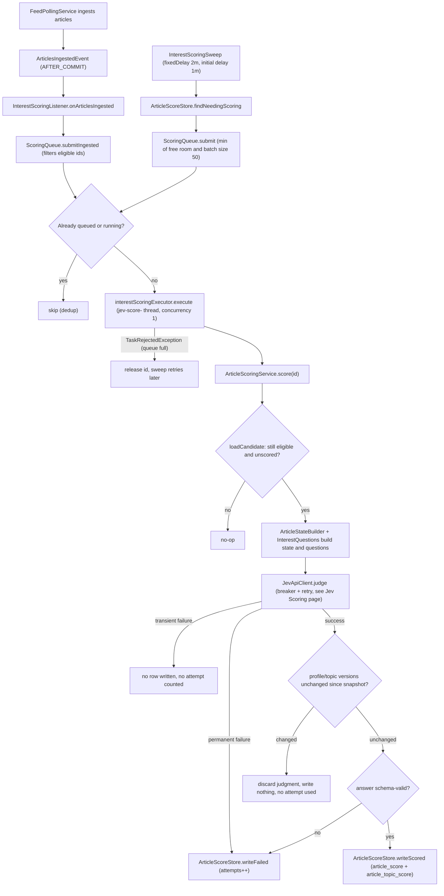

## Overview

Interest scoring is myfeeder's "why is this article ranked here" pipeline. A reader describes
what they want to read (a free-text profile and/or up to 25 weighted topics); every eligible
article is then judged against that rubric by the Jev API (`TypeSafeClient`/`JevApiClient`) and
the result is stored as a score the ranking SQL later blends into a display priority. This page
covers the business process end to end: profile/topic setup, cold start, the queue/executor and
sweep, the eligibility window, the Jev call itself, the mid-call rubric-change discard rule, and
status polling. For the HTTP client's retry/circuit-breaker mechanics, see
[Jev Scoring and Resilience](../integrations/jev-scoring.md); this page only covers what matters
for the scoring workflow.

## Pipeline at a glance

*Ingest and the sweep both feed the same single-threaded scoring queue, which calls Jev and either writes a score, records a failed attempt, or discards the result if the rubric changed mid-call.*

## Profile and topic setup (`InterestService`)

`InterestService` owns the interest rubric and enforces every limit server-side (never only in
the UI), using fixed-text messages that never echo the submitted value:

- **Profile**: a single singleton row (`interest_profile`, id 1), free text up to
  `MAX_PROFILE_CHARS` (2000, counted in UTF-16 code units). `updateProfile` bumps the profile's
  `version` by 1 only when the text actually changes; an empty text clears the profile.
- **Topics**: up to `MAX_TOPICS` (25), each with a name (≤40 chars), a description (≤500 chars)
  judged by Jev, and a weight in `[-50, 50]` (default 20 when omitted). `createTopic` is a
  count-then-insert in one transaction (concurrency is not serialized; single-user app).
  `updateTopic` keeps the same id and bumps the topic's `version` by 1 only when the trimmed
  **description** changes — editing only the name or weight never bumps the version.
  `deleteTopic` relies on the V6 foreign keys to cascade its scores and feedback picks.
- **Cold start**: `InterestService.isColdStart()` is the single predicate — true only when the
  profile text is blank after trim **and** there are zero topics. Both the status endpoint and
  `ArticleScoringService` call this one method rather than reimplementing the check.

### Shared pure builders

`InterestQuestions` and `ArticleStateBuilder` are static, dependency-free builders used
**verbatim** by both `InterestPreviewService` and `ArticleScoringService`, so a topic preview
judges exactly what scoring would send for the same article/topic pair:

- `ArticleStateBuilder.build` produces the factual article state sent to Jev — `feed`, `title`,
  `summary` (falling back to `content` when the summary is empty), blank fields omitted. Raw HTML
  is capped at 50,000 chars before Jsoup-stripping tags/scripts, and the resulting summary is
  truncated to 1500 chars at a word boundary. Titles/summaries come from untrusted feeds, so they
  travel only as state data, never interpolated into question text (a prompt-injection guard).
  `hasJudgeableText` is true only when the state carries a `title` or `summary`.
- `InterestQuestions.forRubric` builds the question map sent to `judge()`: a `profile` entry
  first (only when the profile text is non-blank) followed by one `topic_<id>` entry per topic.
  `InterestPreviewService` uses the same `topic(...)` builder with key `topic_<id>` or the
  special `topic_draft` key for an unsaved preview row.

### `/api/interest` routes

| Route | Purpose |
|---|---|
| `GET/PUT /api/interest/profile` | Read/replace the profile text |
| `GET/POST /api/interest/topics` | List topics / create one (`POST` accepts an optional `sourceArticleId` that marks a suggestion handled in the same transaction) |
| `GET /api/interest/topics/learned` | Base/learned/effective weight per topic |
| `PUT/DELETE /api/interest/topics/{id}` | Update (ignores `sourceArticleId`) / delete a topic |
| `GET /api/interest/status` | `InterestStatus` snapshot (see below) |
| `POST /api/interest/preview` | One-off Jev judgment of a draft description against one article; nothing persisted |
| `GET/POST /api/interest/rescore` | Count / perform the Re-score reset (see below) |
| `GET /api/interest/suggestions`, `PUT /api/interest/suggestions/{articleId}/dismissal` | Gap-discovery suggestions (see [Engagement & Suggestions](engagement-and-suggestions.md)) |

## The scoring path: ingest → queue → executor → Jev

1. **Ingest**: `FeedPollingService` publishes `ArticlesIngestedEvent` with the new article ids.
2. **`InterestScoringListener`** is a `@TransactionalEventListener(AFTER_COMMIT, fallbackExecution = true)`,
   so it runs inline on the single polling thread, after the ingest transaction commits. It
   checks `JevApiClient.isConfigured()` and, if so, calls `ScoringQueue.submitIngested(ids)`. It
   never throws — any failure is logged and swallowed, so a scoring hiccup must never reach the
   poll's own error bookkeeping.
3. **`ScoringQueue.submitIngested`** filters the ids through `ArticleScoreStore.filterNeedingScoring`
   (the same eligibility predicate the sweep uses) before submitting, so an old back-catalogue
   flood never floods the queue.
4. **`ScoringQueue.submit`** tracks in-flight ids in a `ConcurrentHashSet`: an id already queued or
   running is silently skipped. For each newly accepted id it calls `executor.execute(...)` on the
   `interestScoringExecutor` bean. If the executor throws `TaskRejectedException` (queue full), the
   id is immediately released from the in-flight set so the sweep can pick it up again later — the
   queue never blocks and never throws back to the caller.
5. **`interestScoringExecutor`** (`InterestScoringConfig.EXECUTOR`, threads named `jev-score-`) is
   a dedicated `ThreadPoolTaskExecutor` with core = max = `myfeeder.interest.concurrency` (1) and
   `queue-capacity` 1000, registered as `defaultCandidate = false` so it doesn't steal Boot's
   `applicationTaskExecutor` slot. Consumers inject it by qualifier
   (`@Qualifier(InterestScoringConfig.EXECUTOR)`); there is no `@Async` anywhere in this path — work
   is handed off explicitly. The default abort rejection policy is kept intentionally, because
   `ScoringQueue` relies on catching `TaskRejectedException` to release the id; a discarding policy
   would leave it stuck "in flight" forever. Concurrency is pinned at 1 by design, so Jev only ever
   sees one in-flight request from this app at a time.
6. **`ArticleScoringService.score(id)`** runs on that executor thread and performs the single Jev
   call (see below), then either writes a score, records a failed attempt, or discards the result.

## `InterestScoringSweep`

`InterestScoringSweep` is the single drain loop for interest scoring: it covers the initial
backfill, recovery after an outage, scoring newly added topics/profile text, and the Re-score
drain, because "needs scoring" is a pure function of the database rather than an in-memory job
list.

- **Schedule**: `@Scheduled(fixedDelayString = "${myfeeder.interest.sweep-delay}", initialDelayString = "${myfeeder.interest.sweep-initial-delay}")`
  — defaults `sweep-delay` = `PT2M`, `sweep-initial-delay` = `PT1M` (`MyfeederProperties.Interest`).
- **Batch size**: each run enqueues `min(scoringQueue.remainingCapacity(), sweepBatchSize)` ids
  (`sweepBatchSize` default 50), newest first (`ORDER BY COALESCE(published_at, fetched_at) DESC, id DESC`),
  so a large backlog never starves freshly published articles. New articles are also enqueued
  immediately on ingest via `InterestScoringListener`, which the sweep's batch size does not cap.
- **Eligibility window** (`ArticleScoreStore.ELIGIBLE` / `NEEDS_SCORING`): an article qualifies
  when it is `read = false` and `COALESCE(published_at, fetched_at) > now - window-days` (default
  14 days), and it has **no `article_score` row at all, or a `FAILED` row with `attempts < 3`**
  (`MAX_ATTEMPTS`). Every query — the sweep, the per-article dispatch recheck, the status counts,
  and Re-score — is built from this one shared predicate so they always agree on scope.
- **Transient-failure exemption**: a transient failure (429, 5xx, connection/timeout failure, an
  open breaker, a missing key, or 401/403 — `ScoringFailure.isTransient`) writes **no** row and
  consumes **no** attempt; the outage isn't the article's fault, and the circuit breaker already
  pauses the sweep during it. Only non-transient failures (e.g. a rejected 400/422 answer, an
  invalid judgment) count toward the 3-attempt bound, via `ArticleScoreStore.writeFailed`.
- **Skip conditions**: the sweep returns immediately, doing nothing, when:
  - `jevApiClient.isConfigured()` is false (no TypeSafe key set), or
  - the `jev` circuit breaker is `OPEN` or `FORCED_OPEN` (read from `CircuitBreakerRegistry`;
    `HALF_OPEN` is allowed to run, so the automatic `OPEN` → `HALF_OPEN` transition resumes
    scoring on its own without operator action), or
  - `interestService.isColdStart()` is true (no profile text and no topics).
  A `RuntimeException` anywhere in the sweep body is caught and logged as a warning rather than
  propagated, so one bad run never breaks the `@Scheduled` task's future executions.
- **Throttling**: if 429s or breaker trips become a problem, lower `sweep-batch-size` and/or
  lengthen `sweep-delay`. Concurrency is pinned at 1 and should not be raised; see
  [Jev Scoring and Resilience](../integrations/jev-scoring.md) for why.

## The Jev judge call and the rubric-change discard rule

`ArticleScoringService.score(articleId)` runs with **no database transaction** across the HTTP
call — a DB connection must never be held across Jev's retries, which can together take roughly
90 seconds. The method:

1. Re-checks `jevApiClient.isConfigured()` and `interestService.isColdStart()` (the same shared
   predicates the sweep checks) and returns immediately if either fails.
2. Loads the candidate via `ArticleScoreStore.loadCandidate(articleId, cutoff)` — a dispatch-time
   recheck that re-verifies eligibility and "needs scoring", since time may have passed between
   enqueue and execution. An empty result (read, aged out, or already scored) is a silent no-op.
3. Writes a terminal `SKIPPED` row (never retried) when the article has no GUID or no judgeable
   text (`ArticleStateBuilder.hasJudgeableText`).
4. **Snapshots the profile and topic list (with their versions) before calling Jev.**
5. Calls `jevApiClient.judge(state, questions)`. The service itself never retries and never checks
   the breaker state — only the client's Resilience4j retry/breaker apply (see
   [Jev Scoring and Resilience](../integrations/jev-scoring.md)). A transient failure is logged
   and swallowed (no row, no attempt); a permanent failure writes a `FAILED` row via
   `ArticleScoreStore.writeFailed` with a fixed-text description (exception class, plus HTTP
   status/request id for API errors — never the raw message or body).
6. **Rubric-change discard rule**: after `judge()` returns successfully, the service re-reads the
   current profile and topic list and compares `(profile.version, {topicId → topic.version})`
   against the pre-call snapshot (`sameRubric`). If either changed — most likely because a
   Re-score or a profile/topic edit landed while the ~90s call was in flight — the judgment is
   **discarded entirely**: nothing is written and no attempt is recorded, leaving the article for
   the sweep to re-pick against the now-current rubric. Only a **topic's description** or the
   **profile text** bump the version; changing a topic's name or weight does not, so those edits
   never trigger a discard. This matters for correctness: without it, a write-once `SCORED` row
   could permanently pin a judgment against a rubric the reader has already replaced, and that
   stale score would never be recomputed because the article would no longer be "needs scoring".
7. **Answer validation**: an otherwise successful judgment whose values fail validation (every
   requested noul must be finite and in `[0, 1]`; a profile score must be finite, in
   `[0, maxLevel]`, with a finite confidence) is treated as a **failed attempt**, not silently
   discarded or retried forever — this keeps a malformed response bounded at 3 billed attempts
   instead of looping.
8. On success, `ArticleScoreStore.writeScored` stores the raw profile score/confidence/version and
   each topic's noul/version in one transaction (`article_score` + `article_topic_score`,
   write-once: it overwrites a `FAILED` row but never a `SCORED` or `SKIPPED` one). If that write
   itself fails, the service records a `FAILED` attempt instead — the Jev call was already billed,
   so the attempt must still count toward the 3-attempt bound.

## `InterestStatusService` / `InterestStatus` and UI polling

`InterestStatusService.status()` assembles `InterestStatus` from live sources in one pass:

| Field | Source |
|---|---|
| `configured` | `JevApiClient.isConfigured()` |
| `breakerState` | `CircuitBreakerRegistry.circuitBreaker("jev").getState().name()` (point-in-time read; reading never trips or resets the breaker) |
| `coldStart` | `InterestService.isColdStart()` |
| `eligibleUnscored` | eligible (unread, in-window) articles with no score row or a `FAILED` row under 3 attempts |
| `failed` | eligible articles whose `FAILED` row has used all 3 attempts |
| `tiers` | `{high, neutral}` badge thresholds from `myfeeder.interest.blend.tiers.*` |

Both counts come from a single `ArticleScoreStore.counts` query, so they are a consistent
snapshot of the same moment. Later fields are only ever appended; existing ones are never
renamed, since the frontend contract depends on field stability.

The frontend's `useInterestStatus` hook (`hooks/useInterest.ts`) polls `GET /status` every 15
seconds **only while** `configured && !coldStart && eligibleUnscored > 0` — the same condition
that drives the "N waiting" UI line. It keeps polling while the breaker is `OPEN`, because the
breaker recovers on its own and the UI should reflect that recovery without a manual refresh.
`useInterestTiers` shares the same query cache key but never polls (`staleTime: Infinity`), and
falls back to `DEFAULT_TIERS` until the first status load resolves.

## `InterestPreviewService`

`InterestPreviewService.preview(articleId, description, topicId)` lets a reader try a topic
description against one specific article before saving it. It is deliberately lightweight:

- Validates the description (required, ≤500 chars) and loads the article (404 if missing)
  **before** calling Jev, so caller bugs never reach the circuit breaker.
- Builds the same `ArticleStateBuilder` state and an `InterestQuestions.topic(...)` question keyed
  `topic_<id>` or `topic_draft` for an unsaved row — the shared builders guarantee the preview
  judges exactly what scoring would send.
- Makes exactly **one** `JevApiClient.judge` call and returns `{noul, model}`.
- **No persistence and no service-level retry**: nothing is written to `article_score` or
  anywhere else, and only the client's Resilience4j retry applies — there is no DB transaction
  held across the call.

## Re-score and the cold-start 409 rule

`GET /api/interest/rescore` returns `RescoreCount` (rows that would be reset, plus the window in
days) from `ArticleScoreStore.countRescoreScope` — purely a count, it deletes nothing.
`POST /api/interest/rescore` requires a JSON body `{"confirm": true}`:

- The endpoint only accepts `application/json`, so a bodyless/form/text cross-site POST is
  rejected with 415 before any reset logic runs.
- A missing or `false` `confirm` field is rejected with 400 (`IllegalArgumentException`).
- `InterestRescoreService.rescore()` then re-checks `jevApiClient.isConfigured()` and
  `interestService.isColdStart()`; if either fails, it throws a fixed-text `IllegalStateException`,
  mapped by `GlobalExceptionHandler` to **409** ("Re-score needs a TypeSafe API key and a profile
  or at least one topic"). Combined, the 415/400/409 layers mean a reset only ever happens from an
  explicit, same-origin, confirmed request against a configured, non-cold-start rubric.
- The Re-score scope (`RESCORE_SCOPE`) is eligible (unread, in-window) articles with a `SCORED` or
  `FAILED` row — including an exhausted `FAILED` row — but never `SKIPPED` rows. The delete is one
  atomic statement sharing the exact scope predicate with the count query, so the confirmation
  number is exactly the number of rows reset. The V6 cascade removes the associated
  `article_topic_score` rows. There is no immediate re-score kick: deleted rows simply become
  eligible again, and `InterestScoringSweep` (or a later ingest) picks them up on its own schedule.

## Related pages

- [Jev Scoring and Resilience](../integrations/jev-scoring.md) — the `JevApiClient` HTTP layer: circuit breaker, retry policy, event logging, and the app-owned `TypeSafeClient` bean.
- [Engagement & Suggestions](engagement-and-suggestions.md) — how engagement and feedback learn on top of stored scores, and how gap-discovery suggestions are derived.
- [Architecture Overview](../architecture/overview.md) — where this pipeline sits among the rest of the application.
- [Domain Concepts](../domain/concepts.md) — definitions of profile, topic, noul, score, and related terms.
- [Testing Guide](../testing/guide.md) — test patterns, including how the test `application.yaml` keeps this pipeline offline by default.
